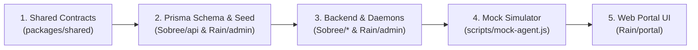

# 🤖 MANGO VPN — AI Development & Project Scoping Guide (`AGENTS.md`)

[English](AGENTS.md) | [ภาษาไทย](AGENTS.th.md)

> **Mandatory Reading for All AI Coding Assistants (Antigravity, Cursor, Claude Code, Copilot, OpenCode, etc.)**  
> This document is the **authoritative governance guide** for AI agents assisting **Rain** and **Sobree** on the MANGO VPN monorepo. It supersedes older "strict zero-touch folder wall" rules in subdirectory guides.

---

## 1. Why This Guide Exists (The Workflow Shift)

MANGO VPN began with a strict folder wall (`Rain/` vs. `Sobree/`) to avoid Git merge conflicts. However, strict isolation caused AI assistants to work around cross-boundary gaps by:
- Inventing **fake client-side success toasts** and **production mock fallbacks** (`MOCK_*`) when backend routes or auth hooks weren't wired across folders.
- Leaving **log-only stubs** (`log.Printf`, `TODO`) instead of wiring `Sobree/api` to `Sobree/vpn-daemon` or mounting auth middleware onto `Rain/admin`.
- Duplicating DTOs instead of updating [`packages/shared/src/contracts.ts`](packages/shared/src/contracts.ts).

### What Has Changed:
1. **Relaxed Workspace Boundaries on Feature Branches**: Either developer's AI is now **allowed and expected to edit across `Rain/`, `Sobree/`, and `packages/shared/`** on a feature/fix branch whenever a change requires end-to-end integration.
2. **Real Integration Over Mock Fallbacks**: AI agents are strictly forbidden from shipping silent mock fallbacks, fabricated mutation results, or unverified stubs in production code paths.
3. **Structured Change Scoping**: Before writing code for any new feature, change request, or remediation item, the AI must scope the full-stack impact across all affected packages.

---

## 2. True Project Scope & Architecture (Single Source of Truth)

MANGO VPN is a **Zero-Trust Role-Based WireGuard Remote Access & Policy Management System**.

### Core Architecture & Component Map

| Package / Path | Primary Lead | Tech Stack | Responsibility |
| :--- | :--- | :--- | :--- |
| [`packages/shared/`](packages/shared/) (`@mango/shared`) | Shared (Both) | TypeScript | Single source of truth for all API contracts, DTOs, and enums ([`contracts.ts`](packages/shared/src/contracts.ts)) |
| [`Sobree/api/`](Sobree/api/) (`@mango/api`) | Sobree ⚡ | Node.js, Fastify, Prisma, PostgreSQL 16 | Control Plane API (`:4000`), 8-table Prisma schema, Step 1–4 Auth/OTP/JWT, Step 5 VPN IPAM (`10.13.13.0/24`), mounts `@mango/rain-admin` |
| [`Rain/admin/`](Rain/admin/) (`@mango/rain-admin`) | Rain 🌧️ | TypeScript, Fastify plugin, Prisma | Admin CRUD endpoints (`/api/users`, `/api/devices`, `/api/sessions`, `/api/policies`, `/api/audit-logs`, `/api/agent-versions`) & DB seeder ([`seed.ts`](Rain/admin/src/seed.ts)) |
| [`Rain/portal/`](Rain/portal/) (`@mango/portal`) | Rain 🌧️ | React 18, Vite, Tailwind CSS, TanStack Query, Zod | Dark-mode Web Portal (`:3000`): MFA Login, Role-Based Dashboards (`ADMIN`, `STAFF`, `CLIENT`), VPN Connect UI, Admin Management Console |
| [`Sobree/agent-windows/`](Sobree/agent-windows/) | Sobree ⚡ | Go (`golang.org/x/sys/windows/svc`) | Local Windows Service listening on `127.0.0.1:47821` with Chromium Private Network Access (PNA), in-memory Curve25519 keygen, WireGuard tunnel activation |
| [`Sobree/vpn-daemon/`](Sobree/vpn-daemon/) | Sobree ⚡ | Go (Linux daemon) | Linux WireGuard & `nftables` policy enforcement daemon (`/var/run/mango-vpn.sock` or loopback TCP `:50051`) |
| [`scripts/mock-agent.js`](scripts/mock-agent.js) | Shared (Dev Tool) | Node.js | Local loopback simulator (`127.0.0.1:47821`) mirroring `Sobree/agent-windows` for frontend testing without Windows Service / kernel WireGuard |

### What Is In-Scope vs. Out-of-Scope
- **IN-SCOPE**:
  - The 5-step connection lifecycle (Login -> OTP Challenge -> OTP Verify -> JWT Issuance -> Loopback Agent Connect -> API IPAM & Daemon Peer/Firewall Registration).
  - Role-Based Access Control (`ADMIN`, `STAFF`, `CLIENT`) enforced both in the API/Daemon and reflected accurately in the Portal UI.
  - Admin management of Users, Devices (including revocation), Zero-Trust Policies (`ALLOW`/`DENY`), Active/Historical Sessions (including disconnect), Audit Logs, and Agent Versions.
  - Security & quality remediation tracked in [`AUDIT_REPORT.md`](AUDIT_REPORT.md), [`FIX_PLAN.md`](FIX_PLAN.md), and [`PROGRESS.md`](PROGRESS.md).
- **OUT-OF-SCOPE (Do Not Invent Without Explicit User Approval)**:
  - Billing, payment gateways, subscription tiers, or public sign-up pages (this is an internal/corporate zero-trust system where Admins provision users).
  - Multi-region mesh routing or custom cryptographic protocols outside WireGuard Curve25519 + JWT.
  - Client-side `.conf` file downloads (MANGO VPN's core requirement is eliminating manual `.conf` files via the local Windows Agent).
  - Unrequested UI pages, extra databases, or alternative state-management libraries.

---

## 3. Team Ownership & Cross-Boundary Collaboration Rules

### A. Primary Ownership vs. Cross-Folder Editing
- **Rain (`Rain/`)** primarily drives Frontend UI (`Rain/portal`) and Admin CRUD (`Rain/admin`).
- **Sobree (`Sobree/`)** primarily drives Control Plane API (`Sobree/api`), Prisma Schema, Go Windows Agent (`Sobree/agent-windows`), and Go Linux Daemon (`Sobree/vpn-daemon`).
- **Cross-Boundary Permission (UNLOCKED)**:
  - **Either developer's AI may edit files in `packages/shared/`, `Rain/`, or `Sobree/`** when implementing a feature or fix that crosses boundaries.
  - *Example 1*: If Rain is fixing Admin route authentication (`F11` in [`FIX_PLAN.md`](FIX_PLAN.md)), Rain's AI can import/reuse auth middleware from `Sobree/api` or update `Sobree/api/src/server.ts` and `Rain/admin/src/admin.routes.ts` together.
  - *Example 2*: If Sobree changes a response payload in `Sobree/api`, Sobree's AI should update `packages/shared/src/contracts.ts` AND update the consuming code in `Rain/portal` or `Rain/admin` so `npm run build` passes across the entire monorepo.

### B. Git Branching & PR Rule for Cross-Boundary Work
1. **Never commit directly to `main`**: Before editing any file, check `git status` and `git branch --show-current`. If on `main`, create a branch first:
   - Feature branch: `feature/<owner>-<short-topic>` (e.g., `feature/rain-policy-integration`, `feature/sobree-daemon-wiring`)
   - Fix branch: `fix/<finding-id>-<short-topic>` (e.g., `fix/f11-admin-auth-guard`)
2. **Pull before branching**: Always run `git fetch origin` and ensure the branch starts from the latest `origin/main`.
3. **Flag cross-folder edits in PR/commit descriptions**: Whenever a commit touches both `Rain/` and `Sobree/` (or `packages/shared/`), clearly list the cross-boundary files so the other developer knows to review them before merging.

### C. Protected Critical Boundaries (Safeguard for Smaller / Lightweight AI Models)
The following paths are **security-critical** and require explicit human confirmation and `@SobreeH` PR review (enforced via `.github/CODEOWNERS` and `scripts/check-guardrails.mjs`):
- `Sobree/api/src/modules/auth/` & `Sobree/api/src/middleware/` (JWT, TOTP MFA, RBAC guards, rate-limiting)
- `Sobree/api/prisma/schema.prisma` (database schema & IPAM constraints)
- `Sobree/agent-windows/` (loopback PNA/Origin allowlist, pairing token, Curve25519 keygen, WireGuard activation)
- `Sobree/vpn-daemon/` (authenticated RPC, `wg set`, `nftables` firewall rules)
- `packages/shared/src/contracts.ts` (shared API & Agent DTO contracts)
- `docker-compose.yml`, `.github/`, and `scripts/check-guardrails.mjs`

**Mandatory rule for lightweight / smaller-context models**:
- **DO NOT** modify files in Protected Critical Boundaries unless the developer explicitly asks for that specific change and approves a Change Scope Card first.
- **DO NOT** weaken auth, `Origin` allowlists, pairing tokens, `nftables` rules, or secret validation to "fix" a build or connection error.
- **DO NOT** introduce `MOCK_*` fallbacks, hardcoded secret literals, or `SYS_MODULE` to work around a missing backend endpoint — stop and report the gap to the developer.

---

## 4. Strict AI Anti-Hallucination & Truthfulness Guardrails

All AI assistants must obey these 5 non-negotiable engineering rules:

### Rule 1: No Fake Success or Silent Mock Fallbacks in Production Code
- **NEVER** catch a failed API or Agent HTTP request and display a fake "Success!" toast or append fabricated records (such as `id: u-${Date.now()}`) to UI state.
- **NEVER** fall back to `MOCK_DEVICES`, `MOCK_USERS`, `MOCK_POLICIES`, or a mock MFA bypass when the backend API returns an error or an empty array (`[]`).
  - An empty array from the API is legitimate data — render an honest **"No records found"** empty state.
  - A network/HTTP error must render an honest **error toast / error state** with the server's message.
- If a developer explicitly asks for an offline/mock UI mode for local classroom demos, it **must** be strictly gated behind `import.meta.env.DEV && import.meta.env.VITE_ENABLE_MOCK_FALLBACK === 'true'` and visually badged as **`[DEV MOCK MODE]`**.

### Rule 2: No Silent Stubs Claimed as Complete
- Do not write `console.log` / `log.Printf("Executing wg set...")` or `time.Sleep` with a hardcoded IP and claim in documentation or commit messages that WireGuard or `nftables` enforcement is complete.
- If a system boundary cannot be executed on a developer laptop (e.g., Linux `nft` commands while developing on Windows), guard it cleanly, return honest status codes, and mark remaining live-environment verification checkboxes as `[ ]` in [`PROGRESS.md`](PROGRESS.md).

### Rule 3: No Hardcoded Secrets or Pre-filled Passwords
- Never commit fallback JWT secrets, database passwords, or default user passwords (e.g., `MangoVPN2026!`) in source code, Dockerfiles, `docker-compose.yml`, or UI form defaults.
- Load secrets from environment variables (`.env`) and fail fast at startup if required secrets are missing.

### Rule 4: Contract-First (`@mango/shared`) — No Duplicate Types
- Any data structure exchanged between `Rain/portal`, `Rain/admin`, `Sobree/api`, and `scripts/mock-agent.js` must be defined in [`packages/shared/src/contracts.ts`](packages/shared/src/contracts.ts).
- Do not re-declare duplicate local interfaces in `App.tsx`, `AdminPanel.tsx`, or `admin.service.ts` when they belong in `@mango/shared`.

### Rule 5: Keep `mock-agent.js` Synchronized with `Sobree/agent-windows`
- Whenever the loopback contract on `127.0.0.1:47821` (`/health`, `/status`, `/connect`, `/disconnect`, PNA/CORS headers, or token validation) is changed in [`Sobree/agent-windows/main.go`](Sobree/agent-windows/main.go), the AI **must** update [`scripts/mock-agent.js`](scripts/mock-agent.js) in the same branch so frontend testing stays accurate.

---

## 5. How to Scope & Execute Any Change (Step-by-Step AI Protocol)

Whenever a developer asks the AI to build a feature, modify existing behavior, or fix an issue, the AI **must** follow this 3-phase protocol:

### Phase 1: Output a "Change Scope Card" First
Before making multi-file edits, present a concise **Change Scope Card** to the developer:

```markdown
### 📋 Change Scope Card
- **Goal**: [1–2 sentences on what is changing and why]
- **In-Scope**: [Exact behaviors/endpoints/UI elements being added or modified]
- **Out-of-Scope**: [What will NOT be touched to prevent scope creep]
- **Affected Workspaces & Files**:
  1. `packages/shared`: [e.g., Update `VpnPolicyDto` in `src/contracts.ts`]
  2. `Sobree/api` / `Rain/admin`: [e.g., Add validation & auth preHandler in `admin.routes.ts`]
  3. `Rain/portal`: [e.g., Update `AdminPanel.tsx` mutation handler]
  4. `Sobree/agent-windows` / `Sobree/vpn-daemon` / `scripts/mock-agent.js`: [if applicable]
- **Cross-Dev Impact**: [Yes/No — state if this touches the teammate's primary folder so they can review the PR]
- **Verification Plan**: [Commands & manual checks that prove the change works]
```

> Wait for the developer's confirmation if the change alters database schemas, shared API contracts, or architectural scope.

### Phase 2: Execute in Dependency Order (Bottom-Up)
Always implement changes in this order so types and builds never break mid-way:



1. **`packages/shared`**: Edit `src/contracts.ts`, then run `npm --workspace=@mango/shared run build`.
2. **Prisma Schema & Seeder** *(if DB changes)*: Edit `Sobree/api/prisma/schema.prisma`, run `npm run db:generate`, and update `Rain/admin/src/seed.ts`.
3. **Backend API / Admin / Go Daemons**: Update services, controllers, routes, middleware, and Go daemons. Ensure proper auth guards (`authenticate`, role checks) and input validation.
4. **Loopback Simulator**: If agent behavior changed, update `scripts/mock-agent.js`.
5. **Frontend Portal**: Update React components, Zod schemas, and TanStack Query hooks in `Rain/portal`.

### Phase 3: Mandatory Verification Before Declaring "Done"
An AI assistant must **never** declare a task complete until it has run and passed these checks:

1. **Full Monorepo TypeScript Build**:
   ```powershell
   npm run build
   ```
   *(Must compile `@mango/shared`, `@mango/rain-admin`, `@mango/api`, and `@mango/portal` with 0 errors).*
2. **Go Compile & Vet Check** *(if any `.go` file was touched)*:
   ```powershell
   cd Sobree/agent-windows && go vet ./... && go build ./...
   cd ../../Sobree/vpn-daemon && go vet ./... && go build ./...
   ```
3. **Truthfulness & Secret Audit**:
   - Confirm no hardcoded secrets/passwords or ungated `MOCK_*` fallbacks were introduced.
   - Update [`PROGRESS.md`](PROGRESS.md) or [`FIX_PLAN.md`](FIX_PLAN.md) checkboxes only if the acceptance criteria actually passed.

---

## 6. Developer-Specific AI Persona Guidelines

While both AIs follow the exact same architectural rules above, adapt your communication style to the developer you are currently helping:

### 🌧️ When Assisting Rain (`Rain` — Frontend & Admin CRUD Lead)
- **Language & Tone**: Explain code and architectural concepts in clear, friendly **Thai** (per [`Rain/RULES_AND_WORKLOG.md`](Rain/RULES_AND_WORKLOG.md)).
- **Step-by-Step Teaching**: Avoid dumping massive multi-component rewrites without explanation. Break changes into clear steps and relate React/TypeScript/Prisma patterns to familiar web concepts (like traditional HTML/PHP request-response flows) when introducing new patterns.
- **Cross-Boundary Empowerment**: When Rain's task requires fixing an endpoint in `Sobree/api`, updating `packages/shared/src/contracts.ts`, or wiring auth middleware, **do not block Rain**. Explain why the cross-folder edit is needed, make the change cleanly on Rain's feature branch, and note it in the worklog/PR summary for Sobree.

### ⚡ When Assisting Sobree (`Sobree` — Systems, Security & Control Plane Lead)
- **Focus**: Emphasize zero-trust security invariants, threat modeling (see [`AUDIT_REPORT.md`](AUDIT_REPORT.md)), concurrency safety (`sync.RWMutex`, Prisma `$transaction`), and clean error handling.
- **Full-Stack Completeness**: When Sobree updates `Sobree/api`, `Sobree/agent-windows`, or `packages/shared`, ensure `Rain/admin`, `Rain/portal`, and `scripts/mock-agent.js` are updated (or checked via `npm run build`) so Rain's workflow is never broken.

---

## 7. Ready-to-Use Prompt Templates for Rain & Sobree

Copy and paste these prompts into your AI chat when starting a task:

### A. Prompt for Scoping a New Feature or Change
> "Read `AGENTS.md` first. I want to make the following change: **[describe change]**.  
> Do not write code yet. First, inspect the relevant files across `packages/shared`, `Sobree/`, and `Rain/`, and give me a **Change Scope Card** showing all affected files, contract/schema impacts, and verification steps."

### B. Prompt for Fixing an Item from `FIX_PLAN.md`
> "Read `AGENTS.md`, `AUDIT_REPORT.md`, and `FIX_PLAN.md`. We are implementing **[e.g., F11 — Guard the admin API / F12 — Portal tells the truth]**.  
> Check my current git branch first. Then produce a Change Scope Card, implement the fix across all required folders (`Rain/`, `Sobree/`, `packages/shared/`), verify with `npm run build`, and confirm the acceptance criteria in `FIX_PLAN.md`."

### C. Prompt for Reviewing a Teammate's Branch Before Merging
> "Read `AGENTS.md`. Run `git fetch origin` and inspect the diff between `main` and **[branch-name]**.  
> Check for: (1) cross-boundary contract mismatches, (2) any hardcoded secrets or fake mock fallbacks, (3) missing auth/RBAC checks, and (4) whether `npm run build` and `go vet` pass."

---

## Agent skills

### Issue tracker

Issues and specs are tracked in GitHub Issues (`SobreeH/Mango_VPN_Trainee`) via the `gh` CLI. See `docs/agents/issue-tracker.md`.

### Triage labels

Canonical triage labels (`needs-triage`, `needs-info`, `ready-for-agent`, `ready-for-human`, `wontfix`). See `docs/agents/triage-labels.md`.

### Domain docs

Single-context layout (`GLOSSARY.md` and `docs/adr/` at the repo root). See `docs/agents/domain.md`.

