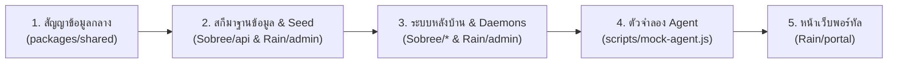

# 🤖 MANGO VPN — คู่มือควบคุม AI และการกำหนดขอบเขตโปรเจกต์ (`AGENTS.th.md`)

[English](AGENTS.md) | [ภาษาไทย](AGENTS.th.md)

> **เอกสารบังคับอ่านสำหรับ AI ผู้ช่วยเขียนโค้ดทุกตัว (Antigravity, Cursor, Claude Code, Copilot, OpenCode ฯลฯ)**  
> เอกสารฉบับนี้คือ **กฎและมาตรฐานกลางสูงสุด** สำหรับ AI ที่ช่วยงาน **Rain** และ **Sobree** ในโปรเจกต์ MANGO VPN โดยใช้แทนกฎเดิมที่เคยห้ามแก้ไขข้ามโฟลเดอร์อย่างเด็ดขาดในเอกสารย่อยทั้งหมด

---

## 1. ทำไมเราถึงเปลี่ยนวิธีพัฒนาโปรเจกต์นี้ (The Workflow Shift)

ในช่วงเริ่มต้น โปรเจกต์ MANGO VPN แบ่งโฟลเดอร์ `Rain/` และ `Sobree/` ออกจากกันอย่างเด็ดขาดเพื่อป้องกันปัญหา Git Merge Conflicts แต่การห้ามแตะไฟล์ข้ามโฟลเดอร์ทำให้ AI ผู้ช่วยแก้ปัญหาเฉพาะหน้าแบบผิดทิศทาง เช่น:
- สร้าง **ข้อความแจ้งเตือนว่าสำเร็จแบบหลอกๆ (Fake Success Toasts)** และ **ดึงข้อมูลจำลอง (`MOCK_*`) มาแสดงในโหมดใช้งานจริง** เมื่อ API หรือระบบตรวจสิทธิ์ยังไม่ได้เชื่อมต่อกันข้ามโฟลเดอร์
- เขียนโค้ดแบบ **พิมพ์แค่ Log (`log.Printf`, `TODO`)** แทนการเชื่อมต่อ `Sobree/api` เข้ากับ `Sobree/vpn-daemon` จริง หรือไม่ได้ผูก Middleware ตรวจสิทธิ์เข้ากับ `Rain/admin`
- สร้าง Interface/Type ซ้ำซ้อนแยกกันเอง แทนที่จะอัปเดตที่ศูนย์กลาง [`packages/shared/src/contracts.ts`](packages/shared/src/contracts.ts)

### สิ่งที่เปลี่ยนแปลงตั้งแต่วันนี้เป็นต้นไป:
1. **ปลดล็อกการแก้ไขข้ามโฟลเดอร์บน Feature Branch**: AI ของทั้ง Rain และ Sobree **ได้รับอนุญาตและควรแก้ไขไฟล์ข้ามระหว่าง `Rain/`, `Sobree/` และ `packages/shared/` ได้เลย** บน Branch ของฟีเจอร์นั้นๆ หากงานนั้นต้องเชื่อมต่อทั้งระบบ (End-to-End Integration)
2. **ห้ามสร้าง Mock หลอกๆ ในโค้ดใช้งานจริงเด็ดขาด**: ห้าม AI เขียนโค้ดที่แอบคืนค่าสำเร็จปลอมๆ, ข้ามขั้นตอน MFA เมื่อ API ล่ม, หรือใส่ข้อมูล `MOCK_*` ปะปนใน Production Build
3. **ต้องวางขอบเขตงาน (Change Scoping) ก่อนลงมือแก้โค้ด**: ทุกครั้งที่จะเพิ่มฟีเจอร์ ปรับแก้ระบบ หรือแก้บั๊กจากรายงาน Audit AI ต้องวิเคราะห์ผลกระทบทั้งระบบ (Full-Stack Impact) ก่อนเสมอ

---

## 2. ขอบเขตจริงและสถาปัตยกรรมของโปรเจกต์ (Single Source of Truth)

MANGO VPN คือ **ระบบบริหารจัดการการเข้าถึงเครือข่ายระยะไกลด้วย WireGuard VPN บนสถาปัตยกรรม Zero-Trust ตามบทบาทผู้ใช้ (RBAC)**

### แผนผังองค์ประกอบและผู้รับผิดชอบหลัก

| แพ็กเกจ / โฟลเดอร์ | ผู้ดูแลหลัก | เทคโนโลยี | หน้าที่รับผิดชอบ |
| :--- | :--- | :--- | :--- |
| [`packages/shared/`](packages/shared/) (`@mango/shared`) | ดูแลร่วมกัน | TypeScript | ศูนย์กลางสัญญาข้อมูล API (Contracts), DTOs และ Enums ทั้งหมด ([`contracts.ts`](packages/shared/src/contracts.ts)) |
| [`Sobree/api/`](Sobree/api/) (`@mango/api`) | Sobree ⚡ | Node.js, Fastify, Prisma, PostgreSQL 16 | Control Plane API (`:4000`), สกีมาฐานข้อมูล 8 ตาราง, ระบบล็อกอิน Step 1–4 (OTP/JWT), ระบบจัดสรร IPAM (`10.13.13.0/24`), และดึง `@mango/rain-admin` มา挂载 |
| [`Rain/admin/`](Rain/admin/) (`@mango/rain-admin`) | Rain 🌧️ | TypeScript, Fastify plugin, Prisma | ระบบจัดการหลังบ้าน Admin CRUD (`/api/users`, `/api/devices`, `/api/sessions`, `/api/policies`, `/api/audit-logs`, `/api/agent-versions`) และสคริปต์ [`seed.ts`](Rain/admin/src/seed.ts) |
| [`Rain/portal/`](Rain/portal/) (`@mango/portal`) | Rain 🌧️ | React 18, Vite, Tailwind CSS, TanStack Query, Zod | หน้าเว็บพอร์ทัล Dark-mode (`:3000`): ล็อกอิน MFA, แดชบอร์ดแยกตามสิทธิ์ (`ADMIN`, `STAFF`, `CLIENT`), ปุ่มเชื่อมต่อ VPN และหน้า Admin Console |
| [`Sobree/agent-windows/`](Sobree/agent-windows/) | Sobree ⚡ | Go (`golang.org/x/sys/windows/svc`) | เซอร์วิสบน Windows ทำงานที่ `127.0.0.1:47821` รองรับ Chromium PNA, สร้างคีย์ Curve25519 ในหน่วยความจำ และสั่งเปิดท่อ WireGuard |
| [`Sobree/vpn-daemon/`](Sobree/vpn-daemon/) | Sobree ⚡ | Go (Linux daemon) | ดิมอนบน Linux สำหรับคุม WireGuard (`wg0`) และฉีดกฎไฟร์วอลล์ `nftables` (`/var/run/mango-vpn.sock` หรือ Loopback TCP `:50051`) |
| [`scripts/mock-agent.js`](scripts/mock-agent.js) | เครื่องมือพัฒนา | Node.js | ตัวจำลอง Agent (`127.0.0.1:47821`) ที่จำลองการทำงานของ `Sobree/agent-windows` สำหรับทดสอบหน้าเว็บโดยไม่ต้องรันเซอร์วิส Windows จริง |

### สิ่งที่อยู่ในขอบเขต (In-Scope) vs นอกขอบเขต (Out-of-Scope)
- **อยู่ในขอบเขต (IN-SCOPE)**:
  - โฟลว์การเชื่อมต่อ 5 ขั้นตอน (Login -> OTP Challenge -> OTP Verify -> ออก JWT -> สั่ง Agent ในเครื่องเชื่อมต่อ -> API จัดสรร IP และสั่ง Daemon ลงทะเบียน Peer/กฎไฟร์วอลล์)
  - การจำกัดสิทธิ์ตามบทบาท (`ADMIN`, `STAFF`, `CLIENT`) ที่บังคับใช้จริงทั้งฝั่ง API/Daemon และแสดงผลตรงตามจริงบนหน้าเว็บ Portal
  - ระบบจัดการ Users, Devices (รวมถึงการเพิกถอนอุปกรณ์), Zero-Trust Policies (`ALLOW`/`DENY`), Sessions (รวมถึงการสั่งตัดการเชื่อมต่อ), Audit Logs และ Agent Versions
  - การแก้ไขช่องโหว่ความปลอดภัยและคุณภาพโค้ดตาม [`AUDIT_REPORT.md`](AUDIT_REPORT.md), [`FIX_PLAN.md`](FIX_PLAN.md) และ [`PROGRESS.md`](PROGRESS.md)
- **นอกขอบเขต (OUT-OF-SCOPE — ห้าม AI คิดค้นเพิ่มเองโดยไม่ได้รับอนุญาต)**:
  - ระบบคิดเงิน, ชำระเงิน, แพ็กเกจสมาชิก หรือหน้าสมัครสมาชิกสาธารณะ (ระบบนี้เป็นระบบภายในองค์กรที่ Admin เป็นผู้สร้างบัญชีผู้ใช้)
  - ระบบดาวน์โหลดไฟล์ `.conf` ให้ผู้ใช้เอาไปอิมพอร์ตเอง (เพราะหัวใจของ MANGO VPN คือการเลิกใช้ไฟล์ `.conf` แล้วจัดการผ่าน Windows Agent อัตโนมัติ)
  - หน้าจอ, ตารางฐานข้อมูล, หรือไลบรารีเสริมอื่นๆ ที่ไม่ได้อยู่ในแผนงาน

---

## 3. กฎการทำงานร่วมกันและการแก้ไขไฟล์ข้ามโฟลเดอร์

### A. เจ้าของพื้นที่หลัก vs สิทธิ์การแก้ไขข้ามโฟลเดอร์
- **Rain (`Rain/`)** รับผิดชอบหลักในส่วน Frontend UI (`Rain/portal`) และ Admin CRUD (`Rain/admin`)
- **Sobree (`Sobree/`)** รับผิดชอบหลักในส่วน Control Plane API (`Sobree/api`), Prisma Schema, Go Windows Agent (`Sobree/agent-windows`) และ Go Linux Daemon (`Sobree/vpn-daemon`)
- **ปลดล็อกการแก้ไขข้ามโฟลเดอร์ (Cross-Boundary Permission)**:
  - **AI ของทั้งสองคนสามารถแก้ไขไฟล์ใน `packages/shared/`, `Rain/` และ `Sobree/` ได้** เมื่อฟีเจอร์หรือการแก้บั๊กนั้นต้องเชื่อมโยงถึงกัน
  - *ตัวอย่างที่ 1*: เมื่อ Rain ต้องแก้เรื่องการตรวจสิทธิ์ของ Admin API (`F11` ใน [`FIX_PLAN.md`](FIX_PLAN.md)) AI ของ Rain สามารถดึง Middleware `authenticate` จาก `Sobree/api` มาผูกใน `Rain/admin/src/admin.routes.ts` หรือปรับ `Sobree/api/src/server.ts` ไปพร้อมกันได้ทันที
  - *ตัวอย่างที่ 2*: เมื่อ Sobree เปลี่ยนโครงสร้างข้อมูลใน `Sobree/api` AI ของ Sobree ต้องอัปเดต `packages/shared/src/contracts.ts` และตามไปอัปเดตโค้ดที่เรียกใช้ใน `Rain/portal` หรือ `Rain/admin` เพื่อให้สั่ง `npm run build` ผ่านทั้งโปรเจกต์

### B. กฎการใช้ Git Branch และ Pull Request สำหรับงานข้ามโฟลเดอร์
1. **ห้ามเขียนโค้ดบน Branch `main` โดยตรง**: ก่อนแก้ไฟล์ทุกครั้ง AI ต้องเช็ก `git status` และ `git branch --show-current` หากอยู่บน `main` ต้องแตก Branch ใหม่ก่อนเสมอ:
   - งานฟีเจอร์: `feature/<ชื่อผู้ทำ>-<หัวข้อสั้นๆ>` (เช่น `feature/rain-policy-integration`, `feature/sobree-daemon-wiring`)
   - งานแก้บั๊ก/Audit: `fix/<รหัสปัญหา>-<หัวข้อสั้นๆ>` (เช่น `fix/f11-admin-auth-guard`)
2. **อัปเดตโค้ดล่าสุดก่อนแตก Branch**: รัน `git fetch origin` และดึงโค้ดล่าสุดจาก `origin/main` เสมอ
3. **ระบุไฟล์ที่แก้ข้ามโฟลเดอร์ใน PR / Commit**: หากมีการแก้ไฟล์ข้ามไปยังโฟลเดอร์ของเพื่อนร่วมทีม ให้ระบุไว้ในสรุปงานอย่างชัดเจนเพื่อให้เพื่อนช่วยรีวิวก่อน Merge

---

## 4. กฎเหล็ก 5 ข้อป้องกัน AI มโนโค้ดหรือสร้างข้อมูลหลอก (Truthfulness Guardrails)

AI ผู้ช่วยทุกตัวต้องปฏิบัติตามกฎเหล็ก 5 ข้อนี้อย่างเคร่งครัด:

### กฎข้อที่ 1: ห้ามสร้างผลลัพธ์สำเร็จปลอมๆ หรือ Fallback ไปใช้ข้อมูล Mock ในโค้ดใช้งานจริง
- **ห้าม** ดัก `catch` เมื่อยิง API ไม่สำเร็จแล้วแสดง Toast ว่า "สำเร็จ!" หรือแอบสร้างข้อมูลจำลองในหน้าเว็บ (เช่น `id: u-${Date.now()}`) เด็ดขาด
- **ห้าม** สลับไปใช้ `MOCK_DEVICES`, `MOCK_USERS`, `MOCK_POLICIES` หรือระบบล็อกอินจำลองที่ข้าม MFA เมื่อ API ตอบกลับมาเป็นค่าว่าง (`[]`) หรือเกิด Error
  - หาก API คืนค่าอาร์เรย์ว่าง `[]` แปลว่าในฐานข้อมูลยังไม่มีข้อมูลจริง ต้องแสดงหน้าจอ **"ไม่พบข้อมูล (Empty State)"** ตามความจริง
  - หาก API เกิด Error ต้องแสดงข้อความแจ้งเตือน Error ตามจริงจากเซิร์ฟเวอร์
- หากผู้พัฒนาต้องการโหมดจำลองสำหรับการนำเสนอแบบออฟไลน์ ต้องล็อกไว้ภายใต้เงื่อนไข `import.meta.env.DEV && import.meta.env.VITE_ENABLE_MOCK_FALLBACK === 'true'` เท่านั้น และต้องติดป้ายเตือน **`[DEV MOCK MODE]`** บนหน้าจอให้ชัดเจน

### กฎข้อที่ 2: ห้ามเขียน Stub ที่พิมพ์แค่ Log แล้วเคลมว่างานเสร็จสมบูรณ์
- ห้ามเขียนแค่ `console.log` / `log.Printf("Executing wg set...")` หรือ `time.Sleep` พร้อม IP คงที่ แล้วระบุในเอกสารหรือ Commit ว่าระบบบังคับใช้นโยบาย WireGuard / `nftables` เสร็จแล้ว
- หากคำสั่งระดับเคอร์เนลไม่สามารถรันบนเครื่อง Windows ที่ใช้พัฒนาได้ ให้จัดการ Error อย่างตรงไปตรงมา และคงสถานะ `[ ]` ใน [`PROGRESS.md`](PROGRESS.md) ไว้สำหรับการทดสอบบนคอนเทนเนอร์/เซิร์ฟเวอร์จริง

### กฎข้อที่ 3: ห้ามฝังรหัสลับ (Hardcoded Secrets) หรือกรอกรหัสผ่านทิ้งไว้ในโค้ด
- ห้ามฝังค่าเริ่มต้นของ `JWT_SECRET`, `REFRESH_SECRET`, รหัสผ่านฐานข้อมูล หรือรหัสผ่านผู้ใช้ (เช่น `MangoVPN2026!`) ลงในโค้ด, Dockerfile, `docker-compose.yml` หรือช่องกรอกฟอร์มล็อกอิน
- ต้องดึงค่าความลับจาก Environment Variables (`.env`) เสมอ และให้โปรแกรมหยุดทำงานพร้อมแจ้งเตือนทันทีหากไม่ได้ตั้งค่าความลับที่จำเป็น

### กฎข้อที่ 4: ยึดสัญญาข้อมูลกลาง (`@mango/shared`) เป็นหลัก — ห้ามประกาศ Type ซ้ำซ้อน
- โครงสร้างข้อมูลใดๆ ที่ส่งหากันระหว่าง `Rain/portal`, `Rain/admin`, `Sobree/api` และ `scripts/mock-agent.js` ต้องประกาศไว้ที่ [`packages/shared/src/contracts.ts`](packages/shared/src/contracts.ts)
- ห้ามประกาศ Interface ซ้ำซ้อนแยกไว้ในไฟล์หน้าเว็บหรือเซอร์วิสย่อย

### กฎข้อที่ 5: อัปเดต `mock-agent.js` ให้ตรงกับ `Sobree/agent-windows` เสมอ
- ทุกครั้งที่มีการเปลี่ยนแปลง API บนพอร์ต `127.0.0.1:47821` (`/health`, `/status`, `/connect`, `/disconnect`, กฎ PNA/CORS หรือการตรวจโทเคน) ใน [`Sobree/agent-windows/main.go`](Sobree/agent-windows/main.go) AI **ต้อง** อัปเดตไฟล์ [`scripts/mock-agent.js`](scripts/mock-agent.js) ไปพร้อมกันเสมอ

---

## 5. ขั้นตอนมาตรฐานในการกำหนดขอบเขตและลงมือแก้ไขโค้ด (3-Phase Protocol)

ทุกครั้งที่ผู้พัฒนาสั่งให้เพิ่มฟีเจอร์ ปรับแก้ระบบ หรือแก้บั๊ก AI **ต้อง** ทำงานตาม 3 ขั้นตอนนี้:

### ขั้นตอนที่ 1: แสดงบัตรสรุปขอบเขตการเปลี่ยนแปลง (Change Scope Card) ก่อนแก้โค้ด
ก่อนจะลงมือแก้ไฟล์หลายจุด ให้สรุปแผนสั้นๆ ตามแบบฟอร์มนี้ให้ผู้พัฒนาทราบก่อน:

```markdown
### 📋 บัตรสรุปขอบเขตการเปลี่ยนแปลง (Change Scope Card)
- **เป้าหมาย (Goal)**: [อธิบายสั้นๆ 1–2 ประโยคว่าจะเปลี่ยนอะไรและทำไม]
- **สิ่งที่อยู่ในขอบเขต (In-Scope)**: [ระบุ Endpoint, ลอจิก หรือหน้าจอที่จะเพิ่ม/แก้ไข]
- **สิ่งที่อยู่นอกขอบเขต (Out-of-Scope)**: [ระบุสิ่งที่จะไม่แตะต้อง เพื่อไม่ให้งานบานปลาย]
- **แพ็กเกจและไฟล์ที่ได้รับผลกระทบ**:
  1. `packages/shared`: [เช่น อัปเดต `VpnPolicyDto` ใน `src/contracts.ts`]
  2. `Sobree/api` / `Rain/admin`: [เช่น เพิ่มการตรวจสิทธิ์ใน `admin.routes.ts`]
  3. `Rain/portal`: [เช่น ปรับการจัดการ Error ใน `AdminPanel.tsx`]
  4. `Sobree/agent-windows` / `Sobree/vpn-daemon` / `scripts/mock-agent.js`: [ถ้ามี]
- **กระทบโฟลเดอร์ของเพื่อนร่วมทีมหรือไม่**: [ใช่/ไม่ — ระบุเพื่อให้เพื่อนร่วมทีมทราบเมื่อต้องรีวิว PR]
- **แผนการตรวจสอบความถูกต้อง (Verification Plan)**: [คำสั่ง Build และการทดสอบที่จะใช้ยืนยันผล]
```

### ขั้นตอนที่ 2: ลงมือแก้ไขตามลำดับการพึ่งพา (Bottom-Up Order)
แก้ไขโค้ดตามลำดับนี้เสมอ เพื่อไม่ให้เกิดปัญหา Type Error ระหว่างทาง:



1. **`packages/shared`**: แก้ไข `src/contracts.ts` แล้วรัน `npm --workspace=@mango/shared run build`
2. **Prisma Schema & Seeder** *(ถ้ามีการแก้ตารางฐานข้อมูล)*: แก้ไข `Sobree/api/prisma/schema.prisma`, รัน `npm run db:generate` และอัปเดต `Rain/admin/src/seed.ts`
3. **Backend API / Admin / Go Daemons**: แก้ไข Service, Controller, Routes, Middleware และโปรแกรม Go พร้อมตรวจสอบสิทธิ์ (`authenticate`, RBAC) และความถูกต้องของข้อมูลขาเข้า
4. **Loopback Simulator**: หากการทำงานของ Agent เปลี่ยนไป ให้อัปเดต `scripts/mock-agent.js`
5. **Frontend Portal**: อัปเดต Component, Zod Schema และ TanStack Query ใน `Rain/portal`

### ขั้นตอนที่ 3: ตรวจสอบการคอมไพล์และความถูกต้องก่อนแจ้งว่า "เสร็จสิ้น"
AI **ห้าม** แจ้งว่างานเสร็จจนกว่าจะรันคำสั่งตรวจสอบเหล่านี้ผ่าน 100%:

1. **คอมไพล์ TypeScript ทั้ง Monorepo**:
   ```powershell
   npm run build
   ```
   *(ต้องบิลด์ผ่านทั้ง `@mango/shared`, `@mango/rain-admin`, `@mango/api` และ `@mango/portal` โดยไม่มี Error)*
2. **ตรวจสอบและคอมไพล์โค้ดภาษา Go** *(หากมีการแก้ไขไฟล์ `.go`)*:
   ```powershell
   cd Sobree/agent-windows && go vet ./... && go build ./...
   cd ../../Sobree/vpn-daemon && go vet ./... && go build ./...
   ```
3. **ตรวจสอบความถูกต้องและความปลอดภัย**:
   - ยืนยันว่าไม่มีการฝังรหัสผ่านหรือใส่ข้อมูล Mock หลอกๆ ลงในโค้ด
   - อัปเดตสถานะใน [`PROGRESS.md`](PROGRESS.md) หรือ [`FIX_PLAN.md`](FIX_PLAN.md) เฉพาะเมื่อผ่านเกณฑ์ Acceptance Criteria จริงเท่านั้น

---

## 6. รูปแบบการสื่อสารของ AI สำหรับผู้พัฒนาแต่ละคน

แม้ AI ทั้งสองฝั่งจะใช้กฎทางวิศวกรรมเดียวกันทั้งหมด แต่ให้ปรับสไตล์การอธิบายให้เหมาะกับผู้พัฒนาแต่ละคนดังนี้:

### 🌧️ เมื่อเป็นผู้ช่วยของ Rain (`Rain` — ดูแลหลักฝั่ง Frontend & Admin CRUD)
- **ภาษาและวิธีการสอน**: อธิบายโค้ดและสถาปัตยกรรมด้วย **ภาษาไทย** ที่เข้าใจง่าย เป็นขั้นเป็นตอน (ตามแนวทางใน [`Rain/RULES_AND_WORKLOG.md`](Rain/RULES_AND_WORKLOG.md)) และเปรียบเทียบแนวคิด React/TypeScript/Prisma กับพื้นฐานเว็บแบบดั้งเดิม (เช่น HTML/PHP) เมื่อสอนแนวคิดใหม่
- **การแก้ปัญหาข้ามโฟลเดอร์**: หากงานของ Rain ต้องแก้โค้ดที่เชื่อมกับ `Sobree/api` หรือ `packages/shared/src/contracts.ts` **ไม่ต้องบล็อกหรือห้ามทำ** ให้ช่วยอธิบายเหตุผล แก้ไขให้ครบวงจรบน Branch ของ Rain และบันทึกไว้ใน Worklog/PR เพื่อให้ Sobree รีวิว

### ⚡ เมื่อเป็นผู้ช่วยของ Sobree (`Sobree` — ดูแลหลักฝั่ง Systems, Security & Control Plane)
- **จุดเน้น**: เน้นความรัดกุมของสถาปัตยกรรม Zero-Trust, การป้องกันช่องโหว่ตาม [`AUDIT_REPORT.md`](AUDIT_REPORT.md), ความปลอดภัยของการทำงานพร้อมกัน (Concurrency เช่น `sync.RWMutex`, Prisma `$transaction`) และการจัดการ Error ที่ปลอดภัย
- **ความสมบูรณ์ทั้งระบบ**: เมื่อ Sobree ปรับแก้ `Sobree/api`, `Sobree/agent-windows` หรือ `packages/shared` ต้องตรวจสอบและอัปเดต `Rain/admin`, `Rain/portal` และ `scripts/mock-agent.js` ให้บิลด์ผ่านด้วย `npm run build` เสมอ

---

## 7. ตัวอย่างคำสั่ง (Prompt Templates) สำหรับให้ Rain และ Sobree สั่งงาน AI

สามารถคัดลอกข้อความด้านล่างนี้ไปวางในแชทของ AI เมื่อต้องการเริ่มงานใหม่:

### A. คำสั่งเมื่อต้องการวางขอบเขตฟีเจอร์ใหม่หรือปรับแก้ระบบ
> "ให้อ่านไฟล์ `AGENTS.th.md` ก่อน ฉันต้องการปรับแก้ระบบดังนี้: **[อธิบายสิ่งที่ต้องการทำ]**  
> อย่าเพิ่งเขียนโค้ด ให้ตรวจสอบไฟล์ที่เกี่ยวข้องทั้งใน `packages/shared`, `Sobree/` และ `Rain/` แล้วสรุป **Change Scope Card (บัตรสรุปขอบเขตการเปลี่ยนแปลง)** ให้ฉันดูก่อนว่าต้องแก้ไฟล์ไหนบ้าง กระทบ Contract/Schema หรือไม่ และจะทดสอบอย่างไร"

### B. คำสั่งเมื่อต้องการแก้ปัญหาตามแผน `FIX_PLAN.md`
> "ให้อ่านไฟล์ `AGENTS.th.md`, `AUDIT_REPORT.md` และ `FIX_PLAN.md` วันนี้เราจะแก้หัวข้อ **[เช่น F11 — Guard the admin API / F12 — Portal tells the truth]**  
> ช่วยเช็ก Git Branch ปัจจุบันก่อน จากนั้นสรุป Change Scope Card แล้วลงมือแก้ไขให้ครบทุกโฟลเดอร์ที่เกี่ยวข้อง (`Rain/`, `Sobree/`, `packages/shared/`) พร้อมรัน `npm run build` ยืนยันความถูกต้องตามเกณฑ์ Acceptance ใน `FIX_PLAN.md`"

### C. คำสั่งเมื่อต้องการรีวิวโค้ดของเพื่อนร่วมทีมก่อน Merge
> "ให้อ่านไฟล์ `AGENTS.th.md` แล้วรัน `git fetch origin` เพื่อตรวจดูความเปลี่ยนแปลงระหว่าง `main` กับ Branch **[ชื่อ Branch]**  
> ช่วยตรวจเช็กว่า: (1) ข้อมูลใน Contract ตรงกันทั้งฝั่งหน้าบ้านและหลังบ้านหรือไม่, (2) มีรหัสลับฝังไว้หรือมี Mock Fallback หลอกๆ หรือไม่, (3) มีการตรวจสิทธิ์ Auth/RBAC ครบหรือไม่ และ (4) สั่ง `npm run build` กับ `go vet` ผ่านหรือไม่"
