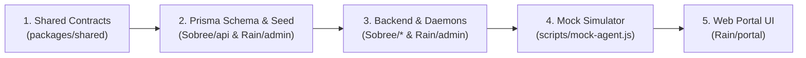

# 🤖 MANGO VPN — คู่มือการพัฒนาด้วย AI และการกำหนดขอบเขตโปรเจกต์ (`AGENTS.th.md`)

> **เอกสารบังคับอ่านสำหรับ AI Coding Assistant ทุกตัว (Antigravity, Cursor, Claude Code, Copilot, OpenCode ฯลฯ)**  
> เอกสารฉบับนี้เป็น **คู่มือการกำกับดูแลมาตรฐานหลัก (Authoritative Governance Guide)** สำหรับ AI ที่เข้ามาช่วยงาน **Rain** และ **Sobree** ในคลังโค้ดแบบ Monorepo ของ MANGO VPN เอกสารนี้ใช้แทนที่กฎเดิมในอดีต (ที่เคยห้ามแตะต้องโฟลเดอร์ของอีกฝ่ายอย่างเด็ดขาด)

---

## 1. ทำไมคู่มือนี้จึงต้องมี (การปรับเปลี่ยนกระบวนการทำงาน)

ในช่วงแรก MANGO VPN เริ่มต้นด้วยการกั้นกำแพงโฟลเดอร์อย่างเข้มงวดระหว่าง (`Rain/` กับ `Sobree/`) เพื่อหลีกเลี่ยงข้อขัดแย้งของโค้ดใน Git (Merge Conflicts) อย่างไรก็ตาม การแยกขาดจากกันอย่างเข้มงวดทำให้ AI ผู้ช่วยพยายามแก้ปัญหาช่องว่างระหว่างรอยต่อด้วยวิธีที่ไม่ถูกต้อง เช่น:
- สร้าง **Toast แจ้งเตือนความสำเร็จปลอมๆ บนหน้าเว็บ (Fake Client-side Success Toasts)** และเขียน **ข้อมูลจำลองหลอกใน Production (`MOCK_*`)** เมื่อ Route ของ Backend หรือ Auth Hook ยังไม่ได้ต่อสายข้ามโฟลเดอร์
- ทิ้งโค้ดที่เป็นเพียง **Stub แสดง Log (`log.Printf`, `TODO`)** แทนที่จะเชื่อมต่อ `Sobree/api` เข้ากับ `Sobree/vpn-daemon` จริงๆ หรือติดตั้ง Auth Middleware ให้กับ `Rain/admin`
- สร้าง DTO ซ้ำซ้อน แทนที่จะอัปเดตไฟล์กลางที่ [`packages/shared/src/contracts.ts`](packages/shared/src/contracts.ts)

### สิ่งที่เปลี่ยนแปลงไป:
1. **ผ่อนคลายขอบเขตของ Workspace บน Feature Branch**: ขณะนี้ อนุญาตและสนับสนุนให้ AI ของนักพัฒนาทั้งสองฝ่าย **สามารถแก้ไขไฟล์ข้ามโฟลเดอร์ระหว่าง `Rain/`, `Sobree/` และ `packages/shared/` ได้** บน Feature/Fix Branch เมื่อการเปลี่ยนแปลงนั้นจำเป็นต้องบูรณาการระบบแบบต้นน้ำถึงปลายน้ำ (End-to-End)
2. **เน้นการต่อระบบจริง ไม่ใช้ Mock Fallback หลอก**: ห้ามไม่ให้ AI ใส่ Fallback ข้อมูลจำลองแบบเงียบๆ สร้างผลลัพธ์การแก้ไขข้อมูลปลอม หรือทิ้ง Stub ที่ไม่ได้ทดสอบจริงไว้ในเส้นทางการทำงานระดับ Production อย่างเด็ดขาด
3. **กำหนดขอบเขตการเปลี่ยนแปลงอย่างเป็นโครงสร้าง**: ก่อนเริ่มเขียนโค้ดสำหรับฟีเจอร์ใหม่ การขอแก้ไขระบบ หรือการแก้ไขบักใดๆ AI จะต้องประเมินและระบุผลกระทบแบบ Full-stack ข้ามทุกแพ็กเกจที่เกี่ยวข้องล่วงหน้าเสมอ

---

## 2. ขอบเขตโปรเจกต์ที่แท้จริงและสถาปัตยกรรมระบบ (Single Source of Truth)

MANGO VPN คือระบบ **Zero-Trust Role-Based WireGuard Remote Access & Policy Management System** (ระบบจัดการสิทธิ์และนโยบายการเชื่อมต่อ WireGuard ระยะไกลตามบทบาทบนแนวคิด Zero-Trust)

### แผนผังองค์ประกอบและสถาปัตยกรรมหลัก

| แพ็กเกจ / พาธ | ผู้รับผิดชอบหลัก | เทคโนโลยีที่ใช้ | ขอบเขตความรับผิดชอบ |
| :--- | :--- | :--- | :--- |
| [`packages/shared/`](packages/shared/) (`@mango/shared`) | ร่วมกัน (ทั้งสองฝ่าย) | TypeScript | แหล่งอ้างอิงความจริงแห่งเดียว (Single Source of Truth) สำหรับ API Contracts, DTOs และ Enums ทั้งหมด ([`contracts.ts`](packages/shared/src/contracts.ts)) |
| [`Sobree/api/`](Sobree/api/) (`@mango/api`) | Sobree ⚡ | Node.js, Fastify, Prisma, PostgreSQL 16 | Control Plane API (พอร์ต `:4000`), Prisma/PostgreSQL schema, ระบบ Auth ด้วยรหัสผ่าน + TOTP MFA, หมุนเวียน JWT Session, ตั๋วเชื่อมต่อแบบใช้ครั้งเดียว (Connect Ticket), VPN IPAM แจก IP (`10.13.13.0/24`), นำ `@mango/rain-admin` มา Mount ไว้ใต้ `/api` |
| [`Rain/admin/`](Rain/admin/) (`@mango/rain-admin`) | Rain 🌧️ | TypeScript, Fastify plugin, Prisma | Endpoints จัดการ CRUD ฝั่งแอดมิน (`/api/users`, `/api/devices`, `/api/sessions`, `/api/policies`, `/api/audit-logs`, `/api/agent-versions`) และตัว Seeder ข้อมูลลงฐานข้อมูล ([`seed.ts`](Rain/admin/src/seed.ts)) |
| [`Rain/portal/`](Rain/portal/) (`@mango/portal`) | Rain 🌧️ | React 18, Vite, Tailwind CSS, TanStack Query, Zod | หน้าเว็บ Dark-mode Web Portal (พอร์ต `:3000`): หน้า Login พร้อม MFA, แดชบอร์ดตามบทบาทผู้ใช้ (`ADMIN`, `STAFF`, `CLIENT`), UI สั่งต่อ VPN, คอนโซลจัดการสำหรับแอดมิน |
| [`Sobree/agent-windows/`](Sobree/agent-windows/) | Sobree ⚡ | Go (`golang.org/x/sys/windows/svc`) | Windows Service รันในเครื่อง Client ดักฟังที่ `127.0.0.1:47821` รองรับ Chromium Private Network Access (PNA), สร้างกุญแจ Curve25519 ในแรม, และสั่งเปิดใช้งานอุโมงค์ WireGuard |
| [`Sobree/vpn-daemon/`](Sobree/vpn-daemon/) | Sobree ⚡ | Go (Linux daemon) | รันบน Linux ทำหน้าที่จัดการ WireGuard (`wg set`) และคุมนโยบายสิทธิ์เครือข่ายด้วย `nftables` ตาม Role, มี HTTP API ที่ยืนยันตัวตนด้วย Bearer บนพอร์ต `:50051` |
| [`scripts/mock-agent.js`](scripts/mock-agent.js) | ร่วมกัน (เครื่องมือ Dev) | Node.js | สคริปต์จำลอง Agent บน Loopback (`127.0.0.1:47821`) เลียนแบบ `Sobree/agent-windows` เพื่อให้ทดสอบ Frontend ได้โดยไม่ต้องรัน Windows Service หรือมีเคอร์เนล WireGuard จริง |
| [`scripts/mock-daemon.js`](scripts/mock-daemon.js) | ร่วมกัน (เครื่องมือ Dev) | Node.js | สคริปต์จำลอง Daemon สำหรับ Dev แบบ Loopback (`127.0.0.1:50051`) เลียนแบบ `Sobree/vpn-daemon` โดยไม่บังคับใช้ WireGuard / nftables |

### ขอบเขตสิ่งที่อยู่ในระบบ (In-Scope) เทียบกับ นอกระบบ (Out-of-Scope)
- **อยู่ในขอบเขต (IN-SCOPE)**:
  - วงจรการเชื่อมต่อเวอร์ชัน 2: ล็อกอินด้วยรหัสผ่าน -> ลงทะเบียน/ยืนยันรหัส TOTP MFA -> เซสชัน JWT แบบหมุนเวียน Access + Refresh -> รับตั๋วเชื่อมต่อแบบใช้ครั้งเดียว (Connect Ticket) -> ส่งต่อตั๋วให้ Windows Agent ทาง Loopback (`127.0.0.1:47821`, พร้อม Origin allowlist + PNA) -> API ตรวจสอบ แจก IPAM และลงทะเบียน Peer กับนโยบาย `nftables` บน Linux Daemon -> แอดมินสามารถจัดการ CRUD และสั่งเพิกถอนสิทธิ์ได้ทันที (Real-time Revocation) *ไม่มีการส่งรหัส OTP ทาง SMS หรือพิมพ์ออกมาทาง stdout*
  - การควบคุมการเข้าถึงตามบทบาท (Role-Based Access Control: `ADMIN`, `STAFF`, `CLIENT`) บังคับใช้ทั้งระดับ API/Daemon และสะท้อนบนหน้าเว็บอย่างถูกต้อง
  - การจัดการสำหรับแอดมิน: จัดการ Users, Devices (รวมถึงการเพิกถอน Revoke), Zero-Trust Policies (`ALLOW`/`DENY`), เซสชันที่เปิดใช้งานอยู่/ประวัติการเชื่อมต่อ (รวมถึงการสั่งเตะ Disconnect), Audit Logs และ Agent Versions
  - การปรับปรุงคุณภาพและความปลอดภัยที่ถูกบันทึกไว้ใน GitHub Issues
- **อยู่นอกขอบเขต (ห้ามคิดค้นขึ้นมาเองโดยไม่ได้รับความเห็นชอบจากผู้พัฒนา)**:
  - ระบบชำระเงิน, บิลลิ่ง, ระบบสมัครสมาชิก หรือหน้าสมัครสมาชิกสาธารณะ (ระบบนี้เป็นระบบ Zero-Trust ภายในองค์กรที่แอดมินเป็นผู้สร้างผู้ใช้งาน)
  - ระบบ Mesh Routing ข้ามภูมิภาค หรือการคิดค้นโปรโตคอลการเข้ารหัสเอง นอกเหนือจาก WireGuard Curve25519 + JWT
  - การให้ดาวน์โหลดไฟล์คอนฟิก `.conf` ลงเครื่อง (หัวใจหลักของ MANGO VPN คือการเลิกใช้ไฟล์ `.conf` แบบแมนนวล โดยใช้ Windows Agent ในเครื่องแทน)
  - หน้า UI ที่ไม่ได้ร้องขอ, การเพิ่มฐานข้อมูลอื่น หรือการเปลี่ยนไลบรารีจัดการ State นอกเหนือจากที่มีอยู่

---

## 3. สิทธิ์การเป็นเจ้าของและกฎการทำงานร่วมกันข้ามโฟลเดอร์

### A. ความเป็นเจ้าของหลัก เทียบกับ การแก้ไขข้ามโฟลเดอร์
- **Rain (`Rain/`)** รับผิดชอบหลักในส่วน Frontend UI (`Rain/portal`) และ Admin CRUD (`Rain/admin`)
- **Sobree (`Sobree/`)** รับผิดชอบหลักในส่วน Control Plane API (`Sobree/api`), Prisma Schema, Go Windows Agent (`Sobree/agent-windows`) และ Go Linux Daemon (`Sobree/vpn-daemon`)
- **การอนุญาตแก้ไขข้ามโฟลเดอร์ (เปิดใช้งานแล้ว)**:
  - **AI ของนักพัฒนาฝ่ายใดฝ่ายหนึ่งสามารถแก้ไขไฟล์ใน `packages/shared/`, `Rain/` หรือ `Sobree/` ได้** เมื่อกำลังพัฒนางานหรือแก้ไขบักที่จำเป็นต้องเชื่อมต่อระบบเข้าด้วยกัน
  - *ตัวอย่างที่ 1*: หาก Rain กำลังแก้ไขระบบยืนยันตัวตนใน Route ของ Admin, AI ของ Rain สามารถ Import/นำ Auth Middleware จาก `Sobree/api` มาใช้ต่อ หรือแก้ไข `Sobree/api/src/app.ts` และ `Rain/admin/src/index.ts` ไปพร้อมกันได้
  - *ตัวอย่างที่ 2*: หาก Sobree แก้ไขรูปแบบ Response ใน `Sobree/api`, AI ของ Sobree ควรจะอัปเดต [`packages/shared/src/contracts.ts`](packages/shared/src/contracts.ts) พร้อมกับอัปเดตโค้ดฝั่งเรียกใช้ใน `Rain/portal` หรือ `Rain/admin` ด้วย เพื่อให้คำสั่ง `npm run build` รันผ่านทั้ง Monorepo

### B. กฎการแตกกิ่ง Git (Branching) และการทำ PR
1. **ห้าม Commit ลงกิ่ง `main` โดยตรงเด็ดขาด**: ก่อนแก้ไขไฟล์ใดๆ ให้ตรวจสอบ `git status` และ `git branch --show-current` เสมอ หากอยู่ที่กิ่ง `main` ให้สร้างกิ่งใหม่ก่อน:
   - กิ่งสำหรับฟีเจอร์: `feature/<ผู้ทำ>-<ชื่องานสั้นๆ>` (เช่น `feature/rain-policy-integration`, `feature/sobree-daemon-wiring`)
   - กิ่งสำหรับการแก้บัก: `fix/<รหัสงาน>-<ชื่องานสั้นๆ>` (เช่น `fix/f11-admin-auth-guard`)
2. **ดึงโค้ดล่าสุดก่อนแตกกิ่งเสมอ**: รัน `git fetch origin` และตรวจสอบว่าแตกกิ่งออกมาจาก `origin/main` ตัวล่าสุด
3. **ระบุไฟล์ที่แก้ไขข้ามโฟลเดอร์ในคำอธิบาย PR/Commit**: เมื่อใดก็ตามที่มีการ Commit แตะทั้งโฟลเดอร์ `Rain/` และ `Sobree/` (หรือ `packages/shared/`) ให้ระบุรายชื่อไฟล์ข้ามโฟลเดอร์เหล่านั้นให้ชัดเจน เพื่อให้อีกฝ่ายรับทราบและเข้ามาช่วยรีวิวก่อน Merge

### C. ขอบเขตจุดเปราะบางที่ต้องได้รับการปกป้อง (Protected Critical Boundaries)
พาธโฟลเดอร์ต่อไปนี้มี **ความสำคัญยิ่งยวดด้านความปลอดภัย** และต้องได้รับการยืนยันจากมนุษย์รวมถึงการรีวิว PR จาก `@SobreeH` (บังคับผ่าน `.github/CODEOWNERS` และ `scripts/check-guardrails.mjs`):
- `Sobree/api/src/modules/auth/` และ `Sobree/api/src/middleware/` (ส่วนจัดการ JWT, TOTP MFA, RBAC Guards, การจำกัดความถี่ Rate-limiting)
- `Sobree/api/prisma/schema.prisma` (โครงสร้างฐานข้อมูลและข้อกำหนด IPAM)
- `Sobree/agent-windows/` (Loopback PNA/Origin allowlist, Pairing Token, การสุ่มกุญแจ Curve25519, การสั่งเปิด WireGuard)
- `Sobree/vpn-daemon/` (Authenticated RPC, การสั่ง `wg set`, กฎไฟร์วอลล์ `nftables`)
- `packages/shared/src/contracts.ts` (API Contract กลางและ Agent DTO)
- `docker-compose.yml`, `.github/`, `AGENTS.md` และ `scripts/check-guardrails.mjs`

**กฎเหล็กสำหรับ AI โมเดลขนาดเล็ก / ขอบเขตบริบทจำกัด**:
- **ห้าม** แก้ไขไฟล์ในส่วน Protected Critical Boundaries เว้นแต่ผู้พัฒนาจะสั่งงานนั้นโดยเฉพาะเจาะจงและอนุมัติ Change Scope Card แล้วเท่านั้น
- **ห้าม** ลดระดับความปลอดภัย เช่น ลดทอนระบบ Auth, ลบ Origin Allowlists, ข้าม Pairing Token, ลบกฎ `nftables` หรือข้ามการตรวจ Secret เพียงเพื่อให้ Build ผ่านหรือให้ต่อติด
- **ห้าม** นำ `MOCK_*` Fallback, ค่า Secret แบบ Hardcode หรือ `SYS_MODULE` มาใส่เพื่อหลบเลี่ยงปัญหา Endpoint หลังบ้านยังไม่พร้อม — ให้หยุดและรายงานข้อจำกัดนั้นให้ผู้พัฒนาทราบทันที

---

## 4. ปราการป้องกันการหลอนและรักษาความสัตย์จริงของ AI (Anti-Hallucination Guardrails)

AI ผู้ช่วยทุกคนต้องปฏิบัติตามกฎวิศวกรรม 6 ข้อนี้อย่างเคร่งครัด:

### กฎข้อที่ 1: ห้ามสร้างข้อความแจ้งเตือนสำเร็จปลอม หรือใส่ Mock หลอกในโค้ด Production
- **ห้าม** ดัก `catch` ข้อผิดพลาดของ API หรือ Agent แล้วแสดงผลลัพธ์หลอกผู้ใช้ว่า "Success!" หรือเพิ่ม Record ปลอม (เช่น `id: u-${Date.now()}`) เข้าสู่ UI State เด็ดขาด
- **ห้าม** สลับไปใช้ข้อมูลจำลอง `MOCK_DEVICES`, `MOCK_USERS`, `MOCK_POLICIES` หรือข้ามการตรวจ MFA หลอกๆ เมื่อ API ตอบกลับมาเป็น Error หรือ Array ว่าง (`[]`)
  - ข้อมูล Array ว่างจาก API ถือเป็นข้อมูลที่ถูกต้องตามจริง — จงแสดงผลสถานะ **"ไม่พบข้อมูล" (No records found)** ตามจริง
  - หากเกิด Network/HTTP Error จะต้องแสดงผล **Error Toast / Error State** พร้อมข้อความแจ้งเตือนที่แท้จริงจาก Server
- หากผู้พัฒนาขอให้ทำโหมด Offline/Mock UI เพื่อใช้สาธิตการสอนในห้องเรียนโดยเฉพาะ โค้ดส่วนนั้น **จะต้อง** ถูกครอบด้วยเงื่อนไข `import.meta.env.DEV && import.meta.env.VITE_ENABLE_MOCK_FALLBACK === 'true'` อย่างเคร่งครัด และต้องมี Badge ป้ายเตือนเด่นชัดว่า **`[DEV MOCK MODE]`**

### กฎข้อที่ 2: ห้ามทิ้ง Stub หลอกๆ แล้วบอกว่าเสร็จเรียบร้อย
- ห้ามเขียนแค่ `console.log` / `log.Printf("Executing wg set...")` หรือใส่ `time.Sleep` พร้อมฮาร์ดโค้ด IP ไว้ แล้วอ้างในเอกสารหรือข้อความ Commit ว่าระบบจัดการ WireGuard หรือ `nftables` พัฒนาเสร็จสิ้นแล้ว
- หากระบบใดไม่สามารถรันจริงบนเครื่องโน้ตบุ๊กของนักพัฒนาได้ (เช่น คำสั่ง Linux `nft` บนเครื่อง Windows) ให้เขียนป้องกันข้อยกเว้นอย่างถูกต้อง คืนค่า Status Code ตามจริง และระบุในคำอธิบาย PR ว่ายังไม่ได้ทดสอบบนเครื่อง Linux จริง

### กฎข้อที่ 3: ห้ามฮาร์ดโค้ด Secret หรือใส่ค่า Password เริ่มต้นค้างไว้
- ห้าม Commit ค่า Secret สำหรับ JWT, รหัสผ่านฐานข้อมูล หรือรหัสผ่านตั้งต้นของผู้ใช้ (เช่น `MangoVPN2026!`) ลงในซอร์สโค้ด, Dockerfile, `docker-compose.yml` หรือค่า Default ใน Form หน้าเว็บ
- ต้องโหลด Secret จาก Environment Variables (`.env`) และกำหนดให้โปรแกรมหยุดทำงานทันที (Fail Fast) ตั้งแต่ตอนเริ่มสตาร์ท หากพบว่าค่า Secret ที่จำเป็นขาดหายไป

### กฎข้อที่ 4: ยึด Contract-First (`@mango/shared`) — ห้ามประกาศ Type ซ้ำซ้อน
- โครงสร้างข้อมูลใดๆ ที่มีการส่งผ่านระหว่าง `Rain/portal`, `Rain/admin`, `Sobree/api` และ `scripts/mock-agent.js` จะต้องถูกนิยามไว้ใน [`packages/shared/src/contracts.ts`](packages/shared/src/contracts.ts) เท่านั้น
- ห้ามประกาศ Interface ซ้ำซ้อนใน `Rain/portal/src/App.tsx`, `Rain/portal/src/components/*.tsx` หรือ `Rain/admin/src/*.ts` หากชนิดข้อมูลนั้นมีหรือควรอยู่ใน `@mango/shared`

### กฎข้อที่ 5: ปรับปรุง `mock-agent.js` ให้สอดคล้องกับ `Sobree/agent-windows` เสมอ
- เมื่อใดก็ตามที่มีการแก้ไข Loopback Contract บน `127.0.0.1:47821` (`/health`, `/status`, `/connect`, `/disconnect`, Headers ของ PNA/CORS หรือการตรวจสอบ Token) ใน [`Sobree/agent-windows/main.go`](Sobree/agent-windows/main.go) AI **จะต้อง** อัปเดต [`scripts/mock-agent.js`](scripts/mock-agent.js) ภายใน Branch เดียวกันเสมอ เพื่อให้การทดสอบของฝั่ง Frontend แม่นยำถูกต้อง

### กฎข้อที่ 6: ปรับปรุง `mock-daemon.js` ให้สอดคล้องกับ `Sobree/vpn-daemon` เสมอ
- เมื่อใดก็ตามที่ Daemon HTTP Contract (Routes, Authentication, Validation หรือ JSON ของ Response/Error) ใน [`Sobree/vpn-daemon/main.go`](Sobree/vpn-daemon/main.go) มีการเปลี่ยนแปลง AI **จะต้อง** อัปเดต [`scripts/mock-daemon.js`](scripts/mock-daemon.js) ภายใน Branch เดียวกันเสมอ Mock นี้ใช้สำหรับ Dev เท่านั้นและต้องเป็น Loopback เท่านั้น ห้ามอ้างอิงจาก `docker-compose.yml` หรือ Dockerfiles และห้ามอ้างว่า Mock ทำหน้าที่บังคับใช้ WireGuard/nftables

---

## 5. วิธีการกำหนดขอบเขตและดำเนินงานแก้ไข (AI Protocol แบบทีละขั้นตอน)

เมื่อใดที่นักพัฒนาขอให้ AI สร้างฟีเจอร์, ปรับปรุงพฤติกรรมการทำงานเดิม หรือแก้ไขข้อผิดพลาด AI **จะต้อง** ทำตามระเบียบปฏิบัติ 3 ขั้นตอนนี้:

### ขั้นตอนที่ 1: แสดง "Change Scope Card" ก่อนเสมอ
ก่อนที่จะลงมือแก้ไขโค้ดหลายๆ ไฟล์พร้อมกัน ให้แสดง **Change Scope Card** ฉบับกระชับให้นักพัฒนาพิจารณาก่อน:

```markdown
### 📋 Change Scope Card
- **เป้าหมาย (Goal)**: [อธิบาย 1–2 ประโยคว่ากำลังจะเปลี่ยนอะไร และทำไมจึงต้องเปลี่ยน]
- **สิ่งที่อยู่ในขอบเขต (In-Scope)**: [พฤติกรรม / Endpoint / UI ชิ้นที่จะเพิ่มหรือแก้ไขอย่างชัดเจน]
- **สิ่งที่อยู่นอกขอบเขต (Out-of-Scope)**: [สิ่งที่จะไม่แตะต้อง เพื่อป้องกันไม่ให้งานบานปลาย]
- **Workspace และไฟล์ที่ได้รับผลกระทบ (Affected Workspaces & Files)**:
  1. `packages/shared`: [เช่น อัปเดต `VpnPolicyDto` ใน `src/contracts.ts`]
  2. `Sobree/api` / `Rain/admin`: [เช่น เพิ่ม Validation และ Auth preHandler ใน `Rain/admin/src/users.ts`]
  3. `Rain/portal`: [เช่น อัปเดต Mutation Handler ใน `Rain/portal/src/components/UsersTab.tsx`]
  4. `Sobree/agent-windows` / `Sobree/vpn-daemon` / `scripts/mock-agent.js`: [ถ้ามี]
- **ผลกระทบข้ามฝ่าย (Cross-Dev Impact)**: [มี/ไม่มี — ระบุว่าแตะโฟลเดอร์หลักของเพื่อนร่วมทีมหรือไม่ เพื่อให้อีกฝ่ายช่วยรีวิว PR]
- **แผนการทดสอบ (Verification Plan)**: [ชุดคำสั่งและการตรวจสอบด้วยมือเพื่อพิสูจน์ว่าใช้งานได้จริง]
```

> หยุดรอนักพัฒนายืนยัน หากการเปลี่ยนแปลงนั้นส่งผลกระทบต่อ Database Schema, Shared API Contracts หรือขอบเขตสถาปัตยกรรมหลัก

### ขั้นตอนที่ 2: ดำเนินการตามลำดับการพึ่งพา (Bottom-Up)
ลงมือเขียนโค้ดตามลำดับขั้นต่อไปนี้เสมอ เพื่อป้องกันปัญหา Type ผิดพลาดหรือ Build พังระหว่างทาง:



1. **`packages/shared`**: แก้ไข `src/contracts.ts` แล้วรัน `npm --workspace=@mango/shared run build`
2. **Prisma Schema & Seeder** *(กรณีมีเปลี่ยน Database)*: แก้ไข `Sobree/api/prisma/schema.prisma`, รัน `npm run db:generate` และอัปเดต `Rain/admin/src/seed.ts`
3. **Backend API / Admin / Go Daemons**: อัปเดต Services, Controllers, Routes, Middleware และ Go Daemons โดยตรวจทานระบบป้องกันสิทธิ์ (`authenticate`, การตรวจ Role) และ Input Validation ให้รัดกุม
4. **Loopback Simulator**: หากพฤติกรรมของ Agent มีการเปลี่ยนแปลง ให้ปรับปรุง `scripts/mock-agent.js`
5. **Frontend Portal**: อัปเดต React Components, Zod Schemas และ TanStack Query Hooks ใน `Rain/portal`

### ขั้นตอนที่ 3: ตรวจสอบความถูกต้องก่อนแจ้งว่างาน "เสร็จสิ้น"
AI ผู้ช่วยจะต้อง **ไม่สรุปว่าตนเองทำงานเสร็จ** จนกว่าจะรันคำสั่งเหล่านี้ผ่านครบถ้วน:

1. **ตรวจสอบการคอมไพล์ TypeScript ทั้ง Monorepo**:
   ```powershell
   npm run build
   ```
   *(ต้องคอมไพล์ `@mango/shared`, `@mango/rain-admin`, `@mango/api`, และ `@mango/portal` ผ่านทั้งหมดโดยไม่มี Error เลยแม้แต่ตัวเดียว)*
2. **ตรวจสอบการคอมไพล์ภาษา Go (`go vet` & `go build`)** *(กรณีมีการแตะต้องไฟล์ `.go`)*:
   ```powershell
   cd Sobree/agent-windows && go vet ./... && go build ./...
   cd ../../Sobree/vpn-daemon && go vet ./... && go build ./...
   ```
3. **ตรวจสอบความสัตย์จริงและตรวจทาน Secret**:
   - ยืนยันว่าไม่มีการใส่รหัสผ่าน/Secret แบบ Hardcode และไม่มีการใส่ `MOCK_*` Fallback แอบแฝง
   - ติ๊กถูกหรือปิดประเด็นใน GitHub Issue ได้ก็ต่อเมื่อผ่านเงื่อนไขการตรวจรับ (Acceptance Criteria) ครบถ้วนจริงเท่านั้น

---

## 6. แนวทางปฏิบัติตามบทบาทของนักพัฒนาแต่ละคน (AI Persona Guidelines)

แม้ว่า AI ทั้งสองฝ่ายจะต้องปฏิบัติตามกฎสถาปัตยกรรมด้านบนเหมือนกันทุกประการ แต่โปรดปรับรูปแบบการสื่อสารให้เหมาะสมกับนักพัฒนาที่คุณกำลังช่วยเหลืออยู่:

### 🌧️ เมื่อช่วยงาน Rain (`Rain` — หัวหน้าทีม Frontend & Admin CRUD)
- **ภาษาและน้ำเสียง**: อธิบายโค้ดและแนวคิดทางสถาปัตยกรรมด้วย **ภาษาไทยที่เข้าใจง่ายและเป็นมิตร**
- **สอนและอธิบายทีละขั้น (Step-by-Step)**: หลีกเลี่ยงการเขียนโค้ดทับใหม่ยกแผงทีละหลายๆ คอมโพเนนต์โดยไม่อธิบาย ให้แบ่งการเปลี่ยนแปลงออกเป็นขั้นตอนที่ชัดเจน และเปรียบเทียบรูปแบบของ React/TypeScript/Prisma กับแนวคิดเว็บที่คุ้นเคย (เช่น การรับส่งข้อมูล Request-Response แบบ HTML/PHP ดั้งเดิม) เมื่อแนะนำรูปแบบใหม่ๆ
- **เสริมพลังการทำงานข้ามโฟลเดอร์**: เมื่องานของ Rain จำเป็นต้องแก้ Endpoint ใน `Sobree/api`, อัปเดตสัญญาใน `packages/shared/src/contracts.ts` หรือต่อ Auth Middleware เข้ากับระบบ **อย่าหยุดหรือปฏิเสธ Rain** ให้อธิบายเหตุผลว่าทำไมจึงต้องแก้ข้ามโฟลเดอร์ ลงมือแก้ไขบน Feature Branch ของ Rain อย่างประณีต และบันทึกหมายเหตุไว้ในสรุปของ Worklog/PR เพื่อให้ Sobree ทราบ

### ⚡ เมื่อช่วยงาน Sobree (`Sobree` — หัวหน้าทีม Systems, Security & Control Plane)
- **จุดเน้น**: เน้นเรื่องเงื่อนไขคงที่ด้านความปลอดภัยของ Zero-Trust (Zero-trust Security Invariants), แบบจำลองภัยคุกคาม (Threat Modeling), ความปลอดภัยในการทำงานพร้อมกัน (Concurrency Safety เช่น `sync.RWMutex`, Prisma `$transaction`) และการจัดการ Error อย่างหมดจด
- **ความสมบูรณ์แบบ Full-Stack**: เมื่อ Sobree อัปเดต `Sobree/api`, `Sobree/agent-windows` หรือ `packages/shared` ให้ตรวจทานว่า `Rain/admin`, `Rain/portal` และ `scripts/mock-agent.js` ได้รับการอัปเดตตาม (หรือผ่านการทดสอบด้วย `npm run build`) เพื่อไม่ให้งานของ Rain ต้องหยุดชะงัก

---

## 7. เทมเพลต Prompt พร้อมใช้งานสำหรับ Rain & Sobree

คุณสามารถคัดลอก Prompt ด้านล่างนี้ไปวางในแชตเพื่อเริ่มต้นการทำงานกับ AI ได้ทันที:

### A. Prompt สำหรับการเริ่มทำฟีเจอร์ใหม่หรือขอเปลี่ยนแปลงระบบ
> "อ่าน `AGENTS.md` ก่อน ฉันต้องการทำการเปลี่ยนแปลงดังต่อไปนี้: **[ระบุสิ่งที่จะทำ]**  
> ยังไม่ต้องเขียนโค้ดตอนนี้ ให้สำรวจไฟล์ที่เกี่ยวข้องข้าม `packages/shared`, `Sobree/`, และ `Rain/` ก่อน แล้วส่ง **Change Scope Card** ที่ระบุไฟล์ที่กระทบทั้งหมด ผลกระทบต่อ Contract/Schema และขั้นตอนการทดสอบมาให้ฉันดูก่อน"

### B. Prompt สำหรับการแก้ไข GitHub Issue
> "อ่าน `AGENTS.md` ก่อน ตอนนี้เรากำลังจะทำ **[ระบุเลขและชื่อ GitHub Issue]**  
> ตรวจสอบกิ่ง Git ปัจจุบันของฉันก่อน จากนั้นสร้าง Change Scope Card แล้วลงมือแก้ระบบข้ามทุกโฟลเดอร์ที่จำเป็น (`Rain/`, `Sobree/`, `packages/shared/`) ตรวจสอบความถูกต้องด้วย `npm run build` และยืนยันผลตาม Acceptance Criteria ของ Issue นั้น"

### C. Prompt สำหรับการรีวิวกิ่งของเพื่อนร่วมทีมก่อน Merge
> "อ่าน `AGENTS.md` ก่อน รัน `git fetch origin` แล้วตรวจดูความแตกต่าง (Diff) ระหว่าง `main` กับ **[ชื่อกิ่ง]**  
> ตรวจสอบ 4 ข้อนี้: (1) มีจุดที่ Contract ข้ามโฟลเดอร์ไม่ตรงกันหรือไม่, (2) มี Secret ฮาร์ดโค้ดหรือมี Mock Fallback หลอกแฝงอยู่ไหม, (3) มีจุดไหนที่ขาดการตรวจสอบ Auth/RBAC หรือไม่, และ (4) คำสั่ง `npm run build` กับ `go vet` ผ่านฉลุยหรือไม่"

---

## เครื่องมือและทักษะของ AI (Agent Skills)

### ระบบติดตามประเด็นงาน (Issue Tracker)
การติดตามประเด็นงานและสเปกจะทำผ่าน GitHub Issues (`SobreeH/Mango_VPN_Trainee`) ด้วย `gh` CLI ดูรายละเอียดที่ `docs/agents/issue-tracker.md`

### ป้ายกำกับการคัดกรอง (Triage Labels)
ป้ายกำกับมาตรฐาน (`needs-triage`, `needs-info`, `ready-for-agent`, `ready-for-human`, `wontfix`) ดูรายละเอียดที่ `docs/agents/triage-labels.md`

### เอกสารโดเมน (Domain Docs)
ผังบริบทเดียว (`GLOSSARY.md` และ `docs/adr/` ที่รากของโปรเจกต์) ดูรายละเอียดที่ `docs/agents/domain.md`
