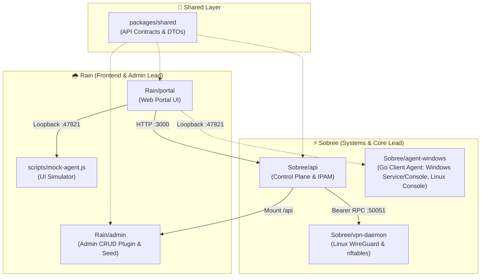

# 🥭 MANGO VPN

> **ระบบจัดการสิทธิ์และนโยบายการเชื่อมต่อ WireGuard ระยะไกลตามบทบาทบนแนวคิด Zero-Trust**  
> *(Zero-Trust Role-Based WireGuard Remote Access & Policy Management System)*

---

MANGO VPN ออกแบบมาเพื่อ **"ขจัดความยุ่งยากในการส่งและจัดการไฟล์คอนฟิก `.conf`"** สำหรับการใช้งาน VPN ระดับองค์กร โดยผู้ใช้งานเพียงแค่ล็อกอินเข้าสู่ Web Portal ด้วยรหัสผ่านและรหัสยืนยันตัวตน 2 ชั้น (TOTP Authenticator) จากนั้นระบบควบคุม (Control Plane API) จะออก "ตั๋วเชื่อมต่อแบบใช้ครั้งเดียว" (One-Time Connect Ticket) ให้กับตัวโปรแกรม Agent บนเครื่อง (`Sobree/agent-windows`) ซึ่งจะทำการสุ่มสร้างคู่กุญแจ Curve25519 ขึ้นมาในหน่วยความจำ (In-Memory) และเปิดใช้งานอุโมงค์ WireGuard ให้อัตโนมัติ โดยที่ฝั่งเซิร์ฟเวอร์ Gateway (Linux) จะมี Daemon คอยควบคุม Firewall ด้วย `nftables` ตามบทบาท (Role) ของผู้ใช้แบบเรียลไทม์

ตัว Client Agent (`Sobree/agent-windows`) รองรับทั้งสองระบบปฏิบัติการ: บน **Windows** รันเป็น Windows Service หรือโหมด Console และเปิดอุโมงค์ด้วย `wireguard.exe /installtunnelservice` ส่วนบน **Linux** รันเป็นโหมด Console (ต้องใช้สิทธิ์ root หรือ `CAP_NET_ADMIN`) และเปิดอุโมงค์ด้วย `wg-quick up`

---

## 📚 เอกสารประกอบโปรเจกต์ (Documentation)

- **[🎓 คู่มือเริ่มต้นใช้งานและทดสอบระบบฉบับจับมือทำ (`TUTORIAL.th.md`)](TUTORIAL.th.md)** *(หรือฉบับภาษาอังกฤษ [TUTORIAL.md](TUTORIAL.md))*:  
  **แนะนำให้อ่านก่อนหากเริ่มใช้งานครั้งแรก**: สอนตั้งค่าตั้งแต่ศูนย์สำหรับทั้ง Rain และ Sobree, สคริปต์สร้าง `.env` อัตโนมัติ, วิธีรันทั้ง 3 แบบ และภารกิจทดสอบทีละคลิก
- **[🤖 คู่มือการพัฒนาด้วย AI และการกำหนดขอบเขต (`AGENTS.th.md`)](AGENTS.th.md)** *(หรือฉบับภาษาอังกฤษ [AGENTS.md](AGENTS.md))*:  
  **เอกสารบังคับอ่านสำหรับ AI ทุกตัว**: อธิบายขอบเขตงาน, การทำงานร่วมกันข้ามโฟลเดอร์ (`Rain/`, `Sobree/`, `packages/shared/`), และปราการป้องกันการทำ Mock หลอก
- **[🚀 คู่มือเริ่มต้นใช้งานด่วน & เตรียมความพร้อมเครื่องมือ (`QUICKSTART.th.md`)](QUICKSTART.th.md)** *(หรือฉบับภาษาอังกฤษ [QUICKSTART.md](QUICKSTART.md))*:  
  รายการเครื่องมือที่ต้องติดตั้ง, การตั้งค่าตัวแปรใน `.env`, แผนผังพอร์ต และการรันระบบครั้งแรก

---

## 🛠️ 1. เทคโนโลยีที่ใช้งาน (Tech Stack v2)

| ส่วนของระบบ | เทคโนโลยีที่ใช้ | รายละเอียด |
| :--- | :--- | :--- |
| **โครงสร้างโปรเจกต์** | **npm workspaces** | จัดการโค้ดแบบ Monorepo (`Rain/*`, `Sobree/*`, `packages/*`) *ไม่ใช้ pnpm* |
| **Web Portal** (`@mango/portal`) | **React 18.3, Vite 5, Tailwind CSS 3** | State Management ด้วย TanStack Query v5, Schema Validation ด้วย Zod v4 |
| **Control Plane API** (`@mango/api`) | **Node.js, Fastify 4, Prisma 5** | Authentication (bcryptjs, JWT, TOTP), IPAM จัดการ IP เครือข่าย VPN |
| **Admin CRUD Plugin** (`@mango/rain-admin`) | **TypeScript, Fastify Plugin** | Endpoints จัดการ Users, Devices, Sessions, Policies และ DB Seeder |
| **ฐานข้อมูล (Database)** | **PostgreSQL 16** | รันผ่าน Docker Compose (`postgres:16-alpine`) หรือแบบฝังตัวด้วย `npm run db:start` (Rain ไม่ต้องใช้ Docker) พอร์ต Host คือ `15432` |
| **Client Agent (Windows / Linux)** | **Go 1.26** | บน Windows รันเป็น Windows Service หรือ Console (`golang.org/x/sys/windows/svc`) และเปิดอุโมงค์ด้วย `wireguard.exe`; บน Linux รันเป็น Console และเปิดอุโมงค์ด้วย `wg-quick` พอร์ต `47821` |
| **Linux VPN Gateway Daemon** | **Go 1.22** | รันบน Linux จัดการ `wg` และกฎไฟร์วอลล์ `nftables` บนพอร์ต `:50051` |
| **Shared Contracts** | **TypeScript** (`@mango/shared`) | ศูนย์กลางเก็บ DTOs, Enums และ Type สัญญากลางที่ใช้ร่วมกันทุกส่วน |

---

## 📂 2. โครงสร้างคลังโค้ด (Repository Layout)

โปรเจกต์แบ่งพื้นที่การรับผิดชอบหลักตามทีมพัฒนา พร้อมทั้งมีจุดเชื่อมต่อสัญญากลาง:

```text
Mango_VPN_Trainee/
├── packages/
│   └── shared/                        # 🤝 [@mango/shared] สัญญากลาง Single Source of Truth
│       └── src/contracts.ts           # DTOs และ Enums ที่แชร์ระหว่าง Portal, Admin, API และ Agent
│
├── Rain/                              # 🌧️ [Rain] ดูแล Web Portal และ Admin CRUD
│   ├── portal/                        # @mango/portal (Frontend React + Vite พอร์ต 3000)
│   │   ├── src/App.tsx                # Flow หลัก: Login -> Setup/Verify TOTP -> แดชบอร์ดตาม Role
│   │   ├── src/api/auth.ts            # ฟังก์ชันเรียก API Login, Verify OTP, Refresh, Logout
│   │   ├── src/api/agent.ts           # ฟังก์ชันคุยกับ Agent บนเครื่อง (127.0.0.1:47821)
│   │   ├── src/components/            # UI Components (AgentStatusCard, NetworkTopology, Toast, แท็บ Users, Devices, Sessions, Policies, Gateways, Audit Logs, Agent Versions)
│   │   └── src/lib/adminApi.ts        # ฟังก์ชันเรียก API หลังบ้านสำหรับจัดการระบบ
│   └── admin/                         # @mango/rain-admin (Fastify Plugin หลังบ้านส่วนแอดมิน)
│       ├── src/index.ts               # Entrypoint ของปลั๊กอิน (มี Guard สิทธิ์ Admin)
│       ├── src/users.ts               # CRUD ผู้ใช้งาน (/api/users)
│       ├── src/devices.ts             # จัดการอุปกรณ์และสั่งเพิกถอน (/api/devices)
│       ├── src/sessions.ts            # ตรวจสอบและสั่งตัดเซสชัน (/api/sessions)
│       ├── src/policies.ts            # กำหนดกฎ Zero-Trust Network Policy (/api/policies)
│       ├── src/gateways.ts            # จัดการ VPN Gateways (/api/gateways: WIREGUARD, FORTINET, CISCO)
│       ├── src/agent-versions.ts      # จัดการเวอร์ชัน Agent (/api/agent-versions)
│       ├── src/revocation.ts          # สั่งเตะ Peer และลบกฎ Firewall บน Daemon แบบ Real-time
│       ├── src/seed.ts                # สคริปต์สร้าง Role และ User เริ่มต้นลงฐานข้อมูล
│       └── src/seed-test-targets.ts   # Seeder นโยบาย Track B แบบเลือกใช้ (npm run db:seed:test-targets)
│
├── Sobree/                            # ⚡ [Sobree] ดูแล Core API, Windows Agent และ Gateway Daemon
│   ├── api/                           # @mango/api (Control Plane API พอร์ต 4000)
│   │   ├── prisma/schema.prisma       # โครงสร้างฐานข้อมูล PostgreSQL (11 Models)
│   │   ├── src/app.ts                 # ตัวสร้าง Fastify App, CORS, Route หลัก และจุด Mount rain-admin
│   │   ├── src/modules/auth/          # ระบบ Login, TOTP MFA, JWT Session Rotation, Rate Limiting
│   │   ├── src/modules/vpn/           # การออก Connect Ticket, การเชื่อมต่อ และ IPAM (10.13.13.0/24)
│   │   └── src/lib/vpn-daemon.ts      # HTTP Client คุยกับ Gateway Daemon (ผ่าน Bearer Token)
│   ├── agent-windows/                 # Go Client Agent (Windows Service/Console บน Windows; Console บน Linux) พอร์ต 127.0.0.1:47821
│   │   ├── main.go                    # Loopback Server, ตรวจ PNA/Origin, สร้างกุญแจ Curve25519, สั่งเปิด WireGuard (wireguard.exe หรือ wg-quick)
│   │   └── service_windows.go         # Wrapper รันแบบ Windows Service
│   └── vpn-daemon/                    # Go Gateway Daemon (Linux)
│       └── main.go                    # จัดการ WireGuard (wg set) และกฎไฟร์วอลล์ nftables พอร์ต :50051
│
├── scripts/
│   ├── init-env.mjs                   # ตัวสร้าง .env และคู่กุญแจ WireGuard X25519 แบบข้ามแพลตฟอร์ม (`npm run env:init`)
│   ├── mock-agent.js                  # 🧪 ตัวจำลอง Client Agent สำหรับใช้รันทดสอบหน้าเว็บในเครื่อง (ใน dev จะเติมพอร์ตต้นทางต่อท้าย device fingerprint)
│   ├── mock-daemon.js                 # 🧪 ตัวจำลอง VPN Gateway Daemon สำหรับการพัฒนาเท่านั้น (127.0.0.1:50051, ไม่บังคับใช้ wg/nftables)
│   ├── start-all-portals.mjs          # เปิด Vite dev ทั้ง 3 พอร์ทัลพร้อมกัน (Admin :3000, Staff :3001, Client :3002) ผ่าน `npm run dev:portal:all`
│   ├── dev-demo.mjs                   # เปิด mock-agent.js พร้อมทั้ง 3 พอร์ทัลใน Terminal เดียว (`npm run dev:demo`)
│   ├── dev-db.mjs                     # ตัวรัน PostgreSQL 16 แบบฝังตัวโดยไม่ใช้ Docker (`npm run db:start` / `db:reset-local` ข้อมูลอยู่ที่ `.local/postgres`)
│   ├── check-guardrails.mjs           # เครื่องมือตรวจจับ Secret หลุด และตรวจห้ามใช้ Mock ใน Production
│   ├── check-environment.mjs          # ตรวจความพร้อมของเครื่องมือบน Linux, macOS และ Windows (`npm run check:env`)
│   └── check-environment.ps1          # Wrapper สำหรับ Windows PowerShell ที่เรียกใช้ check-environment.mjs
│
├── docker-compose.yml                 # คอนฟิกรัน postgres, vpn-gateway, api, portal
├── docker-compose.test-targets.yml     # ตัวเลือกเสริม Track B: เป้าหมาย VPN, target-routes และหน้า Role Harness บน localhost (TUTORIAL.th.md ขั้นตอน B4)
├── test-targets/                         # เว็บเป้าหมายแบบคงที่ (sites/), Role Harness (harness/) และเทมเพลต nginx (nginx/)
├── .env.example                       # เทมเพลตตัวแปรสภาพแวดล้อม
└── package.json                       # Root workspaces configuration
```

> **การทดสอบ Track B แบบเลือกใช้ (Role Enforcement):** `docker-compose.test-targets.yml` และ `test-targets/` เพิ่มเป้าหมายเว็บแบบคงที่ 3 เครื่องที่แยกจาก VPN (`10.99.0.10`, `10.20.0.10`, `10.30.0.10`) และหน้า Role Harness บน localhost ที่ `http://localhost:3090` ใช้ตรวจการบังคับใช้กฎ `nftables` ตาม Role ของ `ADMIN`, `STAFF` และ `CLIENT` ดูรายละเอียดได้ที่ [`TUTORIAL.th.md`](TUTORIAL.th.md) ขั้นตอน B4

---

## 👥 3. การแบ่งหน้าที่รับผิดชอบ (Team Responsibilities)



| หน้าที่ | Rain 🌧️ | Sobree ⚡ |
| :--- | :--- | :--- |
| **พื้นที่โฟลเดอร์หลัก** | `Rain/` | `Sobree/` |
| **หน้าเว็บ Web Portal** | รับผิดชอบหลัก (`Rain/portal`) | ให้คำปรึกษาและรีวิวเชิงสถาปัตยกรรม |
| **ระบบ Admin CRUD** | รับผิดชอบหลัก (`Rain/admin`) | ดูแลจุด Mount ปลั๊กอินใน `Sobree/api/src/app.ts` |
| **Database Seeder** | พัฒนาและดูแล `Rain/admin/src/seed.ts` | ออกแบบ Prisma Schema และ Migrations |
| **Core Backend & Auth** | ฝั่งเรียกใช้งาน (Consumes API) | พัฒนา `Sobree/api` (MFA, JWT, IPAM) |
| **Windows Agent** | ใช้งาน `scripts/mock-agent.js` เพื่อทดสอบ UI | พัฒนา `Sobree/agent-windows` (Go: Windows Service บน Windows หรือ Console บน Linux ด้วย `wg-quick`) |
| **Linux VPN Gateway** | ไม่บังคับ: รัน `scripts/mock-daemon.js` (`npm run mock:daemon`) เพื่อทดสอบ UI/Policy/Connect ในเครื่องได้โดยไม่ใช้ Docker และไม่บังคับใช้ `wg`/`nftables` | พัฒนา `Sobree/vpn-daemon` (Go + `nftables`) |
| **Shared Contracts** | ใช้งาน Types จาก `@mango/shared` | ออกแบบและดูแลสัญญาใน `@mango/shared` |

---

## 🔄 4. วงจรการเชื่อมต่อ VPN แบบละเอียด (Connection Lifecycle v2)


---

## 💻 5. ขั้นตอนการเริ่มทำงาน (Development Workflow)

### 🌧️ สำหรับ Rain (เน้นพัฒนาหน้าบ้าน Portal และ Admin)

Rain สามารถรันระบบทดสอบได้ **โดยไม่ต้องใช้ Docker** ต้องใช้แค่ Node.js และ Git เท่านั้น ไม่ต้องใช้เครื่อง Linux หรือลงโปรแกรม WireGuard จริง:

```powershell
# Terminal 0: สร้าง .env พร้อมค่า Secret และคู่กุญแจ WireGuard X25519 (ข้ามแพลตฟอร์ม)
npm run env:init

# Terminal 1: PostgreSQL 16 แบบฝังตัวบน 127.0.0.1:15432 (ทิ้งไว้ระหว่างใช้งาน กด Ctrl+C เพื่อหยุด)
npm run db:start

# Terminal ตั้งค่า (ขณะที่ Terminal 1 ยังทำงานอยู่):
npm run db:generate
npm run db:migrate
npm run db:seed                      # ต้องตั้งค่า SEED_ADMIN_* ก่อน

# Terminal 2: ตัวจำลอง Gateway Daemon (พอร์ต 50051, dev-only ไม่บังคับใช้ wg/nftables)
npm run mock:daemon

# Terminal 3: รัน Mock Agent จำลอง (พอร์ต 47821)
npm run mock:agent

# Terminal 4: รัน Backend API (พอร์ต 4000)
npm run dev:api

# Terminal 5: รัน Frontend Web Portal เลือกได้ดังนี้:
npm run dev:portal                   # Admin UI บน http://localhost:3000 (ค่าเริ่มต้น)
npm run dev:portal:all               # เปิดทั้ง 3 พอร์ทัลพร้อมกัน (Admin :3000, Staff :3001, Client :3002)
npm run dev:portal:admin             # Admin UI บน :3000
npm run dev:portal:staff             # Staff UI บน :3001
npm run dev:portal:client            # Client UI บน :3002
```

- **สร้าง `.env` ข้ามแพลตฟอร์ม**: `npm run env:init` (`scripts/init-env.mjs`) จะสร้าง `POSTGRES_PASSWORD`, `DATABASE_URL`, `JWT_SECRET`, `REFRESH_SECRET`, `DAEMON_SHARED_SECRET`, `TOTP_ENCRYPTION_KEY` และคู่กุญแจ X25519 `WG_PRIVATE_KEY` / `WG_SERVER_PUBLIC_KEY` ใช้ได้เหมือนกันบน Windows, Linux และ macOS เขียนไฟล์เป็น UTF-8 ไม่มี BOM และจะไม่แก้ `.env` ที่มีค่าครบแล้ว เว้นแต่สั่ง `npm run env:init -- --force` (หรือ `-- --wg-only` เพื่อสร้างเฉพาะกุญแจ WireGuard ใหม่) วิธีเดิมแบบ `copy`/`cp` + `openssl` ก็ยังใช้ได้
- **ไม่ต้องใช้ Docker**: `npm run mock:daemon` ช่วยไม่ให้เจอ `502 Bad Gateway` ตอน Connect, สร้าง Policy และเพิกถอน แต่ **ไม่ได้ตั้งค่า WireGuard หรือ `nftables` จริง** ใช้ Docker Compose เฉพาะเมื่อต้องการรันระบบเต็มรูปแบบ (Sobree / Track B และ C)
- **พอร์ทัลหลายบทบาท**: `npm run dev:portal:all` (`scripts/start-all-portals.mjs`) จะเปิด Admin บน `:3000`, Staff บน `:3001` และ Client บน `:3002` พร้อมกัน โดยมี Log นำหน้าด้วยสีตามบทบาท
- **CORS และ Fingerprint แยกตามผู้ใช้ (Single-Link Demo)**: สามารถทดสอบทุกบทบาท (`ADMIN`, `STAFF`, `CLIENT`) บนลิงก์เดียว `http://localhost:3000` ได้เลย โดยพอร์ทัลจะส่ง `X-Mango-Dev-User` และ `scripts/mock-agent.js` จะแยกสถานะเซสชันและ Device Fingerprint ตามชื่อผู้ใช้ (`mock-<hash>-<username>`) และในโหมด dev `Sobree/api` ยังรองรับ `http://localhost:3000`–`http://localhost:3002` (และ `127.0.0.1`) สำหรับกรณีเปิดแยกพอร์ตด้วย `dev:portal:all`
> [!TIP]
> เมื่อรัน `npm run mock:agent` ตัวจำลองจะพิมพ์ **PairingToken** ออกมา ให้นำโทเคนดังกล่าวไปใส่ในช่องเชื่อมต่อบนหน้าเว็บ Portal เพื่อทำการจับคู่ (Pairing)

---

### ⚡ สำหรับ Sobree (เน้นพัฒนา Core API, Agent และ Gateway, ต้องใช้ Docker Desktop / Docker Engine)

```powershell
# 1. รัน Database
docker compose up -d postgres
npm run db:generate
npm run db:migrate

# 2. รัน Fastify API
npm run dev:api

# 3. รัน Client Agent บน Windows (โหมด Console) — ใช้ Administrator PowerShell สำหรับอุโมงค์จริง
cd Sobree/agent-windows
go run .

# 4. รัน Gateway Daemon (บน Windows ให้รันผ่านคอนเทนเนอร์)
docker compose up -d vpn-gateway
```

```bash
# 1. รัน Database
docker compose up -d postgres
npm run db:generate
npm run db:migrate

# 2. รัน Fastify API
npm run dev:api

# 3. รัน Client Agent บน Linux (ต้องใช้ root หรือ CAP_NET_ADMIN และมี wg-quick)
cd Sobree/agent-windows
sudo -E go run .

# 4. รัน Gateway Daemon บน Linux แบบ Native (ต้องใช้ root หรือ NET_ADMIN พร้อม ip, wg และ nft)
cd Sobree/vpn-daemon
sudo -E go run .
```

---

## 📜 6. ตารางคำสั่งสคริปต์ที่ใช้งานบ่อย (Monorepo Scripts)

| คำสั่ง | การทำงาน |
| :--- | :--- |
| `npm install` | ติดตั้ง Dependencies ทุกแพ็กเกจใน Monorepo |
| `npm run build` | คอมไพล์ `@mango/shared` ก่อน แล้วจึงคอมไพล์ทุก Workspace ที่มีสคริปต์ build |
| `npm test` | รันชุดทดสอบ Vitest ในทุก Workspace |
| `npm run env:init` | สร้าง/อัปเดต `.env` ที่ Root พร้อมค่า Secret และคู่กุญแจ WireGuard X25519 (`scripts/init-env.mjs`; ใช้ `-- --force` หรือ `-- --wg-only` ได้) |
| `npm run dev:portal` | เริ่มรันเซิร์ฟเวอร์ Dev ของหน้าเว็บ (`@mango/portal`) บนพอร์ต `:3000` (Admin) |
| `npm run dev:portal:admin` | เริ่ม Admin Portal บนพอร์ต `:3000` |
| `npm run dev:portal:staff` | เริ่ม Staff Portal บนพอร์ต `:3001` |
| `npm run dev:portal:client` | เริ่ม Client Portal บนพอร์ต `:3002` |
| `npm run dev:portal:all` | เปิดทั้ง 3 พอร์ทัลพร้อมกัน (Admin `:3000`, Staff `:3001`, Client `:3002`) ผ่าน `scripts/start-all-portals.mjs` |
| `npm run dev:demo` | เปิด `mock-agent.js` พร้อมทั้ง 3 พอร์ทัล (Admin `:3000`, Staff `:3001`, Client `:3002`) ใน Terminal เดียว |
| `npm run dev:api` | เริ่มรันเซิร์ฟเวอร์ API (`@mango/api` พร้อม mount `@mango/rain-admin`) |
| `npm run mock:agent` | รันตัวจำลอง Client Agent บน `http://127.0.0.1:47821` (ใน dev จะแยก device fingerprint ตามพอร์ตของ Origin) |
| `npm run mock:daemon` | รันตัวจำลอง VPN Gateway Daemon (`scripts/mock-daemon.js`) บน `http://127.0.0.1:50051` สำหรับการพัฒนาเท่านั้น จะพิมพ์ `[DEV MOCK DAEMON – no wg/nftables enforcement]` และไม่ได้ตั้งค่า WireGuard หรือ `nftables` จริง |
| `npm run db:start` | เริ่ม PostgreSQL 16 แบบฝังตัวบน `127.0.0.1:15432` (`scripts/dev-db.mjs`) โดยไม่ใช้ Docker เก็บข้อมูลที่ `.local/postgres` และสร้าง `POSTGRES_DB` กับ `mangovpn_v2_test` ให้อัตโนมัติ กด Ctrl+C เพื่อหยุด |
| `npm run db:reset-local` | ลบ `.local/postgres` (รันหลังจาก `npm run db:start` หยุดทำงานแล้วเท่านั้น) |
| `npm run db:generate` | อัปเดต Prisma Client จากไฟล์ `schema.prisma` |
| `npm run db:migrate` | รัน Migration โครงสร้างฐานข้อมูล |
| `npm run db:seed` | ใส่ข้อมูลตั้งต้น Role และ Admin ลงฐานข้อมูล |
| `npm run db:seed:test-targets` | รัน `Rain/admin/src/seed-test-targets.ts` เพื่อ Upsert นโยบาย Track B จำนวน 12 รายการสำหรับ ADMIN, STAFF และ CLIENT (เลือกใช้) ต้องรัน `npm run db:seed` ก่อน และคำสั่งนี้ไม่สร้างผู้ใช้ |
| `npm run docker:test-targets:up` | เริ่มชุดทดสอบ Track B แบบเลือกใช้ (`docker-compose.test-targets.yml` ซ้อนบน `docker-compose.yml`): `postgres`, `vpn-gateway`, เป้าหมายเว็บ 3 เครื่อง, `target-routes` และ Role Harness บน localhost ที่ `http://localhost:3090` |
| `npm run docker:test-targets:down` | หยุดและลบชุดทดสอบ Track B โดยใช้ Compose ทั้งสองไฟล์ (Named Volume ยังคงอยู่) |
| `npm run check:env` | ตรวจสอบความพร้อมของเครื่องมือในเครื่อง (`scripts/check-environment.mjs`, ใช้ได้ทั้ง Linux, macOS และ Windows; ค่าเริ่มต้น `--role All`) |
| `npm run check:env -- --role Rain` | ตรวจความพร้อมแบบ Rain ที่ไม่ใช้ Docker โดยกำหนดให้ Docker, Docker Compose และ Go เป็น `OPTIONAL` |
| `npm run check:env -- --role Sobree` | ตรวจความพร้อมแบบ Sobree เต็มรูปแบบ (จะ exit `1` หากขาด Docker, Docker Compose หรือ Go) |
| `npm run docker:up` / `docker:down` / `docker:logs` | เริ่ม, หยุด หรือดู Log ของ Docker Compose ทั้งระบบ |
| `node scripts/check-guardrails.mjs` | รันตัวสแกนความปลอดภัย ตรวจจับ Secret และ Mock หลอก |

ภายใต้ `--role All` หากขาดเครื่องมือฝั่ง Sobree จะแสดงเพียง `[PARTIAL]` และยัง exit `0` เพื่อให้เครื่องที่พัฒนาเฉพาะ Rain และ CI ผ่านได้ เติม `--strict` หากต้องการให้กรณีนี้ถือว่าล้มเหลวด้วย บน Windows สามารถใช้ `scripts/check-environment.ps1 -Role Rain` ซึ่งเรียกตัวตรวจเดียวกัน ดูตัวเลือกทั้งหมดได้ที่ `npm run check:env -- --help`

---

## 🛡️ 7. การตรวจสอบความปลอดภัยและการรวมโค้ด (CI & Guardrails)

ระบบมี GitHub Actions Workflow ([`.github/workflows/ci.yml`](.github/workflows/ci.yml)) คอยตรวจเช็กทุกครั้งที่มีการเปิด PR หรือ Push โค้ด:
1. **Security Guardrail Scanner (`scripts/check-guardrails.mjs`)**: สแกนห้ามมี Secret ฮาร์ดโค้ด, ห้ามมี Mock หลอกใน Production และห้ามเปิด CORS Wildcard บน Agent
2. **Type Checking & Build**: รัน `npm run build` ต้องผ่าน 100% ไม่มี Error
3. **Automated Unit Tests**: รันชุดทดสอบทั้งฝั่ง TypeScript (Vitest) และฝั่ง Go (`go vet`, `go test`)
4. **Codeowners Review**: ไฟล์ในส่วนความปลอดภัยสำคัญ (เช่น Auth, Schema, Linux Daemon, Go Agent) จะถูกส่งให้ `@SobreeH` ช่วยรีวิวก่อน Merge เสมอ
