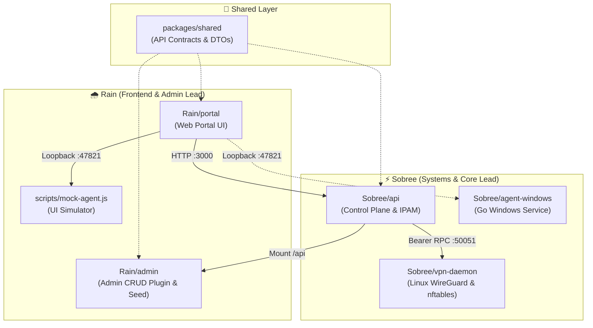
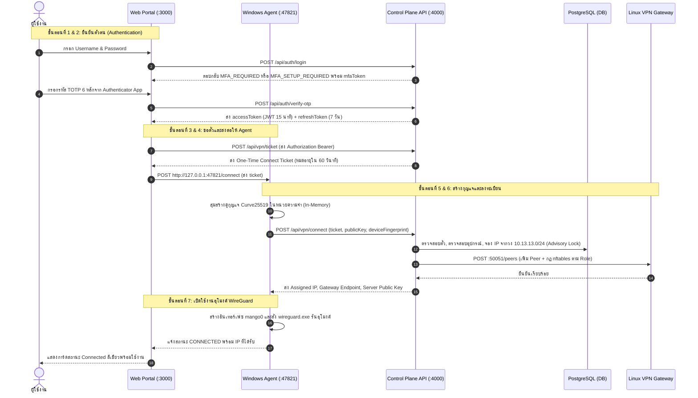

# 🥭 MANGO VPN

> **ระบบจัดการสิทธิ์และนโยบายการเชื่อมต่อ WireGuard ระยะไกลตามบทบาทบนแนวคิด Zero-Trust**  
> *(Zero-Trust Role-Based WireGuard Remote Access & Policy Management System)*

---

MANGO VPN ออกแบบมาเพื่อ **"ขจัดความยุ่งยากในการส่งและจัดการไฟล์คอนฟิก `.conf`"** สำหรับการใช้งาน VPN ระดับองค์กร โดยผู้ใช้งานเพียงแค่ล็อกอินเข้าสู่ Web Portal ด้วยรหัสผ่านและรหัสยืนยันตัวตน 2 ชั้น (TOTP Authenticator) จากนั้นระบบควบคุม (Control Plane API) จะออก "ตั๋วเชื่อมต่อแบบใช้ครั้งเดียว" (One-Time Connect Ticket) ให้กับตัวโปรแกรม Agent บนเครื่อง (Windows Agent) ซึ่งจะทำการสุ่มสร้างคู่กุญแจ Curve25519 ขึ้นมาในหน่วยความจำ (In-Memory) และเปิดใช้งานอุโมงค์ WireGuard ให้อัตโนมัติ โดยที่ฝั่งเซิร์ฟเวอร์ Gateway (Linux) จะมี Daemon คอยควบคุม Firewall ด้วย `nftables` ตามบทบาท (Role) ของผู้ใช้แบบเรียลไทม์

---

## 📚 เอกสารประกอบโปรเจกต์ (Documentation)

- **[🎓 คู่มือเริ่มต้นใช้งานและทดสอบระบบฉบับจับมือทำ (`TUTORIAL.th.md`)](TUTORIAL.th.md)** *(หรือฉบับภาษาอังกฤษ [TUTORIAL.md](TUTORIAL.md))*:  
  **แนะนำให้อ่านก่อนหากเริ่มใช้งานครั้งแรก**: สอนตั้งค่าตั้งแต่ศูนย์สำหรับทั้ง Rain และ Sobree, สคริปต์สร้าง `.env` อัตโนมัติ, วิธีรันทั้ง 3 แบบ และภารกิจทดสอบทีละคลิก
- **[🤖 คู่มือการพัฒนาด้วย AI และการกำหนดขอบเขต (`AGENTS.th.md`)](AGENTS.th.md)** *(หรือฉบับภาษาอังกฤษ [AGENTS.md](AGENTS.md))*:  
  **เอกสารบังคับอ่านสำหรับ AI ทุกตัว**: อธิบายขอบเขตงาน, การทำงานร่วมกันข้ามโฟลเดอร์ (`Rain/`, `Sobree/`, `packages/shared/`), และปราการป้องกันการทำ Mock หลอก
- **[🚀 คู่มือเริ่มต้นใช้งานด่วน & เตรียมความพร้อมเครื่องมือ (`QUICKSTART.th.md`)](QUICKSTART.th.md)** *(หรือฉบับภาษาอังกฤษ [QUICKSTART.md](QUICKSTART.md))*:  
  รายการเครื่องมือที่ต้องติดตั้ง, การตั้งค่าตัวแปรใน `.env`, แผนผังพอร์ต และการรันระบบครั้งแรก

---

## 🛠️ 1. เทคโนโลยีที่ใช้งาน (Tech Stack v2)

| ส่วนของระบบ | เทคโนโลยีที่ใช้ | รายละเอียด |
| :--- | :--- | :--- |
| **โครงสร้างโปรเจกต์** | **npm workspaces** | จัดการโค้ดแบบ Monorepo (`Rain/*`, `Sobree/*`, `packages/*`) *ไม่ใช้ pnpm* |
| **Web Portal** (`@mango/portal`) | **React 18.3, Vite 5, Tailwind CSS 3** | State Management ด้วย TanStack Query v5, Schema Validation ด้วย Zod v4 |
| **Control Plane API** (`@mango/api`) | **Node.js, Fastify 4, Prisma 5** | Authentication (bcryptjs, JWT, TOTP), IPAM จัดการ IP เครือข่าย VPN |
| **Admin CRUD Plugin** (`@mango/rain-admin`) | **TypeScript, Fastify Plugin** | Endpoints จัดการ Users, Devices, Sessions, Policies และ DB Seeder |
| **ฐานข้อมูล (Database)** | **PostgreSQL 16** | รันผ่าน Docker Compose (`postgres:16-alpine`) พอร์ต Host คือ `15432` |
| **Windows Client Agent** | **Go 1.26** | รันเป็น Windows Service หรือ Console (`golang.org/x/sys/windows/svc`) พอร์ต `47821` |
| **Linux VPN Gateway Daemon** | **Go 1.22** | รันบน Linux จัดการ `wg` และกฎไฟร์วอลล์ `nftables` บนพอร์ต `:50051` |
| **Shared Contracts** | **TypeScript** (`@mango/shared`) | ศูนย์กลางเก็บ DTOs, Enums และ Type สัญญากลางที่ใช้ร่วมกันทุกส่วน |

---

## 📂 2. โครงสร้างคลังโค้ด (Repository Layout)

โปรเจกต์แบ่งพื้นที่การรับผิดชอบหลักตามทีมพัฒนา พร้อมทั้งมีจุดเชื่อมต่อสัญญากลาง:

```text
Mango_VPN_Trainee/
├── packages/
│   └── shared/                        # 🤝 [@mango/shared] สัญญากลาง Single Source of Truth
│       └── src/contracts.ts           # DTOs และ Enums ที่แชร์ระหว่าง Portal, Admin, API และ Agent
│
├── Rain/                              # 🌧️ [Rain] ดูแล Web Portal และ Admin CRUD
│   ├── portal/                        # @mango/portal (Frontend React + Vite พอร์ต 3000)
│   │   ├── src/App.tsx                # Flow หลัก: Login -> Setup/Verify TOTP -> แดชบอร์ดตาม Role
│   │   ├── src/api/auth.ts            # ฟังก์ชันเรียก API Login, Verify OTP, Refresh, Logout
│   │   ├── src/api/agent.ts           # ฟังก์ชันคุยกับ Agent บนเครื่อง (127.0.0.1:47821)
│   │   ├── src/components/            # UI Components (การ์ด VPN, แท็บจัดการ Users, Devices, Sessions, Policies, Logs)
│   │   └── src/lib/adminApi.ts        # ฟังก์ชันเรียก API หลังบ้านสำหรับจัดการระบบ
│   └── admin/                         # @mango/rain-admin (Fastify Plugin หลังบ้านส่วนแอดมิน)
│       ├── src/index.ts               # Entrypoint ของปลั๊กอิน (มี Guard สิทธิ์ Admin)
│       ├── src/users.ts               # CRUD ผู้ใช้งาน (/api/users)
│       ├── src/devices.ts             # จัดการอุปกรณ์และสั่งเพิกถอน (/api/devices)
│       ├── src/sessions.ts            # ตรวจสอบและสั่งตัดเซสชัน (/api/sessions)
│       ├── src/policies.ts            # กำหนดกฎ Zero-Trust Network Policy (/api/policies)
│       ├── src/revocation.ts          # สั่งเตะ Peer และลบกฎ Firewall บน Daemon แบบ Real-time
│       └── src/seed.ts                # สคริปต์สร้าง Role และ User เริ่มต้นลงฐานข้อมูล
│
├── Sobree/                            # ⚡ [Sobree] ดูแล Core API, Windows Agent และ Gateway Daemon
│   ├── api/                           # @mango/api (Control Plane API พอร์ต 4000)
│   │   ├── prisma/schema.prisma       # โครงสร้างฐานข้อมูล PostgreSQL (11 Models)
│   │   ├── src/app.ts                 # ตัวสร้าง Fastify App, CORS, Route หลัก และจุด Mount rain-admin
│   │   ├── src/modules/auth/          # ระบบ Login, TOTP MFA, JWT Session Rotation, Rate Limiting
│   │   ├── src/modules/vpn/           # การออก Connect Ticket, การเชื่อมต่อ และ IPAM (10.13.13.0/24)
│   │   └── src/lib/vpn-daemon.ts      # HTTP Client คุยกับ Gateway Daemon (ผ่าน Bearer Token)
│   ├── agent-windows/                 # Go Windows Agent (127.0.0.1:47821)
│   │   ├── main.go                    # Loopback Server, ตรวจ PNA/Origin, สร้างกุญแจ Curve25519, สั่งเปิด WireGuard
│   │   └── service_windows.go         # Wrapper รันแบบ Windows Service
│   └── vpn-daemon/                    # Go Gateway Daemon (Linux)
│       └── main.go                    # จัดการ WireGuard (wg set) และกฎไฟร์วอลล์ nftables พอร์ต :50051
│
├── scripts/
│   ├── mock-agent.js                  # 🧪 ตัวจำลอง Windows Agent สำหรับใช้รันทดสอบหน้าเว็บในเครื่อง
│   ├── check-guardrails.mjs           # เครื่องมือตรวจจับ Secret หลุด และตรวจห้ามใช้ Mock ใน Production
│   └── check-environment.ps1          # สคริปต์ตรวจความพร้อมของเครื่องมือในเครื่อง
│
├── docker-compose.yml                 # คอนฟิกรัน postgres, vpn-gateway, api, portal
├── .env.example                       # เทมเพลตตัวแปรสภาพแวดล้อม
└── package.json                       # Root workspaces configuration
```

---

## 👥 3. การแบ่งหน้าที่รับผิดชอบ (Team Responsibilities)



| หน้าที่ | Rain 🌧️ | Sobree ⚡ |
| :--- | :--- | :--- |
| **พื้นที่โฟลเดอร์หลัก** | `Rain/` | `Sobree/` |
| **หน้าเว็บ Web Portal** | รับผิดชอบหลัก (`Rain/portal`) | ให้คำปรึกษาและรีวิวเชิงสถาปัตยกรรม |
| **ระบบ Admin CRUD** | รับผิดชอบหลัก (`Rain/admin`) | ดูแลจุด Mount ปลั๊กอินใน `Sobree/api/src/app.ts` |
| **Database Seeder** | พัฒนาและดูแล `Rain/admin/src/seed.ts` | ออกแบบ Prisma Schema และ Migrations |
| **Core Backend & Auth** | ฝั่งเรียกใช้งาน (Consumes API) | พัฒนา `Sobree/api` (MFA, JWT, IPAM) |
| **Windows Agent** | ใช้งาน `scripts/mock-agent.js` เพื่อทดสอบ UI | พัฒนา `Sobree/agent-windows` (Go) |
| **Linux VPN Gateway** | ไม่ต้องดูแล | พัฒนา `Sobree/vpn-daemon` (Go + `nftables`) |
| **Shared Contracts** | ใช้งาน Types จาก `@mango/shared` | ออกแบบและดูแลสัญญาใน `@mango/shared` |

---

## 🔄 4. วงจรการเชื่อมต่อ VPN แบบละเอียด (Connection Lifecycle v2)



---

## 💻 5. ขั้นตอนการเริ่มทำงาน (Development Workflow)

### 🌧️ สำหรับ Rain (เน้นพัฒนาหน้าบ้าน Portal และ Admin)

Rain สามารถรันระบบทดสอบได้โดยไม่ต้องใช้เครื่อง Linux หรือลงโปรแกรม WireGuard จริง:

```powershell
# ขั้นตอนเตรียมฐานข้อมูล (ทำครั้งแรกหรือเมื่อมีการอัปเดต Schema)
docker compose up -d postgres
npm run db:generate
npm run db:migrate
npm run db:seed

# เปิด 3 Terminal สำหรับรันระบบทดสอบ:
# Terminal 1: รัน Mock Agent จำลอง (พอร์ต 47821)
npm run mock:agent

# Terminal 2: รัน Backend API (พอร์ต 4000)
npm run dev:api

# Terminal 3: รัน Frontend Web Portal (พอร์ต 3000)
npm --workspace=@mango/portal run dev -- --port 3000
```
> [!TIP]
> เมื่อรัน `npm run mock:agent` ตัวจำลองจะพิมพ์ **PairingToken** ออกมา ให้นำโทเคนดังกล่าวไปใส่ในช่องเชื่อมต่อบนหน้าเว็บ Portal เพื่อทำการจับคู่ (Pairing)

---

### ⚡ สำหรับ Sobree (เน้นพัฒนา Core API, Agent และ Gateway)

```powershell
# 1. รัน Database
docker compose up -d postgres
npm run db:generate
npm run db:migrate

# 2. รัน Fastify API
npm run dev:api

# 3. รัน Windows Agent (โหมด Console)
cd Sobree/agent-windows
go run .

# 4. รัน Linux Gateway Daemon (บน Windows ให้รันผ่านคอนเทนเนอร์)
docker compose up -d vpn-gateway
```

---

## 📜 6. ตารางคำสั่งสคริปต์ที่ใช้งานบ่อย (Monorepo Scripts)

| คำสั่ง | การทำงาน |
| :--- | :--- |
| `npm install` | ติดตั้ง Dependencies ทุกแพ็กเกจใน Monorepo |
| `npm run build` | คอมไพล์ `@mango/shared` ก่อน แล้วจึงคอมไพล์ทุก Workspace ที่มีสคริปต์ build |
| `npm test` | รันชุดทดสอบ Vitest ในทุก Workspace |
| `npm run dev:portal` | เริ่มรันเซิร์ฟเวอร์ Dev ของหน้าเว็บ (`@mango/portal`) |
| `npm run dev:api` | เริ่มรันเซิร์ฟเวอร์ API (`@mango/api` พร้อม mount `@mango/rain-admin`) |
| `npm run mock:agent` | รันตัวจำลอง Windows Agent บน `http://127.0.0.1:47821` |
| `npm run db:generate` | อัปเดต Prisma Client จากไฟล์ `schema.prisma` |
| `npm run db:migrate` | รัน Migration โครงสร้างฐานข้อมูล |
| `npm run db:seed` | ใส่ข้อมูลตั้งต้น Role และ Admin ลงฐานข้อมูล |
| `npm run check:env` | ตรวจสอบความพร้อมของเครื่องมือในเครื่อง |
| `npm run docker:up` / `down` | เริ่มหรือหยุดการทำงานของ Docker Compose ทั้งระบบ |
| `node scripts/check-guardrails.mjs` | รันตัวสแกนความปลอดภัย ตรวจจับ Secret และ Mock หลอก |

---

## 🛡️ 7. การตรวจสอบความปลอดภัยและการรวมโค้ด (CI & Guardrails)

ระบบมี GitHub Actions Workflow ([`.github/workflows/ci.yml`](.github/workflows/ci.yml)) คอยตรวจเช็กทุกครั้งที่มีการเปิด PR หรือ Push โค้ด:
1. **Security Guardrail Scanner (`scripts/check-guardrails.mjs`)**: สแกนห้ามมี Secret ฮาร์ดโค้ด, ห้ามมี Mock หลอกใน Production และห้ามเปิด CORS Wildcard บน Agent
2. **Type Checking & Build**: รัน `npm run build` ต้องผ่าน 100% ไม่มี Error
3. **Automated Unit Tests**: รันชุดทดสอบทั้งฝั่ง TypeScript (Vitest) และฝั่ง Go (`go vet`, `go test`)
4. **Codeowners Review**: ไฟล์ในส่วนความปลอดภัยสำคัญ (เช่น Auth, Schema, Linux Daemon, Go Agent) จะถูกส่งให้ `@SobreeH` ช่วยรีวิวก่อน Merge เสมอ
