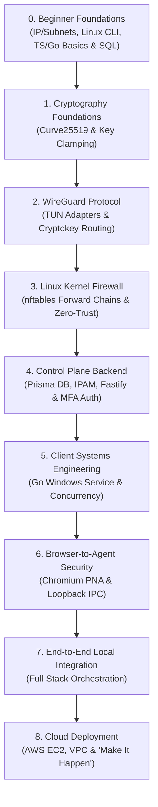
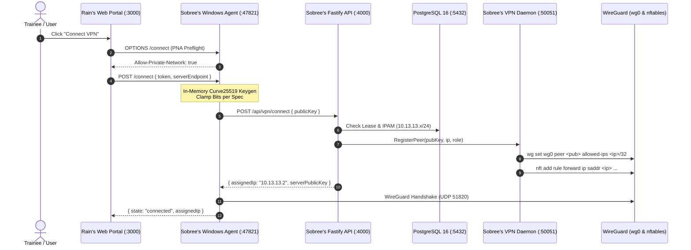

# ⚡ Sobree's Knowledge Base & Learning Path (First to Last)

This guide organizes the essential knowledge, core concepts, **instructor-led YouTube tutorials**, **GitHub repositories**, and **hands-on labs** in the **exact chronological order** you should learn and build them to create MANGO VPN from the ground up.

---

## 🗺️ Learning & Build Roadmap (First to Last)



### Why This Order?
0. **Stage 0 (Absolute Beginner Foundations)** builds the prerequisite vocabulary (what an IP subnet `/24` is, how TCP vs. UDP ports work, how to run Linux terminal commands, and basic programming in TypeScript, SQL, and Go) so none of the later stages feel like magic.
1. **Stage 1 (Cryptography)** comes next because identity in WireGuard *is* a Curve25519 keypair. You must understand how keys are generated and clamped before configuring any tunnel or database.
2. **Stage 2 (WireGuard Protocol)** teaches you how those keys create a virtual network interface (`wg0`) and route encrypted UDP packets (`AllowedIPs`).
3. **Stage 3 (Linux `nftables` Firewall)** turns a basic VPN tunnel into a **Zero-Trust Gateway** (`Sobree/vpn-daemon`) by filtering which internal IPs/ports a connected peer is allowed to reach.
4. **Stage 4 (Control Plane API & Database)** builds the central brain (`Sobree/api`) that authenticates users (OTP + JWT), tracks IP leases (IPAM), and automates Stage 2 & 3.
5. **Stage 5 (Go Windows Agent)** builds the privileged local background service (`Sobree/agent-windows`) that manages client keys in memory and talks to the Control Plane API.
6. **Stage 6 (Chromium PNA & Localhost IPC)** unlocks communication between the Web Portal in the browser and your local Windows Agent on `127.0.0.1:47821`.
7. **Stage 7 (End-to-End Local Lab)** verifies all components working together locally before introducing cloud networking variables.
8. **Stage 8 (AWS Cloud Server)** moves your working local server stack onto a live public cloud instance (AWS EC2).

---

## Stage 0: Absolute Beginner Foundations — Networking, Windows/Linux CLI, Programming & SQL

> **Goal**: Build the essential computer science, networking, command-line (both **Windows PowerShell** and **Linux Bash**), and coding fundamentals needed before diving into VPN systems engineering.

### Core Concepts & Knowledge Base
- **Networking Basics (IPs, CIDR Subnets, TCP vs. UDP, Ports)**:
  - **IPv4 & CIDR Notation**: Understanding what `10.13.13.0/24` (a subnet of 254 usable IPs) vs. `10.13.13.2/32` (a single host IP) means, and what private RFC1918 networks (`10.0.0.0/8`, `172.16.0.0/12`, `192.168.0.0/16`) and loopback (`127.0.0.1`) are.
  - **TCP vs. UDP & Ports**: Why HTTP APIs use **TCP** (reliable, connection-oriented, e.g. port `4000`, `47821`) while WireGuard tunnels use **UDP** (low-latency, connectionless datagrams, port `51820`).
- **Command Line on Both Operating Systems**:
  - **Windows (PowerShell)**: Navigating folders, checking interfaces (`ipconfig`, `Get-NetAdapter`, `Get-NetIPAddress`), checking listening ports (`Get-NetTCPConnection`, `netstat -ano`), and running as Administrator.
  - **Linux (Bash)**: Navigating directories (`cd`, `ls`), inspecting network interfaces (`ip addr`, `ip route`), checking listening sockets (`ss -tulnp`), file permissions (`chmod`, `chown`), and running privileged commands (`sudo`).
- **Programming Fundamentals (Variables, Functions, JSON, HTTP & Async)**:
  - **TypeScript / Node.js**: Used for `Sobree/api` (Control Plane REST API).
  - **Go (Golang)**: Used for `Sobree/agent-windows` (Windows service) and `Sobree/vpn-daemon` (Linux daemon) — compiles natively for both Windows (`.exe`) and Linux ELF binaries.
- **Relational Databases (SQL)**: Tables, rows, primary keys (UUIDs), and foreign keys (linking a `VpnSession` to a `User` and `Device`).

### 🎥 Instructor-Led YouTube Tutorials (Beginner Foundations)
* **Networking & Subnetting**:
  * **[Subnetting Mastery (Part 1 of 7) — Practical Networking (Ed Harmoush)](https://www.youtube.com/watch?v=BWZ-MHIhqjM)** – The clearest visual explanation on YouTube for understanding IP addresses, subnet masks, `/24` vs `/32` CIDR notation, and network ranges.
  * **[You Suck at Subnetting (Episode 1) — NetworkChuck](https://www.youtube.com/watch?v=2-i5x8KCfII)** – Beginner-friendly, energetic walkthrough of binary, IPv4 addresses, and how devices talk on a network.
* **Windows PowerShell & Linux Bash CLI**:
  * **[Learn PowerShell in 1 Video! Complete Beginner's Guide](https://www.youtube.com/watch?v=5FiXyfwXIeI)** & **[PowerShell 7 for Beginners (Full Course)](https://www.youtube.com/watch?v=S16XLOQEiX0)** – Step-by-step introduction to Windows PowerShell cmdlets, pipelines, scripting, and system administration.
  * **[Linux Crash Course for Beginners with Labs — Aaron Lockhart (freeCodeCamp)](https://www.youtube.com/watch?v=6WatcfENsOU)** – Hands-on introduction to the Linux terminal, filesystems, permissions, processes, and basic networking commands.
* **Programming Basics (TypeScript, Go & SQL)**:
  * **[Learn TypeScript in 50 Minutes — PedroTech](https://www.youtube.com/watch?v=3mDny9XAgic)** *(2024)* – Fast, beginner-friendly crash course on variables, functions, interfaces, and types used in `Sobree/api`.
  * **[Go Programming - Full Course — Tech With Tim](https://www.youtube.com/watch?v=V-lI7AmusGs)** *(Feb 2026 • 176K+ views)* – Watch the first half (Variables, Conditions, Loops, Slices, Maps, Functions, Structs) here in Stage 0 before tackling concurrency in Stage 5.
  * **[SQL Full Course for Beginners — freeCodeCamp / GeekCoders](https://www.youtube.com/watch?v=uOCVTbV06ug)** – Covers what tables, primary keys, foreign keys, and `SELECT`/`INSERT` queries are before using Prisma ORM in Stage 4.

### 🛠️ Hands-On Lab 0: Your First Terminal, Network & Code Check (Windows & Linux)
1. **Inspect your computer's IP, routing table, and loopback**:
   * **On Windows (PowerShell)**:
     ```powershell
     ipconfig
     Get-NetIPAddress -AddressFamily IPv4 | Select-Object InterfaceAlias, IPAddress, PrefixLength
     ping 127.0.0.1 -n 3
     ```
   * **On Linux (Bash / WSL / Container)**:
     ```bash
     ip -br addr show
     ip route show
     ping -c 3 127.0.0.1
     ```
2. **Verify your installed developer tools (works on both Windows & Linux)**:
   ```bash
   node -v
   npm -v
   go version
   docker --version
   git --version
   ```
3. **Write & cross-compile a 5-line Go program (`hello.go`) for both OSes**:
   ```go
   package main
   import (
       "fmt"
       "runtime"
   )
   func main() {
       fmt.Printf("Hello Sobree! Running on OS: %s/%s | Subnet: 10.13.13.0/24\n", runtime.GOOS, runtime.GOARCH)
   }
   ```
   - Run natively: `go run hello.go`
   - Cross-compile for Windows (`.exe`) and Linux binary from either OS:
     - **PowerShell**: `$env:GOOS="linux"; $env:GOARCH="amd64"; go build -o hello-linux hello.go`
     - **Bash**: `GOOS=windows GOARCH=amd64 go build -o hello-windows.exe hello.go`

---

## Stage 1: Cryptography Foundations — Curve25519 & Key Clamping

> **Goal**: Understand how VPN peer identities are created in memory without ever touching disk ([`Sobree/agent-windows/main.go`](file:///E:/Trainee/Mango_VPN_Trainee/Sobree/agent-windows/main.go)).

### Core Concepts & Knowledge Base
- **Elliptic Curve Cryptography (ECC)**: Curve25519 is a Montgomery curve designed for use with the Diffie-Hellman key exchange (X25519).
- **Scalar Multiplication**: Generating a public key from a private key via `curve25519.ScalarBaseMult(&pub, &priv)`.
- **Bit Clamping**: WireGuard requires clamping the 32-byte private key scalar:
  ```go
  priv[0] &= 248  // Clear the lowest 3 bits (makes scalar a multiple of 8, avoiding small subgroup attacks)
  priv[31] &= 127 // Clear the highest bit
  priv[31] |= 64  // Set the second-highest bit (ensures constant-time execution)
  ```
- **In-Memory Security**: Keeping private keys strictly in process memory and never writing `.conf` files to disk.

### 🎥 Instructor-Led YouTube Tutorials & GitHub Resources
* **YouTube (With Instructor Teaching)**:
  * **[Secret Key Exchange (Diffie-Hellman) — Taught by Dr. Mike Pound (Computerphile)](https://www.youtube.com/watch?v=NmM9HA2MQGI)** – Visual whiteboard/paper explanation of how two peers agree on a shared secret over an untrusted network.
  * **[Diffie-Hellman: The Mathematics Bit — Taught by Dr. Mike Pound (Computerphile)](https://www.youtube.com/watch?v=VO_0Dx5wjAA)** – Step-by-step walkthrough of the one-way math behind public and private keys.
  * **[Elliptic Curves & Curve25519 — Taught by Dr. Mike Pound (Computerphile)](https://www.youtube.com/watch?v=NF1pwjL9-DE)** – Explains how elliptic curve point multiplication (`ScalarBaseMult`) works and why Curve25519 is the gold standard for modern VPNs.
* **GitHub**:
  * [golang/crypto/curve25519](https://github.com/golang/crypto/tree/master/curve25519) – Go official package implementation of Curve25519 scalar multiplication.

### 🛠️ Hands-On Lab 1: Curve25519 Keypair & Clamping in Go
* **Interactive Workshop Repos**:
  * [quii/learn-go-with-tests](https://github.com/quii/learn-go-with-tests) – TDD-based Go tutorial with hands-on exercises for byte manipulation and slices.
* **Step-by-Step Lab Exercise (Local Go)**:
  Create a file `curve_lab.go` and run with `go run curve_lab.go`:
  ```go
  package main

  import (
      "crypto/rand"
      "encoding/base64"
      "fmt"
      "golang.org/x/crypto/curve25519"
  )

  func main() {
      // 1. Generate 32 random bytes
      var priv [32]byte
      rand.Read(priv[:])
      fmt.Printf("Raw Byte 0:  %08b\n", priv[0])
      fmt.Printf("Raw Byte 31: %08b\n", priv[31])

      // 2. Clamp bits per WireGuard specification
      priv[0] &= 248
      priv[31] &= 127
      priv[31] |= 64
      fmt.Printf("Clamped Byte 0:  %08b (Lowest 3 bits cleared)\n", priv[0])
      fmt.Printf("Clamped Byte 31: %08b (Bit 6 set, Bit 7 cleared)\n", priv[31])

      // 3. Compute Public Key
      var pub [32]byte
      curve25519.ScalarBaseMult(&pub, &priv)

      fmt.Println("Base64 Private Key:", base64.StdEncoding.EncodeToString(priv[:]))
      fmt.Println("Base64 Public Key: ", base64.StdEncoding.EncodeToString(pub[:]))
  }
  ```

---

## Stage 2: WireGuard Architecture & Cryptokey Routing

> **Goal**: Learn how WireGuard uses Curve25519 keys to build virtual network tunnels and route packets ([`Sobree/vpn-daemon/main.go`](file:///E:/Trainee/Mango_VPN_Trainee/Sobree/vpn-daemon/main.go)).

### Core Concepts & Knowledge Base
- **Cryptokey Routing**: Unlike traditional VPNs that route based on IP table interfaces alone, WireGuard maintains an internal mapping between peer public keys and allowed IP ranges (`AllowedIPs`). Every outgoing packet is matched against an allowed IP to identify the destination public key and encrypt accordingly; every incoming packet is decrypted and checked to ensure the inner source IP matches the peer's `AllowedIPs`.
- **Stateless-like UDP Design**: WireGuard sends no packets when idle (avoiding battery and network drain) and performs handshakes silently every few minutes when traffic flows.
- **Virtual Network Adapters**: Layer 3 TUN interfaces (Linux `wg0`) and `Wintun` / `WireGuard-NT` on Windows.
- **Dynamic Peer Registration**: Executing `wg set <interface> peer <pubkey> allowed-ips <ip>/32` programmatically from daemons without restarting the interface.

### 🎥 Instructor-Led YouTube Tutorials & GitHub Resources
* **YouTube (With Instructor Teaching)**:
  * **[Build Your OWN WireGuard VPN! Here's How — Jeff Geerling](https://www.youtube.com/watch?v=5NJ6V8i1Xd8)** *(2023 • 604K+ views)* – Popular, hands-on walkthrough of building and routing a WireGuard VPN server from scratch.
  * **[How To Set Up WG-Easy (WireGuard Easy) VPN Server on Ubuntu Linux — Websplaining](https://www.youtube.com/watch?v=MwZ-Psa8q7M)** *(Oct 2025 • 16K+ views)* – Modern `wg-easy v15` deployment on an Ubuntu Linux VPS with Docker and web UI management.
  * **[Setup Your Own VPN in Minutes with wg-easy (2026 Guide) — ServersatHome](https://www.youtube.com/watch?v=BMfwVxQH_gg)** *(Mar 2026 • 12K+ views)* – Up-to-date 2026 Docker Compose WireGuard walkthrough covering peer profiles and secure remote access.
  * **[WireGuard: Next Generation Secure Network Tunnel — Jason A. Donenfeld (Creator of WireGuard)](https://www.youtube.com/watch?v=F5S4MpTuyoo)** *(Protocol Reference)* – Lecture by WireGuard's creator explaining Cryptokey Routing (`AllowedIPs`), handshake timers, and kernel architecture.
* **GitHub**:
  * [WireGuard/wireguard-go](https://github.com/WireGuard/wireguard-go) – Official user-space implementation in Go showing peer management, cryptographic handshake state machines, and TUN device interfacing.
  * [WireGuard/wintun](https://github.com/WireGuard/wintun) – Official high-performance Layer 3 TUN driver for the Windows kernel.

### 🛠️ Hands-On Lab 2: WireGuard Peer-to-Peer & Dynamic Peer Registration
* **Interactive Workshop Repos**:
  * [wg-easy/wg-easy](https://github.com/wg-easy/wg-easy) – Run WireGuard in Docker Compose with instant UI and QR code generation for peer connection practice.
  * [linuxserver/docker-wireguard](https://github.com/linuxserver/docker-wireguard) – Production container lab for testing kernel-module vs. user-space WireGuard.
* **Step-by-Step Lab Exercise (Linux / Docker)**:
  1. Start a temporary Linux container with `NET_ADMIN` capability:
     ```bash
     docker run -it --rm --cap-add=NET_ADMIN --device /dev/net/tun alpine /bin/sh
     ```
  2. Install WireGuard tools:
     ```bash
     apk add wireguard-tools iproute2
     ```
  3. Generate server and client keys using pure CLI:
     ```bash
     wg genkey | tee server.key | wg pubkey > server.pub
     wg genkey | tee client.key | wg pubkey > client.pub
     ```
  4. Create virtual interface `wg0` and assign an IP:
     ```bash
     ip link add dev wg0 type wireguard
     ip address add 10.13.13.1/24 dev wg0
     wg set wg0 private-key server.key listen-port 51820
     ip link set up dev wg0
     ```
  5. Test dynamic peer addition (simulating `Sobree/vpn-daemon`):
     ```bash
     wg set wg0 peer $(cat client.pub) allowed-ips 10.13.13.2/32
     wg show wg0
     ```
  6. Observe how the peer appears dynamically without dropping active connections.
* **Step-by-Step Lab Exercise (Windows — `Wintun` & WireGuard CLI)**:
  1. Install the official WireGuard for Windows client (which includes `wireguard.exe`, `wg.exe`, and the `Wintun`/`WireGuard-NT` kernel driver) via Winget in PowerShell (Admin):
     ```powershell
     winget install WireGuard.WireGuard
     ```
  2. Generate keys in Windows PowerShell using `wg.exe`:
     ```powershell
     $priv = wg.exe genkey
     $pub  = $priv | wg.exe pubkey
     Write-Host "Windows Client Public Key: $pub"
     ```
  3. Inspect active WireGuard adapters on Windows:
     ```powershell
     wg.exe show
     Get-NetAdapter | Where-Object { $_.InterfaceDescription -match "WireGuard" }
     ```

---

## Stage 3: Linux Kernel Packet Filtering (`nftables` & Zero-Trust Policy)

> **Goal**: Enforce role-based network segmentation (`CLIENT`, `STAFF`, `ADMIN`) on traffic exiting the WireGuard tunnel ([`Sobree/vpn-daemon/main.go`](file:///E:/Trainee/Mango_VPN_Trainee/Sobree/vpn-daemon/main.go)).

### Core Concepts & Knowledge Base
- **Netfilter Architecture**: Modern successor to `iptables`, providing unified bytecode execution, sets, maps, and atomic rule swapping.
- **Forward Chain Isolation**: Enforcing default drop policies on routed VPN traffic:
  ```nftables
  table inet mango_vpn {
      chain forward {
          type filter hook forward priority 0; policy drop;
          ct state established,related accept
      }
  }
  ```
- **Role-Based Dynamic Access**: Injecting and removing stateful rules dynamically based on peer role:
  - `CLIENT`: Specific target hosts on designated ports (e.g., HTTP/HTTPS).
  - `STAFF`: Internal RFC1918 subnets (`10.0.0.0/8`, `172.16.0.0/12`).
  - `ADMIN`: Unrestricted forwarding (`0.0.0.0/0`).
- **IP Forwarding & NAT**: Enabling kernel forwarding (`sysctl net.ipv4.ip_forward=1`) and masquerading when routing traffic outward.

### 🎥 Instructor-Led YouTube Tutorials & GitHub Resources
* **YouTube (With Instructor Teaching)**:
  * **[Implementing a Linux Firewall with firewalld and nftables — Red Hat Enterprise Linux](https://www.youtube.com/watch?v=YJZV79C-rNU)** *(Oct 2025 • 8K+ views)* – Recent RHEL engineering session demonstrating how `nftables` handles packet filtering and rule management under the hood.
  * **[Master Linux nftables Firewall Rules — Learn with Imran Afzal](https://www.youtube.com/watch?v=241wRdWEX1Y)** *(May 2026)* – Up-to-date terminal demonstration of writing rules, filtering ports, stateful connection tracking (`ct state`), and dropping unauthorized traffic.
* **GitHub**:
  * [chri/nftables-cheat-sheet](https://github.com/chri/nftables-cheat-sheet) – Quick-reference cheat sheet for rule syntax, sets, and stateful filtering.
  * [fluffy327/nftables-examples](https://github.com/fluffy327/nftables-examples) – Well-structured production `nftables.conf` examples and templates.

### 🛠️ Hands-On Lab 3: Network Namespaces & Stateful `nftables` Forward Chain
* **Interactive Workshop Repos**:
  * [biswajitdasdev/understanding-network-namespace](https://github.com/biswajitdasdev/understanding-network-namespace) – Complete tutorial on building isolated virtual networks on Linux using network namespaces.
* **Step-by-Step Lab Exercise (Linux / Gateway Container)**:
  Inside the running `vpn-gateway` container (`docker compose exec vpn-gateway bash`):
  1. Inspect the default base table created by `Sobree/vpn-daemon`:
     ```bash
     nft list table inet mango_vpn
     ```
  2. Test adding a base zero-trust table manually:
     ```bash
     nft add table inet test_vpn
     nft add chain inet test_vpn forward '{ type filter hook forward priority 0; policy drop; }'
     nft add rule inet test_vpn forward ct state established,related accept
     ```
  3. Simulate dynamic role injection for a client (`10.13.13.2` accessing Web server `10.0.0.5:443`):
     ```bash
     nft add rule inet test_vpn forward ip saddr 10.13.13.2 ip daddr 10.0.0.5 tcp dport 443 accept
     ```
  4. View rule handles for atomic deletion (when peer disconnects):
     ```bash
     nft -a list chain inet test_vpn forward
     # Output shows: ... ip daddr 10.0.0.5 # handle 4
     nft delete rule inet test_vpn forward handle 4
     ```

---

## Stage 4: Central Control Plane — Fastify, Prisma ORM, Auth & IPAM

> **Goal**: Build the central management API and PostgreSQL schema that authenticates users, assigns IPs, and orchestrates the WireGuard daemon ([`Sobree/api/`](file:///E:/Trainee/Mango_VPN_Trainee/Sobree/api/)).

### Core Concepts & Knowledge Base
- **Prisma Relational Modeling**:
  - Designing the 8 core tables in [`Sobree/api/prisma/schema.prisma`](file:///E:/Trainee/Mango_VPN_Trainee/Sobree/api/prisma/schema.prisma) (`User`, `Device`, `VpnPeer`, `VpnSession`, `IpAllocation`, `RolePolicy`, `AgentVersion`, `AuditLog`).
  - UUID primary keys, foreign key constraints, indexes, and automated migrations (`npx prisma migrate dev`).
- **Zero-Trust Auth & MFA**:
  - Secure password hashing using `bcrypt`.
  - Step 1-4 auth flows ([`Sobree/api/src/modules/auth/`](file:///E:/Trainee/Mango_VPN_Trainee/Sobree/api/src/modules/auth/)): credential verification, generating 6-digit OTP challenges, OTP verification, and JWT token issuance with role payloads.
- **IPAM (IP Address Management)**: Subnet allocation algorithm ([`Sobree/api/src/modules/vpn/`](file:///E:/Trainee/Mango_VPN_Trainee/Sobree/api/src/modules/vpn/)) managing `/24` subnets (`10.13.13.0/24`), leasing unallocated IPs, and releasing expired sessions.
- **Fastify Framework**: High-throughput, low-overhead Node.js/TypeScript HTTP framework with plugin modularity (mounting `@mango/rain-admin`).

### 🎥 Instructor-Led YouTube Tutorials & GitHub Resources
* **YouTube (With Instructor Teaching)**:
  * **[Prisma ORM Full Course 2025 | Become a Prisma Pro in 2.5 Hours — PedroTech](https://www.youtube.com/watch?v=gimSKEsWYb4)** *(Jun 2025 • 114K+ views)* – Popular modern masterclass covering `schema.prisma`, relations, migrations, and Prisma Client queries.
  * **[Fastify Crash Course 2026 | Prisma, Hooks, Decorators, Plugins — Tushar Vashishth](https://www.youtube.com/watch?v=9GmYxoEBqtg)** *(Oct 2025 • 5K+ views)* – Full backend walkthrough combining Fastify + Prisma ORM + Authentication middleware (the exact stack used in `Sobree/api`).
* **GitHub**:
  * [prisma/prisma-examples](https://github.com/prisma/prisma-examples) – Official database design patterns, relational modeling, and authentication setups.
  * [fastify/fastify](https://github.com/fastify/fastify) – Core Fastify repository with TypeScript configuration examples.

### 🛠️ Hands-On Lab 4: Database Migrations & Auth Testing in MANGO VPN
* **Step-by-Step Lab Exercise**:
  1. Boot PostgreSQL container from root:
     ```powershell
     docker compose up -d postgres
     ```
  2. Navigate to Sobree's API directory and run migrations:
     ```powershell
     cd Sobree/api
     npx prisma migrate dev --name init_schema
     ```
  3. Populate sample users and roles using Rain's seed script:
     ```powershell
     npm run db:seed
     ```
  4. Launch Prisma Studio to visually inspect tables, UUID relations, and indexes in your browser:
     ```powershell
     npx prisma studio
     ```
     Open `http://localhost:5555`.
  5. Start the Fastify API:
     ```powershell
     npm run dev
     ```
  6. In another terminal, test Step 1-2 Auth (Login Challenge):
     * **Windows (PowerShell)**:
       ```powershell
       curl.exe -X POST http://localhost:4000/api/auth/login `
         -H "Content-Type: application/json" `
         -d '{\"username\":\"admin_user\",\"password\":\"AdminPass123!\"}'
       ```
     * **Linux (Bash)**:
       ```bash
       curl -X POST http://localhost:4000/api/auth/login \
         -H "Content-Type: application/json" \
         -d '{"username":"admin_user","password":"AdminPass123!"}'
       ```
     Check the API console output to view the 6-digit OTP challenge printed directly to stdout for rapid testing!

---

## Stage 5: Systems Engineering in Go — Windows Services (`svc`) & Linux Daemons (`systemd`)

> **Goal**: Build and manage privileged background services in Go on **both Windows** ([`Sobree/agent-windows/main.go`](file:///E:/Trainee/Mango_VPN_Trainee/Sobree/agent-windows/main.go)) and **Linux** ([`Sobree/vpn-daemon/main.go`](file:///E:/Trainee/Mango_VPN_Trainee/Sobree/vpn-daemon/main.go)).

### Core Concepts & Knowledge Base
- **Windows Service Architecture (`Sobree/agent-windows`)**:
  - **Windows Service Control Manager (SCM)**: Registering and managing background processes via `golang.org/x/sys/windows/svc`.
  - **`LocalSystem` Security Context**: Running with administrative privileges to manage network routes and virtual adapters without interactive user sessions.
  - **Service Handler Lifecycle**: Handling `svc.Handler` transitions (`Start`, `Stop`, `Interrogate`, `Shutdown`).
- **Linux Daemon Architecture (`Sobree/vpn-daemon`)**:
  - **Linux `systemd` Units**: Running compiled Go binaries as persistent Linux background services (`/etc/systemd/system/mango-vpn-daemon.service`) with `Restart=on-failure` and `CAP_NET_ADMIN`.
  - **Unix Domain Sockets & Signals**: Listening on `/var/run/mango-vpn.sock` (with TCP port `50051` fallback for local dev) and catching OS termination signals (`os/signal`, `syscall.SIGINT`, `syscall.SIGTERM`) for graceful cleanup.
- **Cross-Platform Go Concurrency & Thread Safety**:
  - Using `sync.RWMutex` and `sync.Mutex` to protect in-memory tunnel state and serialize `wg`/`nft` command execution across concurrent HTTP requests.

### 🎥 Instructor-Led YouTube Tutorials & GitHub Resources
* **YouTube (Go Programming & Concurrency)**:
  * **[Go Programming - Full Course — Tech With Tim](https://www.youtube.com/watch?v=V-lI7AmusGs)** *(Feb 2026 • 176K+ views)* – Popular 2026 Go course covering types, slices, maps, pointers, structs, and goroutines.
  * **[Golang Full Course 2026 — Sangam Mukherjee](https://www.youtube.com/watch?v=DR4QhvIlFfQ)** *(Jan 2026 • 93K+ views)* – Backend-focused 2026 Go course covering `net/http`, project structure, JWT auth, and concurrency.
  * **[Golang Production-grade Backend Full Course — Coder's Gyan](https://www.youtube.com/watch?v=LCZAqXEeePI)** *(Oct 2026 • 40K+ views)* – Recent one-shot production Go backend tutorial with structured logging and clean architecture.
  * **[Mutex Basics in Go — Gary Clarke](https://www.youtube.com/watch?v=D4avInS_vME)** *(Mar 2026)* & **[Go Mutex Tutorial: sync.Mutex & RWMutex — CodeLucky](https://www.youtube.com/watch?v=u0Yr-mCiHaU)** *(Sep 2025)* – Live coding walkthroughs showing how `sync.RWMutex` protects shared state (like `TunnelState` in `Sobree/agent-windows/main.go`).
* **YouTube (Linux `systemd` Services & Daemons)**:
  * **[How Linux systemd Works (Writing Unit Files Step-by-Step)](https://www.youtube.com/watch?v=Z50E2qS6Yg0)** – Deep dive into PID 1, creating `.service` unit files, `systemctl enable/start`, and automatic crash recovery.
  * **[Anatomy of a Linux Service: Step-by-Step systemctl Guide — Red Hat Into the Terminal](https://www.youtube.com/watch?v=VLt2b3iNUgg)** – Practical walkthrough of daemon lifecycles and inspecting logs with `journalctl`.
* **GitHub**:
  * [golang/sys/windows/svc/example](https://github.com/golang/sys/tree/master/windows/svc/example) – The official Go team sample demonstrating Windows SCM dispatching, interactive vs. service detection, and event logging.
  * [kardianos/service](https://github.com/kardianos/service) – Cross-platform service architecture in Go covering Windows SCM, Linux `systemd`, and macOS `launchd`.

### 🛠️ Hands-On Lab 5A (Windows): Compiling & Controlling the Windows Agent (`sc.exe`)
* **Step-by-Step Lab Exercise (Windows PowerShell as Admin)**:
  1. Test interactive console debugging (no SCM registration required):
     ```powershell
     cd Sobree/agent-windows
     go run main.go -debug
     ```
  2. In another terminal, query the loopback agent:
     ```powershell
     curl.exe http://127.0.0.1:47821/health
     curl.exe http://127.0.0.1:47821/status
     ```
  3. Compile into a production standalone Windows `.exe` binary:
     ```powershell
     go build -o bin/mango-agent-windows.exe .
     ```
  4. Register and run via Windows Service Control Manager (SCM):
     ```powershell
     sc.exe create MangoVpnAgent binPath= "E:\Trainee\Mango_VPN_Trainee\Sobree\agent-windows\bin\mango-agent-windows.exe" start= auto
     sc.exe start MangoVpnAgent
     sc.exe query MangoVpnAgent
     ```
  5. Check Windows Event Viewer (`eventvwr.msc` -> Application Logs) to see service start events.
  6. Stop and remove the test service:
     ```powershell
     sc.exe stop MangoVpnAgent
     sc.exe delete MangoVpnAgent
     ```

### 🛠️ Hands-On Lab 5B (Linux): Compiling & Running the VPN Daemon with `systemd`
* **Step-by-Step Lab Exercise (Linux Host / Ubuntu VM / WSL with systemd)**:
  1. Compile the Linux VPN Policy Daemon (`Sobree/vpn-daemon`):
     ```bash
     cd Sobree/vpn-daemon
     go build -o mango-vpn-daemon .
     sudo mv mango-vpn-daemon /usr/local/bin/
     ```
  2. Create a `systemd` unit file at `/etc/systemd/system/mango-vpn-daemon.service`:
     ```ini
     [Unit]
     Description=MANGO VPN WireGuard & nftables Policy Daemon
     After=network.target

     [Service]
     Type=simple
     User=root
     ExecStart=/usr/local/bin/mango-vpn-daemon
     Restart=on-failure
     RestartSec=5

     [Install]
     WantedBy=multi-user.target
     ```
  3. Reload `systemd`, start the daemon, and inspect live logs with `journalctl`:
     ```bash
     sudo systemctl daemon-reload
     sudo systemctl enable --now mango-vpn-daemon
     sudo systemctl status mango-vpn-daemon
     sudo journalctl -u mango-vpn-daemon -f
     ```
  4. Test querying the daemon over its Unix Domain Socket (`/var/run/mango-vpn.sock`) on Linux:
     ```bash
     curl --unix-socket /var/run/mango-vpn.sock http://localhost/health
     ```

---

## Stage 6: Browser-to-Agent Bridge — Chromium Private Network Access (PNA) & CORS

> **Goal**: Allow the React Web Portal (`http://localhost:3000`) to securely trigger the local Windows Agent (`http://127.0.0.1:47821`) across browser security boundaries.

### Core Concepts & Knowledge Base
- **Chromium PNA Specification**: Security mechanism preventing public internet websites from attacking devices on private networks (`localhost`, RFC1918 IP addresses).
- **CORS Preflight Headers**: When the Web Portal sends requests to the local Windows Agent loopback at `http://127.0.0.1:47821`, the browser issues an `OPTIONS` preflight with `Access-Control-Request-Private-Network: true`.
- **Agent Server Header Requirements**:
  ```http
  Access-Control-Allow-Origin: *
  Access-Control-Allow-Methods: GET, POST, OPTIONS
  Access-Control-Allow-Headers: Content-Type, Authorization
  Access-Control-Allow-Private-Network: true
  ```
- **Loopback Binding**: Strictly binding to `127.0.0.1` (never `0.0.0.0`) to prevent external LAN access to the agent.

### 🎥 Instructor-Led YouTube Tutorials & GitHub Resources
* **YouTube (With Instructor Teaching)**:
  * **[Stop Copying CORS Headers - CORS Explained — LearnThatStack](https://www.youtube.com/watch?v=cGg7aRcIm8o)** *(Apr 2026 • 39K+ views)* – Popular 2026 deep dive into same-origin policy, `OPTIONS` preflight requests, response headers, and systematic browser debugging.
  * **[Ultimate Guide To CORS — Train To Code](https://www.youtube.com/watch?v=3KaBzxLIgCo)** *(May 2025)* – Practical walkthrough of Cross-Origin Resource Sharing and resolving common browser preflight errors.
* **GitHub & Specifications**:
  * [WICG/private-network-access](https://github.com/WICG/private-network-access) – Official W3C Web Platform Incubator Community Group repository for the PNA specification.
  * [WICG PNA HOWTO.md](https://github.com/WICG/private-network-access/blob/main/HOWTO.md) – Step-by-step developer guide for passing preflight checks and troubleshooting browser console errors.

### 🛠️ Hands-On Lab 6: PNA Preflight Simulation with cURL & Browser DevTools
* **Step-by-Step Lab Exercise**:
  1. Ensure the local agent (`Sobree/agent-windows` or `npm run mock:agent` on Linux/macOS/Windows) is running on port `47821`.
  2. Simulate Chromium's exact PNA preflight check using `curl`:
     * **Windows (PowerShell)**:
       ```powershell
       curl.exe -i -X OPTIONS http://127.0.0.1:47821/connect `
         -H "Origin: http://localhost:3000" `
         -H "Access-Control-Request-Method: POST" `
         -H "Access-Control-Request-Headers: Content-Type" `
         -H "Access-Control-Request-Private-Network: true"
       ```
     * **Linux (Bash)**:
       ```bash
       curl -i -X OPTIONS http://127.0.0.1:47821/connect \
         -H "Origin: http://localhost:3000" \
         -H "Access-Control-Request-Method: POST" \
         -H "Access-Control-Request-Headers: Content-Type" \
         -H "Access-Control-Request-Private-Network: true"
       ```
  3. Verify the HTTP response contains:
     - `HTTP/1.1 204 No Content` (or `200 OK`)
     - `Access-Control-Allow-Private-Network: true`
     - `Access-Control-Allow-Origin: *`
  4. Open your browser console on any external web page (e.g. `https://example.com`) and run:
     ```javascript
     fetch("http://127.0.0.1:47821/health")
       .then(r => r.json())
       .then(console.log)
       .catch(console.error);
     ```
     Inspect the **Network tab** to observe the preflight `OPTIONS` and ensuing `GET` request succeeding.

---

## Stage 7: 🚀 Full End-to-End Local Integration Lab

> **Goal**: Connect Stages 1–6 together on your machine using Docker Compose and verify the complete lifecycle from MFA Login to active WireGuard tunnel.

### 🎥 Instructor-Led YouTube Tutorials
* **[Ultimate Docker Compose Tutorial — TechWorld with Nana](https://www.youtube.com/watch?v=SXwC9fSwct8)** *(2024 • 399K+ views)* – Step-by-step walkthrough of orchestrating multi-container stacks (`docker-compose.yml`), container networking, and port mapping.
* **[Docker Compose Tutorial | Docker for Beginners — KodeKloud](https://www.youtube.com/watch?v=iOGEBj7Ozak)** *(Apr 2025 • 7K+ views)* – Hands-on multi-container stack tutorial covering service dependencies, networking, and deployment.



### 🛠️ Hands-On Lab 7: Running the Full Stack Locally
1. **Terminal 1 (Infrastructure Containers)**:
   ```powershell
   docker compose up -d postgres vpn-gateway
   ```
2. **Terminal 2 (Database Seeding & Fastify API)**:
   ```powershell
   npm run db:migrate
   npm run db:seed
   npm run dev:api
   ```
3. **Terminal 3 (Windows Agent in Debug Mode)**:
   ```powershell
   cd Sobree/agent-windows
   go run main.go -debug
   ```
4. **Terminal 4 (Web Portal UI)**:
   ```powershell
   npm run dev:portal
   ```
5. Open `http://localhost:3000`, log in with `admin_user` / `AdminPass123!`, enter the OTP shown in Terminal 2, and click **CONNECT**. Observe the agent generate keys, register with the API, and establish the tunnel!

---

## Stage 8: ☁️ Production Cloud Deployment — AWS Server & "Make It Happen" Tutorials

> **Goal**: Take your working local server stack (Stages 2, 3, and 4) and deploy it onto a real public cloud server on **Amazon Web Services (AWS)**.

### Core Cloud Concepts for Systems & VPN Engineers
1. **Amazon EC2 (Elastic Compute Cloud)**:
   - Running the Linux Gateway container and Fastify Control Plane API on an Ubuntu 24.04 LTS instance (e.g. `t3.micro` under the AWS Free Tier).
2. **VPC Networking & Security Groups**:
   - Configuring virtual firewall rules for the cloud instance:
     - **Inbound UDP 51820**: WireGuard VPN handshake & encrypted tunnel traffic (Open to `0.0.0.0/0` or corporate CIDR).
     - **Inbound TCP 4000 / 443**: Fastify Control Plane API for authentication and peer registration.
     - **Inbound TCP 22**: SSH administration (restricted to your personal IP `YOUR_IP/32`).
3. **⚠️ The Critical AWS VPN Gateway Gotcha: "Source/Destination Check"**:
   - By default, AWS EC2 drops all network packets whose source or destination IP does not match the private IP assigned to the instance's Elastic Network Interface (ENI).
   - Because a WireGuard gateway routes packets on behalf of client subnets (e.g. `10.13.13.0/24`), you **MUST disable Source/Destination Checking** on the EC2 instance in the AWS Console, otherwise the cloud will drop routed client traffic!
4. **Elastic IP (EIP)**:
   - Assigning a persistent public IPv4 address to the EC2 instance so clients connect to a stable `serverEndpoint` that survives instance stops and restarts.

### 🎥 Instructor-Led YouTube Tutorials & Official AWS Platforms

#### 1. Instructor-Led YouTube Courses for AWS EC2 & Cloud VPNs
* **[AWS Certified Cloud Practitioner Full Course 2026 (CLF-C02) — Andrew Brown (freeCodeCamp)](https://www.youtube.com/watch?v=7HKot-brXFE)** *(May 2026 • 540K+ views)* – Up-to-date 2026 full course with step-by-step AWS Console labs covering EC2 instances, VPCs, Security Groups, and Elastic IPs.
* **[AWS Tutorial for Beginners: Step-by-Step Guide — Kevin Stratvert](https://www.youtube.com/watch?v=Nzv-tzU-UAw)** *(Apr 2025 • 388K+ views)* – Popular, clear walkthrough of core AWS cloud services, launching servers, and cloud networking basics.
* **[How To Build Your Own WireGuard VPN Server in the Cloud — Tom Lawrence (Lawrence Systems)](https://www.youtube.com/watch?v=7yC-gJtl9mQ)** *(184K+ views)* – Real-world architectural walkthrough of deploying and routing a WireGuard VPN gateway in the cloud.
* **[Official AWS Online Tech Talks Channel](https://www.youtube.com/@AWSOnlineTechTalks)** – Live technical deep-dives and architecture sessions taught by AWS Solutions Architects.

#### 2. AWS Workshop Studio (Official Hands-on Sandbox)
* **URL**: [workshops.aws](https://workshops.aws/)
* **How to use**: Search for **"Amazon EC2"**, **"VPC Networking"**, or **"Docker on AWS"**.
* **Recommended Workshops**:
  * *Amazon EC2 Foundations*: Covers instance launching, key pairs, user-data startup scripts, and EBS storage.
  * *AWS Networking Basics / VPC Workshop*: Hands-on practice creating subnets, route tables, internet gateways, and security group filtering.

#### 3. AWS Builder & Hands-On Tutorials ("Make It Happen" Tracks)
* **URL**: [aws.amazon.com/getting-started/hands-on](https://aws.amazon.com/getting-started/hands-on/)
* **How to use**: Provides step-by-step 10-to-20 minute self-paced guides categorized by difficulty level (100 to 300). Filter by:
  * **Compute -> Run Docker Containers on EC2**
  * **Databases -> Connect Node.js Application to PostgreSQL on AWS**

#### 4. AWS Skill Builder
* **URL**: [skillbuilder.aws](https://skillbuilder.aws/)
* **How to use**: Amazon’s official digital learning portal. Offers free self-paced paths such as **AWS Cloud Practitioner Essentials** and interactive game-based labs (**AWS Cloud Quest: Cloud Practitioner**).

### 🛠️ Hands-On Lab 8: Deploying MANGO VPN Gateway & Server to AWS EC2

#### Step 1: Launch an AWS EC2 Free Tier Instance
1. Sign in to the [AWS Management Console](https://console.aws.amazon.com/ec2/).
2. Select your closest AWS Region (e.g. `ap-southeast-1` Singapore or `us-east-1`).
3. Click **Launch Instance**:
   - **Name**: `mango-vpn-server`
   - **AMI**: Ubuntu Server 24.04 LTS (HVM), SSD Volume Type (Free tier eligible)
   - **Instance Type**: `t3.micro` or `t2.micro`
   - **Key Pair**: Create new or select existing `.pem` key pair for SSH.

#### Step 2: Configure the Security Group (Virtual Firewall)
Under **Network settings**, create a Security Group with these Inbound Rules:
| Type | Protocol | Port Range | Source | Purpose |
| :--- | :--- | :--- | :--- | :--- |
| **SSH** | TCP | `22` | `My IP` | Secure server management |
| **Custom UDP** | UDP | `51820` | `0.0.0.0/0` | WireGuard client tunnel traffic |
| **Custom TCP** | TCP | `4000` | `0.0.0.0/0` | MANGO Fastify Management API |
| **HTTP** | TCP | `80` | `0.0.0.0/0` | (Optional) Web portal |

#### Step 3: Disable EC2 Source/Destination Check (Critical!)
1. In the EC2 Instances list, right-click `mango-vpn-server`.
2. Go to **Networking** -> **Change source/dest. check**.
3. Check **Stop** (Disable) and click **Save**.
   *(This allows the Linux kernel on EC2 to forward packets from `10.13.13.0/24` to internal or external destinations).*

#### Step 4: Allocate an Elastic IP
1. Go to **EC2 Console -> Network & Security -> Elastic IPs**.
2. Click **Allocate Elastic IP address**.
3. Select the allocated IP, click **Actions -> Associate Elastic IP address**, and choose your `mango-vpn-server` instance.
4. Note your public IP (e.g. `54.255.x.x`).

#### Step 5: SSH into EC2 & Install Docker + Networking Toolchain
* **On Linux / macOS**: Restrict `.pem` key permissions first, then SSH:
  ```bash
  chmod 400 your-key.pem
  ssh -i "your-key.pem" ubuntu@YOUR_ELASTIC_IP
  ```
* **On Windows (PowerShell)**:
  ```powershell
  ssh -i "your-key.pem" ubuntu@YOUR_ELASTIC_IP
  ```
Inside the Ubuntu EC2 server, install Docker and the systems networking toolchain:
```bash
sudo apt-get update && sudo apt-get install -y docker.io docker-compose-v2 wireguard-tools nftables
sudo usermod -aG docker ubuntu
newgrp docker
```

#### Step 6: Deploy MANGO VPN Server on EC2
1. Clone your project or transfer the server files:
   ```bash
   git clone <YOUR_REPO_URL> mango-vpn
   cd mango-vpn
   ```
2. Enable kernel packet forwarding on the AWS host:
   ```bash
   sudo sysctl -w net.ipv4.ip_forward=1
   echo "net.ipv4.ip_forward=1" | sudo tee -a /etc/sysctl.conf
   ```
3. Start the infrastructure containers:
   ```bash
   docker compose up -d postgres vpn-gateway
   ```
4. Verify the gateway container has bound to UDP port `51820` on the AWS instance:
   ```bash
   docker compose ps
   sudo ss -ulnp | grep 51820
   ```

#### Step 7: Test Remote Client Handshake
1. On your Windows development machine, update the server endpoint in [`Sobree/agent-windows/main.go`](file:///E:/Trainee/Mango_VPN_Trainee/Sobree/agent-windows/main.go) or through your Web Portal connection payload to point to your **AWS Elastic IP**:
   ```json
   {
     "serverEndpoint": "54.255.x.x:51820"
   }
   ```
2. Initiate connection from the Windows Agent:
   ```powershell
   cd Sobree/agent-windows
   go run main.go -debug
   ```
3. Check the AWS EC2 server logs to observe the remote handshake succeed across the public cloud:
   ```bash
   sudo wg show
   ```
   You will see the peer public key, latest handshake timestamp, and transfer counters incrementing in real-time!
