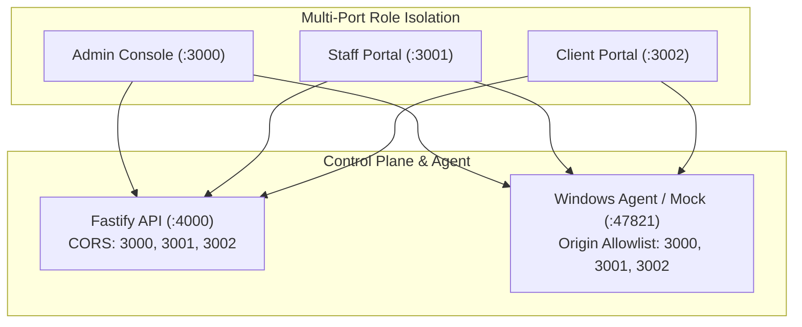

# PR: Full-Screen Sidebar Dashboard, HCI Mango Theme & Multi-Port Role Isolation

## Summary

```text
Rain/portal/
├── src/App.tsx                   # Full-screen layout with left sidebar, role port detection, & multi-port navigation
└── src/components/
    └── AgentStatusCard.tsx       # Hero Connection Card, 3-Node Tunnel Hop Diagram, 3 Metric Cards, & Security Checklist

Sobree/ (Cross-Boundary Updates)
├── api/src/config.ts             # Merge localhost 3000-3002 into CORS allowlist during development
└── agent-windows/main.go         # Extend default AGENT_ALLOWED_ORIGINS with ports 3001 and 3002

scripts/
├── dev-demo.mjs                  # All-in-one live demo launcher (Mock Agent + 3 Role Portals)
├── start-all-portals.mjs         # Multi-port concurrent portal launcher
└── mock-agent.js                 # Extended PNA/CORS allowlist & isolated per-port device fingerprint
```



### Key Changes
1. **Full-Screen Sidebar Dashboard for Staff & Client:** Redesigned non-admin view from a centered card into a responsive full-screen sidebar dashboard matching enterprise Zero-Trust portals.
2. **Visual Telemetry & Tunnel Hop Diagram:** Added live 3-node visual hop diagram (`User Device` ➔ `VPN Gateway` ➔ `Corporate Subnet`), 3 telemetry metric cards (Assigned IP, Connected Role, Uptime/State), and 2 info cards (Permitted Subnets + Curve25519 Key toggle, Account Security Checklist).
3. **Official Mango Theme (HCI Compliant):** Unified colors around Warm Obsidian (`#141311`), Golden Amber (`#f59e0b`), and Emerald Leaf Green (`#10b981`). Eliminated unharmonized blues.
4. **Multi-Port Role Isolation for Concurrent Demos:** Added `PORT` environment and `--port` CLI support (`npm run dev:portal:admin` on `:3000`, `npm run dev:portal:staff` on `:3001`, `npm run dev:portal:client` on `:3002`, and all-in-one launcher `npm run dev:demo`).
5. **Cross-Boundary Allowlist Alignment:** Expanded CORS in `Sobree/api/src/config.ts` and PNA Origin allowlist in `Sobree/agent-windows/main.go` and `scripts/mock-agent.js` to accept ports 3000, 3001, and 3002.
6. **Per-Port Mock Device Fingerprint Isolation:** Configured `scripts/mock-agent.js` to scope device fingerprint by origin port during local multi-tenant testing, preventing `Device fingerprint belongs to another user` collisions when switching between Admin, Staff, and Client accounts on a single development machine.

---

## Evidence

- **Automated Tests:**
  `npm --workspace=@mango/portal run test`
  ```text
  Test Files  6 passed (6)
  Tests       28 passed (28)
  Duration    5.17s
  ```
- **Monorepo Build:**
  `npm run build`
  ```text
  @mango/shared: tsc -> 0 errors
  @mango/rain-admin: tsc -> 0 errors
  @mango/portal: tsc && vite build -> built in 4.76s -> 0 errors
  @mango/api: tsc -> 0 errors
  ```
- **Cross-Origin / PNA Curl Verification:**
  - `curl -i http://localhost:4000/auth/login -H "Origin: http://localhost:3001"` ➔ `204 No Content` with `Access-Control-Allow-Origin: http://localhost:3001`
  - `curl -i http://localhost:4000/auth/login -H "Origin: http://localhost:3002"` ➔ `204 No Content` with `Access-Control-Allow-Origin: http://localhost:3002`
  - `curl -i http://127.0.0.1:47821/health -H "Origin: http://localhost:3002"` ➔ `200 OK` with `Access-Control-Allow-Origin: http://localhost:3002`

---

## Cross-Boundary File Audit (for @SobreeH review)

As agreed in `AGENTS.md` Section 3:
- `Sobree/api/src/config.ts`: Merged dev origins (`3000-3002`) into default CORS allowlist when `NODE_ENV !== 'production'`.
- `Sobree/agent-windows/main.go`: Added `3001` and `3002` to default `originsEnv` fallback.
- `scripts/mock-agent.js`: Kept synchronized with `Sobree/agent-windows` and isolated device fingerprint per origin port in dev mode.

---

## Merge Danger

**Door:** two-way
Changes are entirely backward-compatible and additive. Default single-port workflow on `:3000` remains intact.

**Blast Radius:** isolated
Affects Portal UI layout and dev/demo port configuration. Production build output in `@mango/api` and `@mango/portal` passes with zero type or runtime errors.
