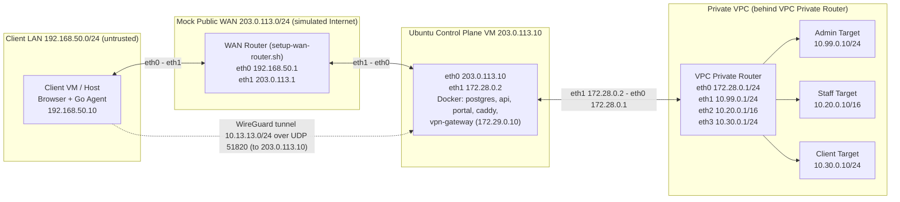

> 🌐 **Language / ภาษา**: **English** | [🇹🇭 ภาษาไทย](th/02-track-b-gns3-mock-cloud.md)

← Previous: [Track A: Local Dev](01-track-a-local-dev.md) | 📚 [Tutorial Index](../../TUTORIAL.md) | Next: [Track C: Cloud Deployment](03-track-c-cloud-deployment.md) →

# 🌩️ Track B: GNS3 Mock Cloud Infrastructure Lab

This track rebuilds MANGO VPN's real deployment shape inside a **GNS3 network
simulator**: an untrusted client LAN, a simulated public WAN (the Internet), an
Ubuntu **control-plane VM** that runs the Docker stack, a **VPC private router**
that segments three private target zones, and a **WireGuard tunnel** whose role
policies are enforced by `nftables`.

You will build the topology by hand, wire the routers and target nodes, start the
control plane, trust Caddy's internal CA, run the **real Go client agent**
(`Sobree/agent-windows`), and then prove with live `curl` probes which roles may
and may not reach which subnets.

> **Track B is a real-routing lab.** Unlike the familiar single-machine Docker
> smoke test, traffic here crosses multiple L3 hops and a real WireGuard tunnel
> before `nftables` decides the verdict. The one-machine fallback lives in the
> appendix: [Appendix: Local Docker Smoke Test](06-appendix-local-docker-smoke-test.md).

---

## 1. Why GNS3, and What This Lab Proves

A single laptop running `docker compose up` proves the application logic, but it
does **not** prove that MANGO VPN keeps a private subnet private once real
routers and a real tunnel are in the path. This lab proves the full L3 story:

- **True multi-hop routing:** `Client LAN → WAN Router (the "Internet") → Ubuntu
  Control Plane / WireGuard Gateway → VPC Private Router → segmented private
  subnets`.
- **Zero-trust WAN isolation:** the WAN router deliberately has **no route** to
  the WireGuard subnet (`10.13.13.0/24`) or to the private zones
  (`10.99.0.0/24`, `10.20.0.0/16`, `10.30.0.0/24`). Before the VPN connects,
  `curl http://10.99.0.10` **must fail**. Private subnets are reachable *only*
  through the tunnel.
- **Segment-by-role enforcement:** once connected, `nftables` on the gateway
  allows or drops forwarding per peer and per policy, so `ADMIN`, `STAFF`, and
  `CLIENT` see different sets of subnets.

### 1.1 Topology and address plan

| Segment | Device / interface | Address |
| --- | --- | --- |
| Client LAN `192.168.50.0/24` | Client VM / WAN router `eth0` | `192.168.50.10` / `192.168.50.1` |
| Mock Public WAN `203.0.113.0/24` | WAN router `eth1` / control VM `eth0` | `203.0.113.1` / `203.0.113.10` |
| Private transit `172.28.0.0/24` | control VM `eth1` / private router `eth0` | `172.28.0.2` / `172.28.0.1` |
| Admin `10.99.0.0/24` | private router `eth1` / target | `10.99.0.1` / `10.99.0.10` |
| Staff `10.20.0.0/16` | private router `eth2` / target | `10.20.0.1` / `10.20.0.10` |
| Client zone `10.30.0.0/24` | private router `eth3` / target | `10.30.0.1` / `10.30.0.10` |
| WireGuard `10.13.13.0/24` | gateway `wg0` | `10.13.13.1` (peers `10.13.13.2+`) |
| Docker bridge `mango-gns3-net` | `vpn-gateway` container | `172.29.0.10` |



The portal is reachable at `https://vpn.mango.lab`, which the client resolves to
the control plane's WAN address `203.0.113.10` through a hosts entry (Step B4).

---

## 2. Two Architectural Deep-Dives (the "Why")

These two details are the difference between a lab that works and one that
silently breaks unrelated Docker traffic. Read them before you build.

### 2.1 Why the gateway lives in an isolated Docker network namespace

The gateway runs `nftables` with a **default-drop `forward` chain**
(`policy drop`), as you can see in `deploy/gns3/docker-compose.gns3.yml`:

```sh
nft add chain inet mango_vpn forward '{ type filter hook forward priority 0 ; policy drop ; }'
```

The `forward` hook is per **network namespace**. If the gateway ran in the Ubuntu
VM's *host* network namespace, that default-drop policy would apply to **every
forwarded packet on the host** - including traffic between the other Docker
bridges (postgres, api, portal, caddy). That would break the very stack you are
testing. Instead, the Compose file places `vpn-gateway` on its own bridge,
`mango-gns3-net` (`172.29.0.0/24`), at a fixed address `172.29.0.10`, so its
`inet mango_vpn` table only governs traffic inside that namespace.

**Two ways traffic returns from the targets to the client**, and why you see what
you see in `/health.json`:

1. **Docker bridge NAT (default).** The gateway bridges packets into
   `172.28.0.2` (the Ubuntu VM's transit address), and Docker masquerades the
   source. The targets therefore see `clientVpnIp = 172.28.0.2`, not your real
   WireGuard IP. This is the reliable default; you do not need to configure it.
2. **Optional no-NAT return route.** If you want the targets to see the true
   client VPN source address, add a static route on the Ubuntu control-plane VM
   (after confirming the `172.29.0.10` bridge exists):

   ```sh
   ip route replace 10.13.13.0/24 via 172.29.0.10
   ```

   With this route, return traffic goes straight to the gateway without NAT, and
   `/health.json`'s `clientVpnIp` shows the actual `10.13.13.x` peer address.

### 2.2 Why the WAN router refuses to route private subnets

Open `deploy/gns3/setup-wan-router.sh` and read the comment: it **does not add
routes** for `10.13.13.0/24` or `10.99/10.20/10.30`. A real Internet router only
routes between public segments. Private VPC traffic must enter the WireGuard
tunnel addressed to `203.0.113.10:51820/udp`. This is the whole point of the lab:
**before** you connect, a probe to a private target fails; **after** you connect,
the tunnel carries it.

Meanwhile `deploy/gns3/setup-private-router.sh` adds exactly one return route:

```sh
ip route replace 10.13.13.0/24 via 172.28.0.2 dev "$TRANSIT_IFACE"
```

and deliberately **omits** `192.168.50.0/24`, preserving client-LAN isolation:
the private zones can answer the VPN subnet, but they have no path back to the
client LAN outside the tunnel.

---

## 3. Step-by-Step Build

### Step B1: GNS3 Node Inventory & Wiring

Create these GNS3 nodes and attach NICs in the exact order below. Getting the NIC
order wrong is the most common failure, because the setup scripts bind
interfaces by position (`eth0`, `eth1`, ...).

| GNS3 node | Type | NIC order (`eth0` →) | Connects to |
| --- | --- | --- | --- |
| `wan-router` | Linux host / Ubuntu server | `eth0`, `eth1` | `eth0`→Client LAN; `eth1`→WAN switch |
| `ubuntu-control` | Ubuntu 24.04 VM | `eth0`, `eth1` | `eth0`→WAN switch; `eth1`→Private transit switch |
| `vpc-router` | Linux host / Ubuntu server | `eth0`, `eth1`, `eth2`, `eth3` | `eth0`→transit; `eth1`→admin; `eth2`→staff; `eth3`→client |
| `target-admin` | Small Linux VM | `eth0` | admin switch |
| `target-staff` | Small Linux VM | `eth0` | staff switch |
| `target-client` | Small Linux VM | `eth0` | client switch |

**Client VM: two supported options.**

- **Option 1 - dedicated VM in GNS3:** a Windows or Linux VM attached to the
  Client LAN switch with address `192.168.50.10/24`, gateway `192.168.50.1`.
  Install the tooling from Phase 1 of the main tutorial (Node.js, Git, and - for
  a real tunnel - WireGuard tools and Go).
- **Option 2 - your own host machine via GNS3 Cloud / TAP bridge:** bind a GNS3
  `Cloud` node to a host TAP/bridge interface so your physical machine joins the
  `192.168.50.0/24` Client LAN. This is convenient when your host already has the
  agent toolchain installed.

> **Important:** whichever option you choose, the client must reach
> `203.0.113.10` (the control plane WAN address) and must be able to reach
> `127.0.0.1:47821` **locally**, because that is where the client agent listens.

**What you should see:** In GNS3 all links show green, and each node boots. The
Client VM answers `ip -br addr` with `192.168.50.10/24`.

---

### Step B2: Configure the Routers and the Three Target Nodes

Run these on the matching GNS3 Linux nodes. Interface names can be overridden
with the environment variables documented below if your NIC order differs.

#### B2.1 WAN Router

On `wan-router`:

```sh
LAN_IFACE=eth0 WAN_IFACE=eth1 ENABLE_NAT=false sh deploy/gns3/setup-wan-router.sh
```

This assigns `192.168.50.1/24` to `eth0` and `203.0.113.1/24` to `eth1`, enables
IPv4 forwarding, and (only when `ENABLE_NAT=true`) adds a masquerade rule. It adds
**no** private routes by design.

**What you should see:**

```sh
ip -br addr
# lo               UNKNOWN  ...
# eth0             UP       192.168.50.1/24
# eth1             UP       203.0.113.1/24
ip route
# (no 10.13.13.0/24, no 10.99/10.20/10.30 entries)
```

#### B2.2 VPC Private Router

On `vpc-router`:

```sh
TRANSIT_IFACE=eth0 ADMIN_IFACE=eth1 STAFF_IFACE=eth2 CLIENT_IFACE=eth3 \
  sh deploy/gns3/setup-private-router.sh
```

**What you should see:**

```sh
ip -br addr
# eth0  UP  172.28.0.1/24
# eth1  UP  10.99.0.1/24
# eth2  UP  10.20.0.1/16
# eth3  UP  10.30.0.1/24
ip route
# 10.13.13.0/24 via 172.28.0.2 dev eth0   <-- the only tunnel return route
# (no 192.168.50.0/24)
```

#### B2.3 The three Target Nodes

On each target VM, run `setup-target-node.sh` with the matching zone. The script
accepts `ZONE=admin|staff|client` or the zone as the first argument, installs
`nginx` + `openssl` (via `apk` or `apt-get`), assigns the target IP on `eth0`,
adds default and `10.13.13.0/24` routes, generates a self-signed certificate with
`CN` set to the target IP, and writes an nginx site that serves `/health.json`.

On `target-admin`:

```sh
ZONE=admin sh deploy/gns3/setup-target-node.sh    # or: sh deploy/gns3/setup-target-node.sh admin
```

On `target-staff`:

```sh
ZONE=staff sh deploy/gns3/setup-target-node.sh
```

On `target-client`:

```sh
ZONE=client sh deploy/gns3/setup-target-node.sh
```

Override the interface with `IFACE=eth1` if the target's NIC is not `eth0`.

**What you should see** on `target-admin`:

```sh
ip -br addr
# eth0  UP  10.99.0.10/24
ip route
# default via 10.99.0.1 dev eth0
# 10.13.13.0/24 via 10.99.0.1 dev eth0
curl -s http://10.99.0.10/health.json
# {"ok":true,"zone":"admin","targetIp":"10.99.0.10","clientVpnIp":"<source-ip>"}
```

Repeat the same shape on `target-staff` (`10.20.0.10/16`) and `target-client`
(`10.30.0.10/24`). Each target serves plain HTTP on `80` and HTTPS on `443`, and
includes CORS plus Private Network Access headers on `/health.json`.

---

### Step B3: Configure the Ubuntu Control Plane VM and Start the Stack

On `ubuntu-control` (Ubuntu 24.04), first confirm both interfaces:

```sh
ip -br addr
# eth0  UP  203.0.113.10/24   <-- mock public WAN
# eth1  UP  172.28.0.2/24     <-- private transit
```

If the addresses are not set, assign them and enable forwarding:

```sh
sudo ip addr replace 203.0.113.10/24 dev eth0
sudo ip addr replace 172.28.0.2/24 dev eth1
sudo sysctl -w net.ipv4.ip_forward=1
```

Add routes so the control plane can reach the private zones through the VPC
router, and the Client LAN through the WAN router:

```sh
sudo ip route replace 10.99.0.0/24 via 172.28.0.1
sudo ip route replace 10.20.0.0/16 via 172.28.0.1
sudo ip route replace 10.30.0.0/24 via 172.28.0.1
sudo ip route replace 192.168.50.0/24 via 203.0.113.1
ip route
```

**What you should see:** The four routes above are present, plus the
`203.0.113.0/24` and `172.28.0.0/24` connected routes.

Now clone the repository and generate the environment file:

```sh
git clone <your-repo-url> Mango_VPN_Trainee
cd Mango_VPN_Trainee
npm install
npm run env:init
```

`npm run env:init` writes `.env` from `.env.example` with fresh `POSTGRES_PASSWORD`,
`JWT_SECRET`, `REFRESH_SECRET`, `DAEMON_SHARED_SECRET`, a 64-hex
`TOTP_ENCRYPTION_KEY`, and a Curve25519 WireGuard keypair. Edit `.env` and set the
three lab-specific values (keep everything else as generated):

```sh
WG_SERVER_ENDPOINT=203.0.113.10:51820
CORS_ORIGIN=https://vpn.mango.lab
VITE_API_URL=https://vpn.mango.lab
```

> **Loopback-only Postgres:** `deploy/gns3/docker-compose.gns3.yml` publishes
> PostgreSQL as `127.0.0.1:${POSTGRES_PORT:-15432}:5432`. It is bound to the
> loopback interface **only**, so your host-side `npm run db:seed` commands can
> reach it while the mock public WAN never sees a Postgres port.

Build and start the stack:

```sh
docker compose -f deploy/gns3/docker-compose.gns3.yml --env-file .env up -d --build
docker compose -f deploy/gns3/docker-compose.gns3.yml ps
```

**What you should see:** `postgres`, `vpn-gateway`, `api`, `portal`, and `caddy`
are `running`. `postgres` and `vpn-gateway` report `healthy`; `api` follows them
once healthy. Caddy publishes `80` and `443`.

Seed the baseline roles and ADMIN account (choose a private password of **at
least 12 characters**):

```sh
export SEED_ADMIN_USERNAME="admin"
export SEED_ADMIN_PASSWORD="<Choose-12+-Char-Password>"
npm run db:seed
unset SEED_ADMIN_PASSWORD
```

Then seed the Track B policy set used by the three zones:

```sh
npm run db:seed:test-targets
```

**What you should see:** `Seeded roles [ADMIN, STAFF, CLIENT] and ADMIN user
"admin".` followed by `Seeded 12 Track B VPN policies.` The policy seeder upserts
by role and name, advances `Allow Internal Web` to priority `101`, and writes to
the database only - so **seed before you connect**, because the gateway reads the
enabled policies for the user's role at connect time.

---

### Step B4: Trust Caddy's Internal CA and Add the Hosts Entry (Client Machine)

The portal is served over HTTPS at `https://vpn.mango.lab`, but the GNS3 Caddyfile
uses `tls internal`, so Caddy issues a certificate from its **own internal CA**.
For Chromium **Private Network Access (PNA)**, the page that calls the agent at
`http://127.0.0.1:47821` must be a **trusted HTTPS origin**. That is why you both
trust the CA and add the hosts entry.

First copy Caddy's root certificate out of the container (run on
`ubuntu-control`):

```sh
docker compose -f deploy/gns3/docker-compose.gns3.yml cp \
  caddy:/data/caddy/pki/authorities/local/root.crt ./mango-gns3-root.crt
```

Copy `mango-gns3-root.crt` to the client machine, then install it as a trusted
root.

**Windows (Administrator PowerShell):**

```powershell
Import-Certificate -FilePath .\mango-gns3-root.crt -CertStoreLocation Cert:\LocalMachine\Root
# Alternative:
certutil -addstore Root mango-gns3-root.crt
```

**Linux (Bash):**

```bash
sudo cp mango-gns3-root.crt /usr/local/share/ca-certificates/mango-gns3.crt
sudo update-ca-certificates
```

Now point `vpn.mango.lab` at the control plane's WAN address.

**Windows (Administrator PowerShell):**

```powershell
Add-Content -Path C:\Windows\System32\drivers\etc\hosts -Value "203.0.113.10 vpn.mango.lab"
```

**Linux / macOS (Bash):**

```bash
echo "203.0.113.10 vpn.mango.lab" | sudo tee -a /etc/hosts
```

**What you should see:** Opening `https://vpn.mango.lab/health` in the browser
returns the API health JSON **without a certificate warning**, and
`https://vpn.mango.lab` shows the portal login. From a shell:

```sh
curl --fail https://vpn.mango.lab/health
```

> **Why HTTPS + trusted CA matters here:** If the portal is loaded over plain
> `http://`, Chromium blocks a page that tries to reach the loopback agent
> (`http://127.0.0.1:47821`) under Private Network Access. A trusted
> `https://vpn.mango.lab` origin is a secure context, so the browser is allowed
> to describe and pair with the local agent.

---

### Step B5: Run the Real Go Client Agent on the Client Machine

The agent listens on `127.0.0.1:47821` and, on connect, activates WireGuard.
Set the origin allowlist to the GNS3 portal origin and point the API at the same
HTTPS URL.

**Windows (Administrator PowerShell):** Right-click PowerShell and choose **Run
as administrator** so the agent can run `wireguard.exe`:

```powershell
$env:AGENT_LISTEN_ADDR="127.0.0.1:47821"
$env:AGENT_ALLOWED_ORIGINS="https://vpn.mango.lab"
$env:AGENT_PAIRING_TOKEN="my-gns3-lab-pairing-token-01"
$env:API_URL="https://vpn.mango.lab"
cd <path-to>\Mango_VPN_Trainee\Sobree\agent-windows
go run .
```

**Linux (Bash):** The agent runs `wg-quick up`, which needs root, so use `sudo -E`
to keep your exported variables:

```bash
export AGENT_LISTEN_ADDR="127.0.0.1:47821"
export AGENT_ALLOWED_ORIGINS="https://vpn.mango.lab"
export AGENT_PAIRING_TOKEN="my-gns3-lab-pairing-token-01"
export API_URL="https://vpn.mango.lab"
cd <path-to>/Mango_VPN_Trainee/Sobree/agent-windows
sudo -E "$(command -v go)" run .
```

> **Linux notes:** If `sudo` reports `go: command not found`, `sudo` has reset
> `PATH`; the `"$(command -v go)"` form above fixes it. If `wg-quick` reports
> `resolvconf: command not found`, install a DNS manager such as `openresolv`
> (`sudo apt install -y openresolv`) or use `systemd-resolved`, then retry.

**What you should see:** A Go log line saying the agent is listening on
`127.0.0.1:47821`. Verify locally:

**Windows (PowerShell):**

```powershell
Invoke-RestMethod http://127.0.0.1:47821/health
```

**Linux / macOS (Bash):**

```bash
curl -s http://127.0.0.1:47821/health
```

Either returns `status: ok`, the service name, version `2.0.0`, and a
tunnel-active boolean. Keep this elevated terminal open.

---

### Step B6: Prove Isolation, Pair, Connect, and Verify Role Enforcement

#### B6.1 Prove pre-VPN isolation (do this **before** connecting)

From the client machine, try to reach a private target with no tunnel up:

**Windows (PowerShell):**

```powershell
curl.exe -m 5 http://10.99.0.10
Test-NetConnection 10.99.0.10 -Port 80
```

**Linux / macOS (Bash):**

```bash
curl -m 5 http://10.99.0.10
```

**What you should see:** The request **times out or fails to connect** - because
the WAN router has no route to the private zones. This is the correct, expected
result and is the proof that isolation is real.

#### B6.2 Pair and connect

1. In the browser open `https://vpn.mango.lab` and sign in as `admin` (first
   sign-in enrolls TOTP; scan the QR or enter the Base32 key, then enter the
   current 6-digit code).
2. Go to **VPN Connect**. Confirm the agent card shows **Agent Reachable
   (Unpaired)**.
3. Paste `my-gns3-lab-pairing-token-01` into **Agent Pairing Token** and click
   **Pair Agent**.
4. Click **Connect VPN**.

**What you should see:** The card reports green **connected**, an **Assigned VPN
IP** (normally `10.13.13.2`), **Active Role** `ADMIN`, and **Permitted
Networks**. On the client host the real `mango0` tunnel appears.

#### B6.3 Verify the role enforcement matrix

> **Go agent device identity:** Unlike `scripts/mock-agent.js`, the **Go agent
> does not append a `-<username>` suffix** to the device fingerprint. To keep
> each test user on its own device identity, stop the agent, set
> `AGENT_DEVICE_FINGERPRINT` to a fresh value per user, and restart it.

Probe all three private targets from the client while connected:

**Windows (PowerShell):**

```powershell
curl.exe -m 5 http://10.99.0.10/health.json
curl.exe -m 5 http://10.20.0.10/health.json
curl.exe -m 5 http://10.30.0.10/health.json
```

**Linux / macOS (Bash):**

```bash
curl -m 5 http://10.99.0.10/health.json
curl -m 5 http://10.20.0.10/health.json
curl -m 5 http://10.30.0.10/health.json
```

**Expected access matrix** (also enforced by the gateway's `nftables` rules):

| Connected role | `10.99.0.10` (admin) | `10.20.0.10` (staff) | `10.30.0.10` (client) |
| --- | --- | --- | --- |
| ADMIN | ALLOW | ALLOW | ALLOW |
| STAFF | DENY | ALLOW | ALLOW |
| CLIENT | DENY | DENY | ALLOW |

To test `STAFF` and `CLIENT`, log out, sign back in as the seeded user, set a new
`AGENT_DEVICE_FINGERPRINT`, and reconnect. Example for `staff01`:

**Windows (Administrator PowerShell):**

```powershell
$env:AGENT_DEVICE_FINGERPRINT="gns3-device-staff01"
go run .
```

**Linux (Bash):**

```bash
export AGENT_DEVICE_FINGERPRINT="gns3-device-staff01"
sudo -E "$(command -v go)" run .
```

**What you should see:** `ADMIN` reaches all three targets (HTTP `200` with
`"ok":true`). `STAFF` reaches staff and client but gets a timeout/refusal on
admin. `CLIENT` reaches only the client zone. A `clientVpnIp` of `172.28.0.2`
means you are using the default bridge NAT; a `10.13.13.x` value means you added
the optional no-NAT return route from Section 2.1.

---

### Step B7: Live Packet & Gateway Inspection, and Teardown

With a session connected, inspect the gateway. All commands run on
`ubuntu-control`:

```sh
docker compose -f deploy/gns3/docker-compose.gns3.yml exec vpn-gateway wg show
docker compose -f deploy/gns3/docker-compose.gns3.yml exec vpn-gateway nft list table inet mango_vpn
```

**What you should see:** `wg show` lists interface `wg0`, its listening port, and
your peer with its public key and allowed IP (`10.13.13.2/32`). The `nft` output
shows the `inet mango_vpn` table, the `forward` chain with `policy drop`, the
`ct state established,related accept` rule, and per-peer `accept`/`drop` rules.

For a live packet trace, capture inside the gateway's namespace. The gateway image
ships `wg`, `nft`, `ip`, and `wget` but **not** `tcpdump`, so install it on demand:

```sh
docker compose -f deploy/gns3/docker-compose.gns3.yml exec vpn-gateway \
  sh -c 'apk add --no-cache tcpdump && tcpdump -ni wg0'
```

Alternatively, capture on the Ubuntu VM host, which sees the UDP `51820` traffic:

```sh
sudo tcpdump -ni any udp port 51820
```

On the client, inspect the local tunnel:

**Linux (Bash):**

```bash
sudo wg show mango0
```

**Windows:** open the **WireGuard for Windows** app and view the `mango0` tunnel;
its live handshake and transfer counters appear there.

**What you should see:** Handshake activity and non-zero transfer counters when
you fetch a permitted target; the client `wg show mango0` reports a recent
handshake with the gateway public key.

**Clean teardown (run on `ubuntu-control`):**

```sh
docker compose -f deploy/gns3/docker-compose.gns3.yml --env-file .env down
```

**What you should see:** All five services stop and are removed. The named
`postgres_data`, `caddy_data`, and `caddy_config` volumes are retained. Do **not**
add `-v` unless you deliberately want to destroy the lab database. On the client,
stop the Go agent with **Ctrl+C** and, if it was connected, disconnect first so
the gateway removes the peer.

---

← Previous: [Track A: Local Dev](01-track-a-local-dev.md) | 📚 [Tutorial Index](../../TUTORIAL.md) | Next: [Track C: Cloud Deployment](03-track-c-cloud-deployment.md) →
