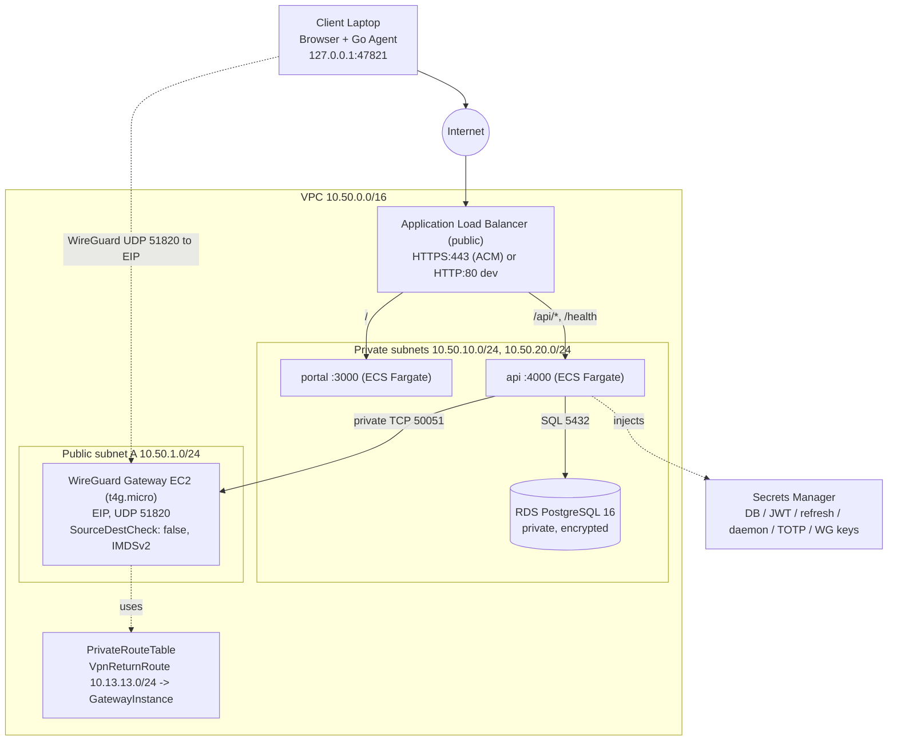

> 🌐 **Language / ภาษา**: **English** | [🇹🇭 ภาษาไทย](th/03-track-c-cloud-deployment.md)

← Previous: [Track B: GNS3 Mock Cloud](02-track-b-gns3-mock-cloud.md) | 📚 [Tutorial Index](../../TUTORIAL.md) | Next: [Testing Playbook](04-testing-playbook.md) →

# ☁️ Track C: Live Cloud Deployment Demo

Track C takes MANGO VPN off the laptop and onto the real Internet, two ways:

- **Part C1 - Single Cloud VM:** one Linux VM runs the whole Docker stack behind
  Caddy, which obtains HTTPS automatically. Fast, cheap, and ideal for a live
  demo or a small pilot.
- **Part C2 - Managed AWS Stack:** an `aws-managed` CloudFormation template
  provisions a VPC, private RDS PostgreSQL 16, private ECS Fargate services, an
  ALB, Secrets Manager, and a dedicated EC2 WireGuard gateway. This is the
  production-shaped path.

> **Before you start:** run through `deploy/cloud-vm/README.md` (C1) and
> `deploy/aws-managed/README.md` (C2). This page is the guided walkthrough; those
> files are the quick references.

---

## Overview: C1 vs C2 at a Glance

| Dimension | Part C1 - Single Cloud VM | Part C2 - Managed AWS Stack |
| --- | --- | --- |
| **Shape** | One Ubuntu 24.04 VM runs `postgres`, `vpn-gateway`, `api`, `portal`, and `caddy` via Compose. | VPC with private RDS + private ECS Fargate (`api`, `portal`) + internet-facing ALB + dedicated EC2 WireGuard gateway. |
| **Relative cost** | Lowest - one small instance. | Higher - NAT Gateway, RDS, Fargate, EC2, EIP, CloudWatch Logs, ECR storage. |
| **Setup time** | Minutes. | Longer: validate stack, push three images, populate two secrets, start the gateway, scale services, seed. |
| **HTTPS mechanism** | Caddy obtains and renews Let's Encrypt automatically on `80`/`443`. | ACM certificate on the ALB (`CertificateArn` + `CustomDomainName`), or HTTP-only dev, or a CloudFront distribution for zero-domain TLS. |
| **Database** | PostgreSQL 16 container on the same VM (private Docker network). | RDS PostgreSQL 16, private and encrypted, reachable only from the API security group. |
| **Best for** | Quick demos, trainees, a single small deployment. | Demonstrating a production-grade, managed, least-privilege layout. |

> **Why HTTPS is not optional for Chromium:** the portal calls the local agent at
> `http://127.0.0.1:47821`. Chromium's **Private Network Access** rules block a
> page served from a plain remote `http://` origin from reaching loopback. A
> trusted **HTTPS** origin (Let's Encrypt on the VM, ACM on the ALB, or a
> CloudFront `https://*.cloudfront.net` name) is what lets the browser pair with
> the agent. There is no bypass; give the portal a real TLS origin.

---

# Part C1: Single Linux VM (AWS EC2 Ubuntu 24.04)

## C1.0 Cloud-equivalent provider table

The steps below use AWS EC2, but the same compose files work on any provider.
Pick one row and translate the provider-specific action.

| Provider | Equivalent image | Firewall / Security Group | Static IP | SSH access |
| --- | --- | --- | --- | --- |
| **AWS EC2** | Ubuntu Server 24.04 LTS (`t3.small` or `t4g.small`) | Security Group inbound: TCP 80, TCP 443, UDP 51820, restricted TCP 22 (or SSM) | Elastic IP | SSH key pair or SSM Session Manager |
| **DigitalOcean** | Ubuntu 24.04 Droplet | Cloud Firewall inbound: 80, 443, 51820/udp, 22 | Reserved IP | SSH key |
| **GCP Compute Engine** | Ubuntu 24.04 `e2-small` | VPC firewall rules: `tcp:80,443`, `udp:51820`, restricted `tcp:22` | Static external IP | SSH via console or key |
| **Azure** | Ubuntu 24.04 `Standard_B1s` | Network Security Group inbound: 80, 443, 51820/udp, restricted 22 | Static public IP | SSH key or Bastion |
| **Linode / Akamai** | Ubuntu 24.04 `g6-nanode-1` | Cloud Firewall: 80, 443, 51820/udp, 22 | Reserved IP | SSH key |
| **Oracle Cloud Always Free** | Ubuntu 24.04 Ampere `VM.Standard.A1.Flex` | Security List / NSG: 80, 443, 51820/udp, restricted 22 | Reserved public IP | SSH key |

## C1.1 Provision the VM and lock down the Security Group

- **AMI / image:** Ubuntu Server 24.04 LTS.
- **Instance type:** `t3.small` (x86) or `t4g.small` (Arm). `t4g` is cheaper but
  means any locally built helper images must be `linux/arm64`.
- **IMDSv2:** require it (HTTP tokens = required). Do not allow IMDSv1.
- **Storage:** encrypted EBS/gp3 root volume.
- **Inbound Security Group rules:** **only** these.
  - TCP `80` (Caddy HTTP + Let's Encrypt challenge)
  - TCP `443` (HTTPS portal/API)
  - UDP `51820` (WireGuard)
  - TCP `22` restricted to your own `/32`, or omit it entirely and use AWS SSM.

> ⚠️ **NEVER open `5432`, `4000`, or `50051` to the Internet.** PostgreSQL, the
> API, and the gateway daemon API stay on the private Docker network. In
> `deploy/cloud-vm/docker-compose.cloud.yml`, only WireGuard UDP and Caddy
> HTTP(S) are published to the VM host.

## C1.2 Domain / HTTPS strategy (three clear paths)

**Path 1 - Zero-domain default (`sslip.io`).** `sslip.io` maps a dashed IP
hostname back to that IP, so you can get Let's Encrypt HTTPS with no DNS account.
If your public IP is `198.51.100.24`, set:

```sh
MANGO_DOMAIN=198-51-100-24.sslip.io
```

Caddy obtains the certificate automatically once `MANGO_DOMAIN` is set and
`80`/`443` are reachable.

**Path 2 - Custom domain.** Point an `A` record for `vpn.example.com` at the VM's
public IP and set `MANGO_DOMAIN=vpn.example.com`. Caddy obtains Let's Encrypt TLS
automatically. `deploy/cloud-vm/Caddyfile` also contains a commented
**dual-subdomain** block (`vpn.example.com` and `api.vpn.example.com`) you can
enable if you prefer to split the portal and API origins.

**Path 3 - HTTP fallback (if `80`/`443` are blocked).** Enable the commented
`:80` server block in `deploy/cloud-vm/Caddyfile`, start the stack, then open an
SSH local port-forward and browse to `http://localhost:8080`:

```sh
ssh -L 8080:localhost:80 ubuntu@<VM_PUBLIC_IP>
```

> Path 3 is a **dev fallback only**. Because it is a plain `http://` origin,
> Chromium Private Network Access may block the portal's call to the local agent.

## C1.3 Bootstrap Docker, `.env.cloud`, and launch

SSH to the VM and install Docker Engine + Compose v2:

```sh
sudo apt-get update
sudo apt-get install -y ca-certificates curl gnupg git
curl -fsSL https://get.docker.com | sudo sh
sudo usermod -aG docker "$USER"     # log out and back in, or use `sg docker`
docker compose version
```

Clone the repository and create `.env.cloud`:

```sh
git clone <your-repo-url> Mango_VPN_Trainee
cd Mango_VPN_Trainee
cp deploy/cloud-vm/.env.cloud.example .env.cloud
```

Populate every blank secret in `.env.cloud`. You can generate them with the
documented shell commands (from `.env.example`):

```sh
openssl rand -base64 32    # JWT_SECRET, REFRESH_SECRET, DAEMON_SHARED_SECRET (≥ 32 chars)
openssl rand -hex 32       # TOTP_ENCRYPTION_KEY (exactly 64 hex chars)
openssl rand -base64 24 | tr '+/' '-_' | tr -d '=\n'   # POSTGRES_PASSWORD
```

For the WireGuard keypair, install `wireguard-tools` and generate it, or let the
repository tool do it:

```sh
# Option A (needs wireguard-tools):
sudo apt-get install -y wireguard-tools
wg genkey | tee wg-private.key | wg pubkey > wg-public.key

# Option B (uses Node's crypto; writes .env from .env.example with fresh
# secrets and a Curve25519 keypair, then copy the values into .env.cloud):
npm install
npm run env:init -- --output .env.cloud
```

> `npm run env:init -- --output .env.cloud` generates the file from
> `.env.example`, so it will **not** contain `MANGO_DOMAIN`. Add or update the four
> cloud-specific values below by hand.

Set the four cloud-specific values in `.env.cloud` (using Path 1 as the example):

```sh
MANGO_DOMAIN=198-51-100-24.sslip.io
WG_SERVER_ENDPOINT=<PUBLIC_IP>:51820
CORS_ORIGIN=https://<MANGO_DOMAIN>
VITE_API_URL=https://<MANGO_DOMAIN>
```

For the same-origin Caddy layout, `CORS_ORIGIN` and `VITE_API_URL` are both
`https://<MANGO_DOMAIN>`: the browser reaches `/api` through Caddy.

Launch the stack:

```sh
docker compose -f deploy/cloud-vm/docker-compose.cloud.yml --env-file .env.cloud up -d --build
docker compose -f deploy/cloud-vm/docker-compose.cloud.yml --env-file .env.cloud ps
```

**What you should see:** `postgres`, `vpn-gateway`, `api`, `portal`, and `caddy`
running, with the two health-checked services reporting `healthy`. Then verify:

```sh
curl --fail "https://<MANGO_DOMAIN>/health"
```

**Optional - prove `nftables` role enforcement over the real Internet.** Add the
targets overlay, which runs the three private targets on an internal network
(no public harness and no public harness port):

```sh
docker compose -f deploy/cloud-vm/docker-compose.cloud.yml \
  -f deploy/cloud-vm/docker-compose.cloud-targets.yml \
  --env-file .env.cloud up -d --build
```

The overlay routes `10.99.0.0/24`, `10.20.0.0/16`, and `10.30.0.0/24` through
the gateway's private target network, so once a client connects you can repeat
the same access matrix used in Track B.

## C1.4 Seed the ADMIN and (optional) target policies inside the `api` container

The API image runs Prisma migrations at startup and ships the compiled seeders
(`Rain/admin/dist/seed.js` and `Rain/admin/dist/seed-test-targets.js`), so you
seed inside the container without exposing PostgreSQL port `5432`:

```sh
docker compose -f deploy/cloud-vm/docker-compose.cloud.yml --env-file .env.cloud exec \
  -e SEED_ADMIN_USERNAME=admin \
  -e SEED_ADMIN_PASSWORD='<Choose-12+-Char-Password>' \
  api node Rain/admin/dist/seed.js
```

If you enabled the targets overlay, also seed the Track B policy set:

```sh
docker compose -f deploy/cloud-vm/docker-compose.cloud.yml \
  -f deploy/cloud-vm/docker-compose.cloud-targets.yml \
  --env-file .env.cloud exec api node Rain/admin/dist/seed-test-targets.js
```

**What you should see:** `Seeded roles [ADMIN, STAFF, CLIENT] and ADMIN user
"admin".` and, when you seeded policies, `Seeded 12 Track B VPN policies.` Use a
password of at least 12 characters and record it safely.

## C1.5 Connect your laptop's real Go Client Agent over the Internet

On your **own machine** (not the VM), run the real Go agent. Point its origin
allowlist and API URL at the portal's public HTTPS URL.

**Windows (Administrator PowerShell):**

```powershell
$env:AGENT_LISTEN_ADDR="127.0.0.1:47821"
$env:AGENT_ALLOWED_ORIGINS="https://<MANGO_DOMAIN>"
$env:AGENT_PAIRING_TOKEN="cloud-demo-pairing-token-01"
$env:API_URL="https://<MANGO_DOMAIN>"
cd <path-to>\Mango_VPN_Trainee\Sobree\agent-windows
go run .
```

**Linux (Bash):**

```bash
export AGENT_LISTEN_ADDR="127.0.0.1:47821"
export AGENT_ALLOWED_ORIGINS="https://<MANGO_DOMAIN>"
export AGENT_PAIRING_TOKEN="cloud-demo-pairing-token-01"
export API_URL="https://<MANGO_DOMAIN>"
cd <path-to>/Mango_VPN_Trainee/Sobree/agent-windows
sudo -E "$(command -v go)" run .
```

Sign in at `https://<MANGO_DOMAIN>`, enroll TOTP, pair with
`cloud-demo-pairing-token-01`, and click **Connect VPN**. Verify the handshake on
the VM:

```sh
docker compose -f deploy/cloud-vm/docker-compose.cloud.yml --env-file .env.cloud \
  exec vpn-gateway wg show
```

**What you should see:** A `wg0` peer with your client's public key and assigned
IP (`10.13.13.2`). On the client, `sudo wg show mango0` (Linux) or the WireGuard
for Windows app (Windows) shows a recent handshake. If you enabled the targets
overlay, probe the zones while connected, remembering the Go agent does **not**
add a `-<username>` suffix - set a distinct `AGENT_DEVICE_FINGERPRINT` per user:

| Connected role | `10.99.0.10` (admin) | `10.20.0.10` (staff) | `10.30.0.10` (client) |
| --- | --- | --- | --- |
| ADMIN | ALLOW | ALLOW | ALLOW |
| STAFF | DENY | ALLOW | ALLOW |
| CLIENT | DENY | DENY | ALLOW |

## C1.6 C1 cleanup

```sh
docker compose -f deploy/cloud-vm/docker-compose.cloud.yml --env-file .env.cloud down
```

Add `-f deploy/cloud-vm/docker-compose.cloud-targets.yml` when the overlay is
active. Do **not** add `-v` unless you intend to destroy the PostgreSQL volume.
Then terminate the EC2 instance and, if you allocated one, **release the Elastic
IP** so it stops billing.

---

# Part C2: Managed AWS Stack

This path deploys `deploy/aws-managed/template.yaml`. It creates a VPC, private
RDS PostgreSQL 16, Secrets Manager secrets, three ECR repositories (`api`,
`portal`, `vpn-daemon`), private ECS Fargate services for the API and portal, an
internet-facing ALB, and a dedicated EC2 WireGuard gateway. The API and portal
services default to **zero** tasks so the stack creates cleanly before any image
is pushed.

## C2.0 Architecture



Key template details worth knowing:

- **`VpnReturnRoute`** (`PrivateRouteTable`, `DestinationCidrBlock: 10.13.13.0/24`,
  `InstanceId: !Ref WireGuardGatewayInstance`) sends VPN client replies back
  through the gateway EC2 instance.
- **`WireGuardGatewayInstance`** sets `SourceDestCheck: false` so it can route
  VPN traffic, and requires **IMDSv2** (`HttpTokens: required`).
- **No SSH ingress** is created. Gateway administration is via **SSM Session
  Manager** (`AmazonSSMManagedInstanceCore`).
- The API reaches the gateway daemon on private port `50051` only, and the daemon
  secret is never written into parameters.

## C2.1 Zero-domain & HTTPS options

- **Recommended production:** supply `CertificateArn` (an ACM certificate) **and**
  a matching `CustomDomainName` (for example `vpn.example.com`). The ALB then runs
  an HTTPS listener (`AlbHttpsListener`, TLS 1.3 policy) and the `PortalUrl`
  output is `https://<CustomDomainName>`.
- **HTTP-only dev:** leave **both** empty. The ALB runs the HTTP dev listener
  (`AlbHttpDevListener`) and `PortalUrl` is `http://<ALB-DNS>`. Because that is a
  plain `http://` origin, Chromium PNA may block the agent call. Use SSH/SSM port
  forwarding, or front the ALB with a distribution - see the next bullet.
- **Zero-domain TLS via CloudFront:** place an **AWS CloudFront distribution** in
  front of the ALB. CloudFront serves `https://<distribution>.cloudfront.net`,
  giving you a trusted TLS origin with no domain and no certificate you manage,
  so Chromium PNA allows `127.0.0.1:47821`.

## C2.2 Step 1 - Prepare `parameters.json`

```sh
cp deploy/aws-managed/parameters.example.json deploy/aws-managed/parameters.json
```

Edit `parameters.json` and replace `<YOUR_PUBLIC_IP>/32` in **both**
`AllowedWebCidr` and `AllowedWireGuardCidr` with your real public/office CIDR.
Do **not** leave the `203.0.113.0/24` example value in a live account. Optionally
set `CertificateArn` and `CustomDomainName` for HTTPS. Keep `ApiDesiredCount=0`
and `PortalDesiredCount=0` for now. The defaults also use
`DBInstanceClass=db.t4g.micro`, `GatewayInstanceType=t4g.micro`, and the Ubuntu
24.04 arm64 SSM AMI path.

## C2.3 Step 2 - Validate and create the stack

```sh
aws cloudformation validate-template \
  --template-body file://deploy/aws-managed/template.yaml

aws cloudformation create-stack \
  --stack-name mango-vpn-managed \
  --template-body file://deploy/aws-managed/template.yaml \
  --parameters file://deploy/aws-managed/parameters.json \
  --capabilities CAPABILITY_IAM CAPABILITY_NAMED_IAM

aws cloudformation wait stack-create-complete --stack-name mango-vpn-managed
```

> `create-stack` takes the JSON array format used by `parameters.example.json`;
> `deploy` uses `Key=Value` overrides instead.

Collect the outputs you will need:

```sh
aws cloudformation describe-stacks --stack-name mango-vpn-managed \
  --query 'Stacks[0].Outputs' --output table
```

**What you should see:** Outputs including `PortalUrl`, `AlbDnsName`,
`ApiEcrRepository`, `PortalEcrRepository`, `DaemonEcrRepository`,
`EcsClusterName`, `WireGuardGatewayInstanceId`, `WireGuardGatewayPublicIp`,
`WireGuardKeySecretArn`, and `TotpEncryptionSecretArn`.

## C2.4 Step 3 - Build and push the three images

`api` and `portal` are `linux/amd64` for Fargate; `vpn-daemon` is `linux/arm64`
to match the default `t4g.micro` gateway (use `linux/amd64` if you switch to a
`t3.micro` gateway).

```sh
REGION=$(aws configure get region)
ACCOUNT_ID=$(aws sts get-caller-identity --query Account --output text)

API_REPO=$(aws cloudformation describe-stacks --stack-name mango-vpn-managed \
  --query 'Stacks[0].Outputs[?OutputKey==`ApiEcrRepository`].OutputValue' --output text)
PORTAL_REPO=$(aws cloudformation describe-stacks --stack-name mango-vpn-managed \
  --query 'Stacks[0].Outputs[?OutputKey==`PortalEcrRepository`].OutputValue' --output text)
DAEMON_REPO=$(aws cloudformation describe-stacks --stack-name mango-vpn-managed \
  --query 'Stacks[0].Outputs[?OutputKey==`DaemonEcrRepository`].OutputValue' --output text)

aws ecr get-login-password --region "$REGION" \
  | docker login --username AWS --password-stdin "$ACCOUNT_ID.dkr.ecr.$REGION.amazonaws.com"

docker buildx build --platform linux/amd64 -f Sobree/api/Dockerfile        -t "$API_REPO:latest"    --push .
docker buildx build --platform linux/amd64 -f Rain/portal/Dockerfile      -t "$PORTAL_REPO:latest" --push .
docker buildx build --platform linux/arm64 -f Sobree/vpn-daemon/Dockerfile -t "$DAEMON_REPO:latest" --push .
```

**What you should see:** Three successful pushes to the three stack
repositories.

## C2.5 Step 4 - Populate secrets and start the WireGuard gateway

The stack auto-generates the RDS master, JWT, refresh, and daemon secrets. You
must populate the 64-hex **TOTP** key:

```sh
TOTP_ARN=$(aws cloudformation describe-stacks --stack-name mango-vpn-managed \
  --query 'Stacks[0].Outputs[?OutputKey==`TotpEncryptionSecretArn`].OutputValue' --output text)
TOTP_KEY=$(openssl rand -hex 32)
aws secretsmanager put-secret-value --secret-id "$TOTP_ARN" --secret-string "$TOTP_KEY"
unset TOTP_KEY
```

Now connect to the gateway instance via **SSM Session Manager** (no open port 22)
and initialize the WireGuard keypair into its secret, then start the daemon:

```sh
GW_ID=$(aws cloudformation describe-stacks --stack-name mango-vpn-managed \
  --query 'Stacks[0].Outputs[?OutputKey==`WireGuardGatewayInstanceId`].OutputValue' --output text)
WG_SECRET_ARN=$(aws cloudformation describe-stacks --stack-name mango-vpn-managed \
  --query 'Stacks[0].Outputs[?OutputKey==`WireGuardKeySecretArn`].OutputValue' --output text)
echo "GW_ID=$GW_ID WG_SECRET_ARN=$WG_SECRET_ARN"

aws ssm start-session --target "$GW_ID"
```

Inside the SSM session on the gateway instance:

```sh
PRIVATE_KEY=$(wg genkey)
PUBLIC_KEY=$(printf '%s' "$PRIVATE_KEY" | wg pubkey)
aws secretsmanager put-secret-value --region "<AWS_REGION>" --secret-id "<WG_SECRET_ARN>" \
  --secret-string "$(jq -cn --arg privateKey "$PRIVATE_KEY" --arg publicKey "$PUBLIC_KEY" \
    '{privateKey:$privateKey,publicKey:$publicKey}')"
unset PRIVATE_KEY
sudo /usr/local/bin/mango-gateway-start.sh
docker ps && sudo wg show
```

**What you should see:** The `mango-vpn-daemon` container is up and `wg show`
lists interface `wg0`. Until `WireGuardKeySecret` holds a real key, the startup
script detects the placeholder and skips the daemon start instead of failing.

## C2.6 Step 5 - Scale the ECS services and seed the first ADMIN

Scale both services to `1`:

```sh
aws cloudformation update-stack \
  --stack-name mango-vpn-managed \
  --use-previous-template \
  --parameters \
    ParameterKey=AllowedWebCidr,UsePreviousValue=true \
    ParameterKey=AllowedWireGuardCidr,UsePreviousValue=true \
    ParameterKey=CertificateArn,UsePreviousValue=true \
    ParameterKey=CustomDomainName,UsePreviousValue=true \
    ParameterKey=EnableNatGateway,UsePreviousValue=true \
    ParameterKey=ApiDesiredCount,ParameterValue=1 \
    ParameterKey=PortalDesiredCount,ParameterValue=1 \
    ParameterKey=ApiImageTag,UsePreviousValue=true \
    ParameterKey=PortalImageTag,UsePreviousValue=true \
    ParameterKey=DaemonImageTag,UsePreviousValue=true \
    ParameterKey=DBInstanceClass,UsePreviousValue=true \
    ParameterKey=GatewayInstanceType,UsePreviousValue=true \
    ParameterKey=UbuntuAmiId,UsePreviousValue=true \
    ParameterKey=WgListenPort,UsePreviousValue=true \
  --capabilities CAPABILITY_IAM CAPABILITY_NAMED_IAM

aws ecs wait services-stable --cluster mango-vpn-managed-ecs \
  --services mango-vpn-managed-api mango-vpn-managed-portal
```

Once `ApiService` is running, seed the initial `ADMIN` via **ECS Exec** (again, no
public database port):

```sh
TASK_ARN=$(aws ecs list-tasks --cluster mango-vpn-managed-ecs \
  --service-name mango-vpn-managed-api --query 'taskArns[0]' --output text)
aws ecs execute-command --cluster mango-vpn-managed-ecs \
  --task "$TASK_ARN" --container api --interactive --command "/bin/sh"
```

Inside the container shell:

```sh
export DATABASE_URL="postgresql://mango:${DB_PASSWORD}@${DB_HOST}:5432/mangovpn?schema=public"
SEED_ADMIN_USERNAME=admin SEED_ADMIN_PASSWORD='<Choose-12+-Char-Password>' node Rain/admin/dist/seed.js
```

**What you should see:** `Seeded roles [ADMIN, STAFF, CLIENT] and ADMIN user
"admin".` (`DB_PASSWORD` and `DB_HOST` are injected into the task environment by
the template.)

## C2.7 Step 6 - Connect the laptop agent and verify

Read `PortalUrl` from the outputs, then run the agent on your own machine:

**Windows (Administrator PowerShell):**

```powershell
$env:AGENT_LISTEN_ADDR="127.0.0.1:47821"
$env:AGENT_ALLOWED_ORIGINS="<PortalUrl>"
$env:AGENT_PAIRING_TOKEN="managed-demo-pairing-token-01"
$env:API_URL="<PortalUrl>"
cd <path-to>\Mango_VPN_Trainee\Sobree\agent-windows
go run .
```

**Linux (Bash):**

```bash
export AGENT_LISTEN_ADDR="127.0.0.1:47821"
export AGENT_ALLOWED_ORIGINS="<PortalUrl>"
export AGENT_PAIRING_TOKEN="managed-demo-pairing-token-01"
export API_URL="<PortalUrl>"
cd <path-to>/Mango_VPN_Trainee/Sobree/agent-windows
sudo -E "$(command -v go)" run .
```

Sign in at `PortalUrl`, enroll TOTP, pair with the token, and connect. Then verify
on the gateway through SSM:

```sh
# Inside the SSM session on the gateway instance:
sudo wg show
sudo nft list table inet mango_vpn
```

**What you should see:** `wg show` lists the client peer; `nft` shows the
`inet mango_vpn` table with the role-based rules. Use `<PortalUrl>` exactly as the
agent origin allowlist - do not use a wildcard.

## C2.8 AWS cost & teardown checklist

Ongoing costs to watch: **NAT Gateway**, **RDS PostgreSQL**, **Fargate tasks**,
the **gateway EC2 instance**, **Elastic IPs**, **CloudWatch Logs**, and **ECR
storage**. RDS, ECR repositories, and CloudWatch log groups use
`DeletionPolicy: Retain` / `Snapshot`, so they survive stack deletion and must be
cleaned up separately once verified.

```sh
aws cloudformation delete-stack --stack-name mango-vpn-managed
aws cloudformation wait stack-delete-complete --stack-name mango-vpn-managed

# Retained ECR repositories. Read the real names from the stack outputs, then:
#   API_REPO_NAME=$(aws cloudformation describe-stacks --stack-name mango-vpn-managed \
#     --query 'Stacks[0].Outputs[?OutputKey==`ApiEcrRepository`].OutputValue' --output text | cut -d/ -f2)
aws ecr delete-repository --repository-name "<api-repo-name>"    --force
aws ecr delete-repository --repository-name "<portal-repo-name>" --force
aws ecr delete-repository --repository-name "<daemon-repo-name>" --force

# Retained RDS snapshots and log groups:
aws rds describe-db-snapshots --snapshot-type manual \
  --query 'DBSnapshots[?contains(DBSnapshotIdentifier, `mango-vpn-managed`)].DBSnapshotIdentifier' --output text
aws logs describe-log-groups \
  --log-group-name-prefix "/mango/mango-vpn-managed" --query 'logGroups[].logGroupName' --output text

# Confirm no Elastic IPs are left unassociated:
aws ec2 describe-addresses \
  --query 'Addresses[?AssociationId==null].[PublicIp,AllocationId]' --output text
```

Delete the RDS snapshots and log groups you no longer need, and **release any
unassociated Elastic IPs**, so nothing keeps billing after the demo.

---

← Previous: [Track B: GNS3 Mock Cloud](02-track-b-gns3-mock-cloud.md) | 📚 [Tutorial Index](../../TUTORIAL.md) | Next: [Testing Playbook](04-testing-playbook.md) →
