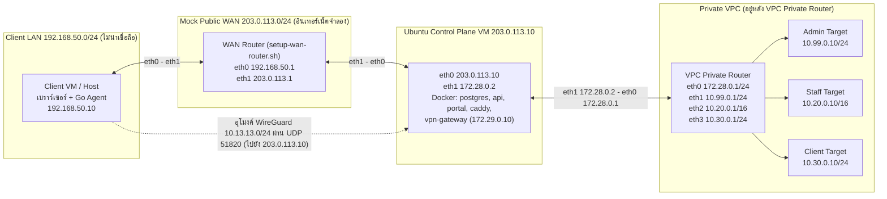

> 🌐 **Language / ภาษา**: [🇬🇧 English](../02-track-b-gns3-mock-cloud.md) | **🇹🇭 ภาษาไทย**

← ก่อนหน้า: [Track A: รันในเครื่อง (Local Dev)](01-track-a-local-dev.md) | 📚 [สารบัญคู่มือ](../../../TUTORIAL.th.md) | ถัดไป: [Track C: การ Deploy บน Cloud](03-track-c-cloud-deployment.md) →

# 🌩️ Track B: ห้องปฏิบัติการโครงสร้างพื้นฐาน GNS3 Mock Cloud

Track นี้จำลองรูปร่างการ Deploy จริงของ MANGO VPN ขึ้นใหม่ภายใน **โปรแกรมจำลองเครือข่าย GNS3**: ประกอบด้วย Client LAN ที่ไม่น่าเชื่อถือ (Untrusted), WAN สาธารณะจำลอง (อินเทอร์เน็ต), **VM Control Plane** บน Ubuntu ที่รันสแตก Docker, **Router ส่วนตัวของ VPC** ที่แบ่งโซนเป้าหมายส่วนตัวออกเป็นสามโซน และ **อุโมงค์ WireGuard** ที่บังคับใช้นโยบายตามบทบาทด้วย `nftables`

คุณจะสร้างโครงสร้างเครือข่าย (Topology) ด้วยมือ เชื่อมต่อ Router และโหนดเป้าหมาย เริ่ม Control Plane เชื่อถือ CA ภายในของ Caddy รัน **Go Client Agent จริง** (`Sobree/agent-windows`) แล้วพิสูจน์ด้วยการทดสอบ `curl` แบบสดว่า บทบาทใดเข้าถึงซับเน็ตใดได้และไม่ได้

> **Track B เป็นห้องปฏิบัติการที่ใช้การ Routing จริง** ต่างจากการทดสอบ Docker บนเครื่องเดียวที่คุ้นเคย ตรงที่ทราฟฟิกที่นี่ต้องข้ามหลาย Hop ในระดับ L3 และผ่านอุโมงค์ WireGuard จริง ก่อนที่ `nftables` จะตัดสินผล ส่วนทางเลือกบนเครื่องเดียวอยู่ในภาคผนวก: [ภาคผนวก: การทดสอบ Docker ในเครื่อง](06-appendix-local-docker-smoke-test.md)

---

## 1. ทำไมต้อง GNS3 และห้องปฏิบัติการนี้พิสูจน์อะไร

โน้ตบุ๊กเครื่องเดียวที่รัน `docker compose up` พิสูจน์ตรรกะของแอปพลิเคชันได้ แต่**ไม่ได้**พิสูจน์ว่า MANGO VPN รักษาความเป็นส่วนตัวของซับเน็ตส่วนตัวไว้ได้ เมื่อมี Router จริงและอุโมงค์จริงอยู่ในเส้นทาง ห้องปฏิบัติการนี้พิสูจน์เรื่องราว L3 ทั้งหมด:

- **การ Routing หลาย Hop จริง:** `Client LAN → WAN Router (ตัว "อินเทอร์เน็ต") → Ubuntu Control Plane / WireGuard Gateway → VPC Private Router → ซับเน็ตส่วนตัวที่ถูกแบ่งส่วน`
- **การแยกตัวแบบ Zero-trust บน WAN:** WAN router จงใจ**ไม่มี Route** ไปยังซับเน็ต WireGuard (`10.13.13.0/24`) หรือไปยังโซนส่วนตัว (`10.99.0.0/24`, `10.20.0.0/16`, `10.30.0.0/24`) ก่อนที่ VPN จะเชื่อมต่อ `curl http://10.99.0.10` **ต้องล้มเหลว** ซับเน็ตส่วนตัวเข้าถึงได้*เฉพาะ*ผ่านอุโมงค์เท่านั้น
- **การบังคับใช้ตามบทบาท (Segment-by-role):** เมื่อเชื่อมต่อแล้ว `nftables` บน Gateway จะอนุญาตหรือทิ้งการ Forward ตาม Peer และตามนโยบาย ดังนั้น `ADMIN`, `STAFF` และ `CLIENT` จะเห็นซับเน็ตที่ต่างกัน

### 1.1 โครงสร้างเครือข่ายและแผนการกำหนดที่อยู่

| Segment | อุปกรณ์ / อินเทอร์เฟซ | ที่อยู่ |
| --- | --- | --- |
| Client LAN `192.168.50.0/24` | Client VM / WAN router `eth0` | `192.168.50.10` / `192.168.50.1` |
| Mock Public WAN `203.0.113.0/24` | WAN router `eth1` / control VM `eth0` | `203.0.113.1` / `203.0.113.10` |
| Private transit `172.28.0.0/24` | control VM `eth1` / private router `eth0` | `172.28.0.2` / `172.28.0.1` |
| Admin `10.99.0.0/24` | private router `eth1` / target | `10.99.0.1` / `10.99.0.10` |
| Staff `10.20.0.0/16` | private router `eth2` / target | `10.20.0.1` / `10.20.0.10` |
| Client zone `10.30.0.0/24` | private router `eth3` / target | `10.30.0.1` / `10.30.0.10` |
| WireGuard `10.13.13.0/24` | gateway `wg0` | `10.13.13.1` (peers `10.13.13.2+`) |
| Docker bridge `mango-gns3-net` | คอนเทนเนอร์ `vpn-gateway` | `172.29.0.10` |



Portal เข้าถึงได้ที่ `https://vpn.mango.lab` ซึ่ง Client จะแก้ชื่อไปยังที่อยู่ WAN ของ Control Plane คือ `203.0.113.10` ผ่านรายการใน hosts (ขั้นตอน B4)

---

## 2. เจาะลึกสถาปัตยกรรม 2 เรื่อง (คำถาม "ทำไม")

รายละเอียดสองข้อนี้คือความต่างระหว่างห้องปฏิบัติการที่ใช้งานได้ กับห้องปฏิบัติการที่พังทราฟฟิก Docker อื่นอย่างเงียบๆ อ่านก่อนลงมือสร้าง

### 2.1 ทำไม Gateway ต้องอยู่ใน Docker network namespace ที่แยกออกมา

Gateway รัน `nftables` ด้วย **`forward` chain แบบ default-drop** (`policy drop`) ดังที่เห็นใน `deploy/gns3/docker-compose.gns3.yml`:

```sh
nft add chain inet mango_vpn forward '{ type filter hook forward priority 0 ; policy drop ; }'
```

Hook `forward` ทำงานแยกตาม **network namespace** หาก Gateway รันใน network namespace ของ *host* ของ VM Ubuntu นโยบาย default-drop นั้นจะบังคับใช้กับ**ทุกแพ็กเก็ตที่ถูก Forward บน host** ซึ่งรวมถึงทราฟฟิกระหว่าง Docker bridge อื่นๆ (postgres, api, portal, caddy) นั่นจะทำให้สแตกที่คุณกำลังทดสอบพังทลาย แทนที่จะเป็นเช่นนั้น ไฟล์ Compose จึงวาง `vpn-gateway` ไว้บน bridge ของตัวเองชื่อ `mango-gns3-net` (`172.29.0.0/24`) ที่ที่อยู่คงที่ `172.29.0.10` เพื่อให้ตาราง `inet mango_vpn` ของมันควบคุมเฉพาะทราฟฟิกภายใน namespace นั้นเท่านั้น

**ทราฟฟิกเดินทางกลับจากโหนดเป้าหมายมาหา Client ได้สองวิธี** และนี่คือเหตุผลที่คุณเห็นค่าต่างๆ ใน `/health.json`:

1. **Docker bridge NAT (ค่าเริ่มต้น)** Gateway ส่งแพ็กเก็ตเข้าสู่ `172.28.0.2` (ที่อยู่ transit ของ VM Ubuntu) และ Docker ทำ masquerade ที่ source ดังนั้นโหนดเป้าหมายจะเห็น `clientVpnIp = 172.28.0.2` ไม่ใช่ IP WireGuard จริงของคุณ นี่คือค่าเริ่มต้นที่เชื่อถือได้ คุณไม่ต้องตั้งค่าใดๆ
2. **Return route แบบไม่ทำ NAT (ทางเลือก)** หากคุณต้องการให้โหนดเป้าหมายเห็นที่อยู่ต้นทาง VPN ของ Client จริง ให้เพิ่ม static route บน VM Control Plane Ubuntu (หลังจากยืนยันว่า bridge `172.29.0.10` มีอยู่แล้ว):

   ```sh
   ip route replace 10.13.13.0/24 via 172.29.0.10
   ```

   เมื่อมี Route นี้ ทราฟฟิกขากลับจะวิ่งตรงไปยัง Gateway โดยไม่ผ่าน NAT และ `clientVpnIp` ใน `/health.json` จะแสดงที่อยู่ Peer จริงคือ `10.13.13.x`

### 2.2 ทำไม WAN Router จึงปฏิเสธการ Route ซับเน็ตส่วนตัว

เปิด `deploy/gns3/setup-wan-router.sh` แล้วอ่านคอมเมนต์: มัน**ไม่เพิ่ม Route** สำหรับ `10.13.13.0/24` หรือ `10.99/10.20/10.30` Router บนอินเทอร์เน็ตจริงจะ Route เฉพาะระหว่าง Segment สาธารณะเท่านั้น ทราฟฟิก VPC ส่วนตัวต้องเข้าสู่อุโมงค์ WireGuard ที่กำหนดปลายทางเป็น `203.0.113.10:51820/udp` นี่คือจุดประสงค์ทั้งหมดของห้องปฏิบัติการนี้: **ก่อน**เชื่อมต่อ การทดสอบไปยังโหนดเป้าหมายส่วนตัวจะล้มเหลว **หลัง**เชื่อมต่อ อุโมงค์จะพาทราฟฟิกไป

ในขณะเดียวกัน `deploy/gns3/setup-private-router.sh` เพิ่ม Return route เพียงหนึ่งรายการ:

```sh
ip route replace 10.13.13.0/24 via 172.28.0.2 dev "$TRANSIT_IFACE"
```

และจงใจ**ละเว้น** `192.168.50.0/24` เพื่อรักษาการแยกตัวของ Client LAN: โซนส่วนตัวตอบกลับซับเน็ต VPN ได้ แต่ไม่มีเส้นทางกลับไปยัง Client LAN นอกอุโมงค์

---

## 3. การสร้างทีละขั้นตอน

### ขั้นตอน B1: รายการโหนด GNS3 และการเชื่อมต่อ

สร้างโหนด GNS3 เหล่านี้และต่อ NIC ตามลำดับด้านล่างอย่างแม่นยำ การเรียงลำดับ NIC ผิดคือความล้มเหลวที่พบบ่อยที่สุด เพราะสคริปต์ตั้งค่าผูกอินเทอร์เฟซตามตำแหน่ง (`eth0`, `eth1`, ...)

| โหนด GNS3 | ชนิด | ลำดับ NIC (`eth0` →) | เชื่อมต่อไปยัง |
| --- | --- | --- | --- |
| `wan-router` | Linux host / Ubuntu server | `eth0`, `eth1` | `eth0`→Client LAN; `eth1`→WAN switch |
| `ubuntu-control` | Ubuntu 24.04 VM | `eth0`, `eth1` | `eth0`→WAN switch; `eth1`→Private transit switch |
| `vpc-router` | Linux host / Ubuntu server | `eth0`, `eth1`, `eth2`, `eth3` | `eth0`→transit; `eth1`→admin; `eth2`→staff; `eth3`→client |
| `target-admin` | Small Linux VM | `eth0` | admin switch |
| `target-staff` | Small Linux VM | `eth0` | staff switch |
| `target-client` | Small Linux VM | `eth0` | client switch |

**Client VM: มีสองทางเลือกที่รองรับ**

- **ทางเลือกที่ 1 - VM เฉพาะภายใน GNS3:** VM Windows หรือ Linux ที่ต่อกับ Client LAN switch ด้วยที่อยู่ `192.168.50.10/24`, gateway `192.168.50.1` ติดตั้งเครื่องมือจากระยะที่ 1 ของคู่มือหลัก (Node.js, Git และสำหรับอุโมงค์จริงคือเครื่องมือ WireGuard และ Go)
- **ทางเลือกที่ 2 - เครื่อง Host ของคุณเองผ่าน GNS3 Cloud / TAP bridge:** ผูกโหนด `Cloud` ของ GNS3 เข้ากับอินเทอร์เฟซ TAP/bridge ของ Host เพื่อให้เครื่องจริงของคุณเข้าร่วม Client LAN `192.168.50.0/24` วิธีนี้สะดวกเมื่อ Host ของคุณติดตั้งชุดเครื่องมือ Agent ไว้แล้ว

> **สำคัญ:** ไม่ว่าคุณจะเลือกทางใด Client ต้องเข้าถึง `203.0.113.10` (ที่อยู่ WAN ของ Control Plane) ได้ และต้องเข้าถึง `127.0.0.1:47821` ได้**ในเครื่อง** เพราะนั่นคือที่ที่ Client Agent รับฟัง

**สิ่งที่ควรเห็น:** ใน GNS3 ลิงก์ทั้งหมดแสดงสีเขียว และแต่ละโหนดบูตขึ้นมา Client VM ตอบ `ip -br addr` ด้วย `192.168.50.10/24`

---

### ขั้นตอน B2: ตั้งค่า Router และโหนดเป้าหมายทั้งสาม

รันคำสั่งเหล่านี้บนโหนด GNS3 Linux ที่ตรงกัน ชื่ออินเทอร์เฟซสามารถแทนที่ได้ด้วยตัวแปรสภาพแวดล้อมที่อธิบายไว้ด้านล่าง หากลำดับ NIC ของคุณต่างออกไป

#### B2.1 WAN Router

บน `wan-router`:

```sh
LAN_IFACE=eth0 WAN_IFACE=eth1 ENABLE_NAT=false sh deploy/gns3/setup-wan-router.sh
```

คำสั่งนี้กำหนด `192.168.50.1/24` ให้ `eth0` และ `203.0.113.1/24` ให้ `eth1` เปิดใช้งาน IPv4 forwarding และ (เฉพาะเมื่อ `ENABLE_NAT=true`) เพิ่มกฎ masquerade มัน**ไม่**เพิ่ม Route ส่วนตัวใดๆ ตามการออกแบบ

**สิ่งที่ควรเห็น:**

```sh
ip -br addr
# lo               UNKNOWN  ...
# eth0             UP       192.168.50.1/24
# eth1             UP       203.0.113.1/24
ip route
# (ไม่มี 10.13.13.0/24 ไม่มีรายการ 10.99/10.20/10.30)
```

#### B2.2 VPC Private Router

บน `vpc-router`:

```sh
TRANSIT_IFACE=eth0 ADMIN_IFACE=eth1 STAFF_IFACE=eth2 CLIENT_IFACE=eth3 \
  sh deploy/gns3/setup-private-router.sh
```

**สิ่งที่ควรเห็น:**

```sh
ip -br addr
# eth0  UP  172.28.0.1/24
# eth1  UP  10.99.0.1/24
# eth2  UP  10.20.0.1/16
# eth3  UP  10.30.0.1/24
ip route
# 10.13.13.0/24 via 172.28.0.2 dev eth0   <-- Return route ของอุโมงค์เพียงรายการเดียว
# (ไม่มี 192.168.50.0/24)
```

#### B2.3 โหนดเป้าหมายทั้งสาม

บน VM เป้าหมายแต่ละตัว รัน `setup-target-node.sh` พร้อมโซนที่ตรงกัน สคริปต์รับ `ZONE=admin|staff|client` หรือโซนเป็นอาร์กิวเมนต์แรก ติดตั้ง `nginx` + `openssl` (ผ่าน `apk` หรือ `apt-get`) กำหนด IP เป้าหมายบน `eth0` เพิ่ม Route default และ `10.13.13.0/24` สร้างใบรับรองแบบ self-signed โดยตั้ง `CN` เป็น IP เป้าหมาย และเขียนไซต์ nginx ที่ให้บริการ `/health.json`

บน `target-admin`:

```sh
ZONE=admin sh deploy/gns3/setup-target-node.sh    # หรือ: sh deploy/gns3/setup-target-node.sh admin
```

บน `target-staff`:

```sh
ZONE=staff sh deploy/gns3/setup-target-node.sh
```

บน `target-client`:

```sh
ZONE=client sh deploy/gns3/setup-target-node.sh
```

แทนที่อินเทอร์เฟซด้วย `IFACE=eth1` หาก NIC ของโหนดเป้าหมายไม่ใช่ `eth0`

**สิ่งที่ควรเห็น** บน `target-admin`:

```sh
ip -br addr
# eth0  UP  10.99.0.10/24
ip route
# default via 10.99.0.1 dev eth0
# 10.13.13.0/24 via 10.99.0.1 dev eth0
curl -s http://10.99.0.10/health.json
# {"ok":true,"zone":"admin","targetIp":"10.99.0.10","clientVpnIp":"<source-ip>"}
```

ทำรูปแบบเดียวกันซ้ำบน `target-staff` (`10.20.0.10/16`) และ `target-client` (`10.30.0.10/24`) โหนดเป้าหมายแต่ละตัวให้บริการ HTTP ธรรมดาบนพอร์ต `80` และ HTTPS บนพอร์ต `443` และแนบ Header ของ CORS พร้อม Private Network Access มาบน `/health.json`

---

### ขั้นตอน B3: ตั้งค่า VM Control Plane Ubuntu และเริ่มสแตก

บน `ubuntu-control` (Ubuntu 24.04) ก่อนอื่นให้ยืนยันอินเทอร์เฟซทั้งสอง:

```sh
ip -br addr
# eth0  UP  203.0.113.10/24   <-- mock public WAN
# eth1  UP  172.28.0.2/24     <-- private transit
```

หากที่อยู่ยังไม่ถูกตั้ง ให้กำหนดและเปิดใช้งาน forwarding:

```sh
sudo ip addr replace 203.0.113.10/24 dev eth0
sudo ip addr replace 172.28.0.2/24 dev eth1
sudo sysctl -w net.ipv4.ip_forward=1
```

เพิ่ม Route เพื่อให้ Control Plane เข้าถึงโซนส่วนตัวผ่าน VPC router และเข้าถึง Client LAN ผ่าน WAN router:

```sh
sudo ip route replace 10.99.0.0/24 via 172.28.0.1
sudo ip route replace 10.20.0.0/16 via 172.28.0.1
sudo ip route replace 10.30.0.0/24 via 172.28.0.1
sudo ip route replace 192.168.50.0/24 via 203.0.113.1
ip route
```

**สิ่งที่ควรเห็น:** มี Route สี่รายการด้านบนอยู่ พร้อมกับ Route แบบ connected ของ `203.0.113.0/24` และ `172.28.0.0/24`

ตอนนี้ Clone repository และสร้างไฟล์สภาพแวดล้อม:

```sh
git clone <your-repo-url> Mango_VPN_Trainee
cd Mango_VPN_Trainee
npm install
npm run env:init
```

`npm run env:init` เขียน `.env` จาก `.env.example` พร้อมค่าใหม่ของ `POSTGRES_PASSWORD`, `JWT_SECRET`, `REFRESH_SECRET`, `DAEMON_SHARED_SECRET`, `TOTP_ENCRYPTION_KEY` ขนาด 64 hex และคู่กุญแจ WireGuard แบบ Curve25519 แก้ไข `.env` และตั้งค่าสามค่าที่เฉพาะกับห้องปฏิบัติการนี้ (เก็บค่าอื่นๆ ที่สร้างไว้ตามเดิม):

```sh
WG_SERVER_ENDPOINT=203.0.113.10:51820
CORS_ORIGIN=https://vpn.mango.lab
VITE_API_URL=https://vpn.mango.lab
```

> **Postgres แบบ Loopback-only:** `deploy/gns3/docker-compose.gns3.yml` เผยแพร่ PostgreSQL เป็น `127.0.0.1:${POSTGRES_PORT:-15432}:5432` มันผูกกับอินเทอร์เฟซ loopback **เท่านั้น** ดังนั้นคำสั่ง `npm run db:seed` ฝั่ง Host ของคุณจึงเข้าถึงได้ ขณะที่ mock public WAN ไม่มีทางเห็นพอร์ต Postgres เลย

Build และเริ่มสแตก:

```sh
docker compose -f deploy/gns3/docker-compose.gns3.yml --env-file .env up -d --build
docker compose -f deploy/gns3/docker-compose.gns3.yml ps
```

**สิ่งที่ควรเห็น:** `postgres`, `vpn-gateway`, `api`, `portal` และ `caddy` อยู่ในสถานะ `running` โดย `postgres` และ `vpn-gateway` รายงาน `healthy` ส่วน `api` จะตามมาหลังจากที่ทั้งคู่ healthy แล้ว Caddy เผยแพร่พอร์ต `80` และ `443`

Seed บทบาทพื้นฐานและบัญชี ADMIN (เลือกรหัสผ่านส่วนตัวที่**ยาวอย่างน้อย 12 ตัวอักษร**):

```sh
export SEED_ADMIN_USERNAME="admin"
export SEED_ADMIN_PASSWORD="<Choose-12+-Char-Password>"
npm run db:seed
unset SEED_ADMIN_PASSWORD
```

จากนั้น Seed ชุดนโยบาย Track B ที่โซนทั้งสามใช้:

```sh
npm run db:seed:test-targets
```

**สิ่งที่ควรเห็น:** `Seeded roles [ADMIN, STAFF, CLIENT] and ADMIN user "admin".` ตามด้วย `Seeded 12 Track B VPN policies.` ตัว Seeder นโยบายจะ upsert ตามบทบาทและชื่อ เลื่อน `Allow Internal Web` ไปที่ priority `101` และเขียนลงฐานข้อมูลเท่านั้น ดังนั้น**ให้ Seed ก่อนเชื่อมต่อ** เพราะ Gateway อ่านนโยบายที่เปิดใช้งานสำหรับบทบาทของผู้ใช้ ณ เวลาเชื่อมต่อ

---

### ขั้นตอน B4: เชื่อถือ CA ภายในของ Caddy และเพิ่มรายการ hosts (เครื่อง Client)

Portal ให้บริการผ่าน HTTPS ที่ `https://vpn.mango.lab` แต่ Caddyfile ของ GNS3 ใช้ `tls internal` ดังนั้น Caddy จึงออกใบรับรองจาก **CA ภายในของตัวเอง** สำหรับ **Private Network Access (PNA)** ของ Chromium หน้าเว็บที่เรียก Agent ที่ `http://127.0.0.1:47821` ต้องเป็น **origin HTTPS ที่เชื่อถือได้** นั่นคือเหตุผลที่คุณต้องทั้งเชื่อถือ CA และเพิ่มรายการ hosts

ก่อนอื่นคัดลอกใบรับรอง root ของ Caddy ออกจากคอนเทนเนอร์ (รันบน `ubuntu-control`):

```sh
docker compose -f deploy/gns3/docker-compose.gns3.yml cp \
  caddy:/data/caddy/pki/authorities/local/root.crt ./mango-gns3-root.crt
```

คัดลอก `mango-gns3-root.crt` ไปยังเครื่อง Client แล้วติดตั้งเป็น root ที่เชื่อถือได้

**Windows (Administrator PowerShell):**

```powershell
Import-Certificate -FilePath .\mango-gns3-root.crt -CertStoreLocation Cert:\LocalMachine\Root
# ทางเลือกอื่น:
certutil -addstore Root mango-gns3-root.crt
```

**Linux (Bash):**

```bash
sudo cp mango-gns3-root.crt /usr/local/share/ca-certificates/mango-gns3.crt
sudo update-ca-certificates
```

ตอนนี้ชี้ `vpn.mango.lab` ไปยังที่อยู่ WAN ของ Control Plane

**Windows (Administrator PowerShell):**

```powershell
Add-Content -Path C:\Windows\System32\drivers\etc\hosts -Value "203.0.113.10 vpn.mango.lab"
```

**Linux / macOS (Bash):**

```bash
echo "203.0.113.10 vpn.mango.lab" | sudo tee -a /etc/hosts
```

**สิ่งที่ควรเห็น:** การเปิด `https://vpn.mango.lab/health` ในเบราว์เซอร์คืนค่า JSON สุขภาพของ API **โดยไม่มีคำเตือนใบรับรอง** และ `https://vpn.mango.lab` แสดงหน้าล็อกอินของ Portal จากเชลล์:

```sh
curl --fail https://vpn.mango.lab/health
```

> **ทำไม HTTPS + CA ที่เชื่อถือได้จึงสำคัญตรงนี้:** หาก Portal ถูกโหลดผ่าน `http://` ธรรมดา Chromium จะบล็อกหน้าที่พยายามเข้าถึง Agent บน loopback (`http://127.0.0.1:47821`) ภายใต้ Private Network Access origin `https://vpn.mango.lab` ที่เชื่อถือได้ถือเป็น secure context ดังนั้นเบราว์เซอร์จึงได้รับอนุญาตให้ describe และ pair กับ Agent ในเครื่องได้

---

### ขั้นตอน B5: รัน Go Client Agent จริงบนเครื่อง Client

Agent รับฟังที่ `127.0.0.1:47821` และเมื่อเชื่อมต่อจะเปิดใช้งาน WireGuard ตั้งค่า origin allowlist เป็น origin ของ Portal GNS3 และชี้ API ไปยัง URL HTTPS เดียวกัน

**Windows (Administrator PowerShell):** คลิกขวาที่ PowerShell แล้วเลือก **Run as administrator** เพื่อให้ Agent รัน `wireguard.exe` ได้:

```powershell
$env:AGENT_LISTEN_ADDR="127.0.0.1:47821"
$env:AGENT_ALLOWED_ORIGINS="https://vpn.mango.lab"
$env:AGENT_PAIRING_TOKEN="my-gns3-lab-pairing-token-01"
$env:API_URL="https://vpn.mango.lab"
cd <path-to>\Mango_VPN_Trainee\Sobree\agent-windows
go run .
```

**Linux (Bash):** Agent รัน `wg-quick up` ซึ่งต้องใช้สิทธิ์ root ดังนั้นให้ใช้ `sudo -E` เพื่อคงตัวแปรที่คุณ export ไว้:

```bash
export AGENT_LISTEN_ADDR="127.0.0.1:47821"
export AGENT_ALLOWED_ORIGINS="https://vpn.mango.lab"
export AGENT_PAIRING_TOKEN="my-gns3-lab-pairing-token-01"
export API_URL="https://vpn.mango.lab"
cd <path-to>/Mango_VPN_Trainee/Sobree/agent-windows
sudo -E "$(command -v go)" run .
```

> **หมายเหตุสำหรับ Linux:** หาก `sudo` รายงาน `go: command not found` แสดงว่า `sudo` รีเซ็ต `PATH` แล้ว รูปแบบ `"$(command -v go)"` ด้านบนจะแก้ปัญหานี้ หาก `wg-quick` รายงาน `resolvconf: command not found` ให้ติดตั้งตัวจัดการ DNS เช่น `openresolv` (`sudo apt install -y openresolv`) หรือใช้ `systemd-resolved` แล้วลองใหม่

**สิ่งที่ควรเห็น:** บรรทัด log ของ Go ที่บอกว่า Agent กำลังรับฟังที่ `127.0.0.1:47821` ตรวจสอบในเครื่อง:

**Windows (PowerShell):**

```powershell
Invoke-RestMethod http://127.0.0.1:47821/health
```

**Linux / macOS (Bash):**

```bash
curl -s http://127.0.0.1:47821/health
```

ทั้งสองคืนค่า `status: ok`, ชื่อบริการ, เวอร์ชัน `2.0.0` และค่าบูลีนว่า อุโมงค์ทำงานอยู่หรือไม่ เปิดเทอร์มินัลที่ยกระดับสิทธิ์นี้ค้างไว้

---

### ขั้นตอน B6: พิสูจน์การแยกตัว, จับคู่, เชื่อมต่อ และตรวจสอบการบังคับใช้ตามบทบาท

#### B6.1 พิสูจน์การแยกตัวก่อน VPN (ทำ**ก่อน**เชื่อมต่อ)

จากเครื่อง Client ลองเข้าถึงโหนดเป้าหมายส่วนตัวโดยยังไม่มีอุโมงค์:

**Windows (PowerShell):**

```powershell
curl.exe -m 5 http://10.99.0.10
Test-NetConnection 10.99.0.10 -Port 80
```

**Linux / macOS (Bash):**

```bash
curl -m 5 http://10.99.0.10
```

**สิ่งที่ควรเห็น:** คำขอ **หมดเวลาหรือเชื่อมต่อไม่สำเร็จ** เพราะ WAN router ไม่มี Route ไปยังโซนส่วนตัว นี่คือผลลัพธ์ที่ถูกต้องและคาดหวังไว้ และเป็นการพิสูจน์ว่าการแยกตัวนั้นเป็นจริง

#### B6.2 จับคู่และเชื่อมต่อ

1. ในเบราว์เซอร์เปิด `https://vpn.mango.lab` แล้วลงชื่อเข้าใช้เป็น `admin` (การลงชื่อครั้งแรกจะลงทะเบียน TOTP; สแกน QR หรือป้อนคีย์ Base32 แล้วป้อนรหัส 6 หลักปัจจุบัน)
2. ไปที่ **VPN Connect** ยืนยันว่าการ์ด Agent แสดง **Agent Reachable (Unpaired)**
3. วาง `my-gns3-lab-pairing-token-01` ลงใน **Agent Pairing Token** แล้วคลิก **Pair Agent**
4. คลิก **Connect VPN**

**สิ่งที่ควรเห็น:** การ์ดรายงานสถานะ **connected** สีเขียว, **Assigned VPN IP** (โดยปกติคือ `10.13.13.2`), **Active Role** `ADMIN` และ **Permitted Networks** บน Host ของ Client อุโมงค์ `mango0` จริงจะปรากฏขึ้น

#### B6.3 ตรวจสอบตารางการบังคับใช้ตามบทบาท

> **ตัวตนอุปกรณ์ของ Go agent:** ต่างจาก `scripts/mock-agent.js` ตรงที่ **Go agent จะไม่ต่อท้าย `-<username>`** ให้กับ device fingerprint เพื่อให้ผู้ใช้ทดสอบแต่ละคนมีตัวตนอุปกรณ์ของตัวเอง ให้หยุด Agent ตั้งค่า `AGENT_DEVICE_FINGERPRINT` เป็นค่าใหม่ต่อผู้ใช้หนึ่งคน แล้วรีสตาร์ต

ทดสอบโหนดเป้าหมายส่วนตัวทั้งสามจาก Client ขณะเชื่อมต่ออยู่:

**Windows (PowerShell):**

```powershell
curl.exe -m 5 http://10.99.0.10/health.json
curl.exe -m 5 http://10.20.0.10/health.json
curl.exe -m 5 http://10.30.0.10/health.json
```

**Linux / macOS (Bash):**

```bash
curl -m 5 http://10.99.0.10/health.json
curl -m 5 http://10.20.0.10/health.json
curl -m 5 http://10.30.0.10/health.json
```

**ตารางการเข้าถึงที่คาดหวัง** (ยังถูกบังคับใช้โดยกฎ `nftables` ของ Gateway ด้วย):

| บทบาทที่เชื่อมต่อ | `10.99.0.10` (admin) | `10.20.0.10` (staff) | `10.30.0.10` (client) |
| --- | --- | --- | --- |
| ADMIN | ALLOW | ALLOW | ALLOW |
| STAFF | DENY | ALLOW | ALLOW |
| CLIENT | DENY | DENY | ALLOW |

หากต้องการทดสอบ `STAFF` และ `CLIENT` ให้ลงชื่อออก ลงชื่อเข้าใช้ใหม่เป็นผู้ใช้ที่ Seed ไว้ ตั้งค่า `AGENT_DEVICE_FINGERPRINT` ใหม่ แล้วเชื่อมต่อใหม่ ตัวอย่างสำหรับ `staff01`:

**Windows (Administrator PowerShell):**

```powershell
$env:AGENT_DEVICE_FINGERPRINT="gns3-device-staff01"
go run .
```

**Linux (Bash):**

```bash
export AGENT_DEVICE_FINGERPRINT="gns3-device-staff01"
sudo -E "$(command -v go)" run .
```

**สิ่งที่ควรเห็น:** `ADMIN` เข้าถึงโหนดเป้าหมายทั้งสามได้ (HTTP `200` พร้อม `"ok":true`) `STAFF` เข้าถึง staff และ client ได้ แต่เจอ timeout/refusal บน admin `CLIENT` เข้าถึงเฉพาะโซน client เท่านั้น ค่า `clientVpnIp` เป็น `172.28.0.2` หมายความว่าคุณใช้ bridge NAT แบบเริ่มต้น ส่วนค่า `10.13.13.x` หมายความว่าคุณเพิ่ม Return route แบบไม่ทำ NAT จากหัวข้อ 2.1

---

### ขั้นตอน B7: การตรวจสอบแพ็กเก็ตและ Gateway แบบสด และการรื้อถอน

เมื่อเซสชันเชื่อมต่ออยู่ ให้ตรวจสอบ Gateway คำสั่งทั้งหมดรันบน `ubuntu-control`:

```sh
docker compose -f deploy/gns3/docker-compose.gns3.yml exec vpn-gateway wg show
docker compose -f deploy/gns3/docker-compose.gns3.yml exec vpn-gateway nft list table inet mango_vpn
```

**สิ่งที่ควรเห็น:** `wg show` แสดงอินเทอร์เฟซ `wg0` พอร์ตที่รับฟัง และ Peer ของคุณพร้อม Public Key และ allowed IP (`10.13.13.2/32`) ส่วนผลลัพธ์ `nft` แสดงตาราง `inet mango_vpn`, `forward` chain ที่มี `policy drop`, กฎ `ct state established,related accept` และกฎ `accept`/`drop` ต่อ Peer

สำหรับการดักจับแพ็กเก็ตแบบสด ให้ Capture ภายใน namespace ของ Gateway อิมเมจของ Gateway มี `wg`, `nft`, `ip` และ `wget` แต่**ไม่มี** `tcpdump` ดังนั้นให้ติดตั้งเมื่อต้องการ:

```sh
docker compose -f deploy/gns3/docker-compose.gns3.yml exec vpn-gateway \
  sh -c 'apk add --no-cache tcpdump && tcpdump -ni wg0'
```

หรือ Capture บน Host ของ VM Ubuntu ซึ่งมองเห็นทราฟฟิก UDP `51820`:

```sh
sudo tcpdump -ni any udp port 51820
```

บน Client ให้ตรวจสอบอุโมงค์ในเครื่อง:

**Linux (Bash):**

```bash
sudo wg show mango0
```

**Windows:** เปิดแอป **WireGuard for Windows** แล้วดูอุโมงค์ `mango0` โดยจะเห็น handshake สดและตัวนับการรับส่งข้อมูลที่นั่น

**สิ่งที่ควรเห็น:** มีกิจกรรม handshake และตัวนับการรับส่งข้อมูลที่ไม่เป็นศูนย์เมื่อคุณดึงโหนดเป้าหมายที่ได้รับอนุญาต ส่วน `wg show mango0` ฝั่ง Client รายงาน handshake ล่าสุดกับ Public Key ของ Gateway

**การรื้อถอนอย่างสะอาด (รันบน `ubuntu-control`):**

```sh
docker compose -f deploy/gns3/docker-compose.gns3.yml --env-file .env down
```

**สิ่งที่ควรเห็น:** บริการทั้งห้าหยุดและถูกลบออก Volume แบบมีชื่อ `postgres_data`, `caddy_data` และ `caddy_config` ยังคงอยู่ **อย่า**เพิ่ม `-v` เว้นแต่คุณต้องการทำลายฐานข้อมูลของห้องปฏิบัติการโดยเจตนา บน Client ให้หยุด Go agent ด้วย **Ctrl+C** และหากมันเชื่อมต่ออยู่ ให้ Disconnect ก่อน เพื่อให้ Gateway ลบ Peer ออก

---

← ก่อนหน้า: [Track A: รันในเครื่อง (Local Dev)](01-track-a-local-dev.md) | 📚 [สารบัญคู่มือ](../../../TUTORIAL.th.md) | ถัดไป: [Track C: การ Deploy บน Cloud](03-track-c-cloud-deployment.md) →
