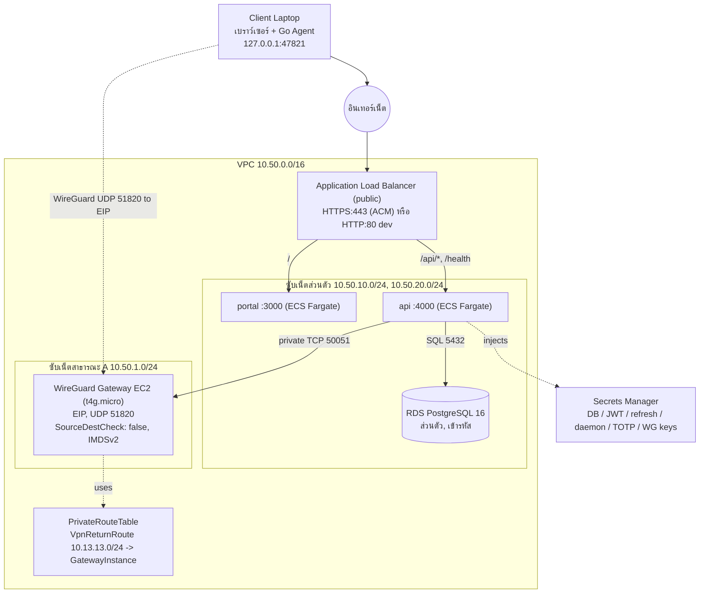

> 🌐 **Language / ภาษา**: [🇬🇧 English](../03-track-c-cloud-deployment.md) | **🇹🇭 ภาษาไทย**

← ก่อนหน้า: [Track B: GNS3 Mock Cloud](02-track-b-gns3-mock-cloud.md) | 📚 [สารบัญคู่มือ](../../../TUTORIAL.th.md) | ถัดไป: [คู่มือการทดสอบระบบ](04-testing-playbook.md) →

# ☁️ Track C: เดโมการ Deploy บน Cloud จริง

Track C พา MANGO VPN ออกจากโน้ตบุ๊กขึ้นสู่โลกอินเทอร์เน็ตจริง สองรูปแบบ:

- **Part C1 - Cloud VM เครื่องเดียว:** VM Linux หนึ่งเครื่องรันสแตก Docker ทั้งหมดไว้หลัง Caddy ซึ่งขอ HTTPS ให้อัตโนมัติ รวดเร็ว ประหยัด และเหมาะสำหรับเดโมสดหรือการนำร่องขนาดเล็ก
- **Part C2 - สแตก AWS แบบ Managed:** เทมเพลต CloudFormation `aws-managed` จัดเตรียม VPC, RDS PostgreSQL 16 แบบส่วนตัว, บริการ ECS Fargate แบบส่วนตัว, ALB, Secrets Manager และ EC2 WireGuard gateway เฉพาะทาง นี่คือเส้นทางที่มีรูปร่างเหมือนโปรดักชัน

> **ก่อนเริ่ม:** อ่าน `deploy/cloud-vm/README.md` (C1) และ `deploy/aws-managed/README.md` (C2) หน้านี้คือคำแนะนำแบบพาทำทีละขั้น ส่วนไฟล์เหล่านั้นคือเอกสารอ้างอิงฉบับย่อ

---

## ภาพรวม: C1 กับ C2 ในพริบตา

| มิติ | Part C1 - Cloud VM เครื่องเดียว | Part C2 - สแตก AWS แบบ Managed |
| --- | --- | --- |
| **รูปร่าง** | VM Ubuntu 24.04 หนึ่งเครื่องรัน `postgres`, `vpn-gateway`, `api`, `portal` และ `caddy` ผ่าน Compose | VPC ที่มี RDS ส่วนตัว + ECS Fargate ส่วนตัว (`api`, `portal`) + ALB ที่หันสู่อินเทอร์เน็ต + EC2 WireGuard gateway เฉพาะทาง |
| **ค่าใช้จ่ายโดยเปรียบเทียบ** | ต่ำสุด - อินสแตนซ์เล็กหนึ่งเครื่อง | สูงกว่า - NAT Gateway, RDS, Fargate, EC2, EIP, CloudWatch Logs, พื้นที่จัดเก็บ ECR |
| **เวลาในการตั้งค่า** | ไม่กี่นาที | นานกว่า: ตรวจสอบสแตก, Push สามอิมเมจ, เติมสอง Secret, เริ่ม Gateway, Scale บริการ, Seed |
| **กลไก HTTPS** | Caddy ขอและต่ออายุ Let's Encrypt อัตโนมัติบนพอร์ต `80`/`443` | ใบรับรอง ACM บน ALB (`CertificateArn` + `CustomDomainName`) หรือ dev แบบ HTTP-only หรือ CloudFront distribution สำหรับ TLS แบบไม่มีโดเมน |
| **ฐานข้อมูล** | คอนเทนเนอร์ PostgreSQL 16 บน VM เดียวกัน (Docker network ส่วนตัว) | RDS PostgreSQL 16 แบบส่วนตัวและเข้ารหัส เข้าถึงได้เฉพาะจาก security group ของ API |
| **เหมาะที่สุดสำหรับ** | เดโมเร็ว, ผู้ฝึกงาน, การ Deploy ขนาดเล็กหนึ่งชุด | การสาธิตโครงสร้างระดับโปรดักชันแบบ Managed และ least-privilege |

> **ทำไม HTTPS จึงไม่ใช่ตัวเลือกเสริมสำหรับ Chromium:** Portal เรียก Agent ในเครื่องที่ `http://127.0.0.1:47821` กฎ **Private Network Access** ของ Chromium จะบล็อกหน้าที่ให้บริการจาก origin `http://` ระยะไกลธรรมดา ไม่ให้เข้าถึง loopback origin **HTTPS** ที่เชื่อถือได้ (Let's Encrypt บน VM, ACM บน ALB หรือชื่อ `https://*.cloudfront.net` ของ CloudFront) คือสิ่งที่ทำให้เบราว์เซอร์จับคู่กับ Agent ได้ ไม่มีทางเลี่ยง ให้ origin TLS จริงแก่ Portal

---

# Part C1: VM Linux เครื่องเดียว (AWS EC2 Ubuntu 24.04)

## C1.0 ตารางผู้ให้บริการที่เทียบเท่า Cloud

ขั้นตอนด้านล่างใช้ AWS EC2 แต่ไฟล์ compose เดียวกันใช้ได้กับผู้ให้บริการรายใดก็ได้ เลือกหนึ่งแถวแล้วแปลงการกระทำที่เฉพาะกับผู้ให้บริการนั้น

| ผู้ให้บริการ | อิมเมจที่เทียบเท่า | Firewall / Security Group | Static IP | การเข้าถึง SSH |
| --- | --- | --- | --- | --- |
| **AWS EC2** | Ubuntu Server 24.04 LTS (`t3.small` หรือ `t4g.small`) | Security Group ขาเข้า: TCP 80, TCP 443, UDP 51820, TCP 22 แบบจำกัด (หรือ SSM) | Elastic IP | SSH key pair หรือ SSM Session Manager |
| **DigitalOcean** | Ubuntu 24.04 Droplet | Cloud Firewall ขาเข้า: 80, 443, 51820/udp, 22 | Reserved IP | SSH key |
| **GCP Compute Engine** | Ubuntu 24.04 `e2-small` | กฎ VPC firewall: `tcp:80,443`, `udp:51820`, `tcp:22` แบบจำกัด | Static external IP | SSH ผ่านคอนโซลหรือ key |
| **Azure** | Ubuntu 24.04 `Standard_B1s` | Network Security Group ขาเข้า: 80, 443, 51820/udp, 22 แบบจำกัด | Static public IP | SSH key หรือ Bastion |
| **Linode / Akamai** | Ubuntu 24.04 `g6-nanode-1` | Cloud Firewall: 80, 443, 51820/udp, 22 | Reserved IP | SSH key |
| **Oracle Cloud Always Free** | Ubuntu 24.04 Ampere `VM.Standard.A1.Flex` | Security List / NSG: 80, 443, 51820/udp, 22 แบบจำกัด | Reserved public IP | SSH key |

## C1.1 จัดเตรียม VM และล็อก Security Group ให้แน่นหนา

- **AMI / อิมเมจ:** Ubuntu Server 24.04 LTS
- **ชนิดอินสแตนซ์:** `t3.small` (x86) หรือ `t4g.small` (Arm) `t4g` ถูกกว่า แต่หมายความว่าอิมเมจตัวช่วยที่ Build ในเครื่องต้องเป็น `linux/arm64`
- **IMDSv2:** บังคับใช้ (HTTP tokens = required) อย่าอนุญาต IMDSv1
- **พื้นที่จัดเก็บ:** EBS/gp3 root volume แบบเข้ารหัส
- **กฎ Security Group ขาเข้า:** **เฉพาะ** เหล่านี้เท่านั้น
  - TCP `80` (Caddy HTTP + การท้าทายของ Let's Encrypt)
  - TCP `443` (HTTPS portal/API)
  - UDP `51820` (WireGuard)
  - TCP `22` จำกัดเฉพาะ `/32` ของคุณเอง หรือละเว้นทั้งหมดแล้วใช้ AWS SSM

> ⚠️ **ห้ามเปิด `5432`, `4000` หรือ `50051` สู่อินเทอร์เน็ตเด็ดขาด** PostgreSQL, API และ gateway daemon API อยู่ใน Docker network ส่วนตัว ใน `deploy/cloud-vm/docker-compose.cloud.yml` มีเพียง WireGuard UDP และ Caddy HTTP(S) เท่านั้นที่ถูกเผยแพร่ไปยัง Host ของ VM

## C1.2 กลยุทธ์โดเมน / HTTPS (สามเส้นทางชัดเจน)

**เส้นทางที่ 1 - ค่าเริ่มต้นแบบไม่มีโดเมน (`sslip.io`)** `sslip.io` แมปชื่อโฮสต์ที่เป็น IP คั่นด้วยขีดกลับไปยัง IP นั้น คุณจึงได้ HTTPS จาก Let's Encrypt โดยไม่ต้องมีบัญชี DNS หาก Public IP ของคุณคือ `198.51.100.24` ให้ตั้งค่า:

```sh
MANGO_DOMAIN=198-51-100-24.sslip.io
```

Caddy จะขอใบรับรองโดยอัตโนมัติเมื่อตั้งค่า `MANGO_DOMAIN` แล้วและพอร์ต `80`/`443` เข้าถึงได้

**เส้นทางที่ 2 - โดเมนที่กำหนดเอง** ชี้ `A` record สำหรับ `vpn.example.com` ไปยัง Public IP ของ VM แล้วตั้งค่า `MANGO_DOMAIN=vpn.example.com` Caddy จะขอ TLS จาก Let's Encrypt โดยอัตโนมัติ `deploy/cloud-vm/Caddyfile` ยังมีบล็อก **dual-subdomain** ที่คอมเมนต์ไว้ (`vpn.example.com` และ `api.vpn.example.com`) ซึ่งคุณเปิดใช้ได้หากต้องการแยก origin ของ Portal และ API

**เส้นทางที่ 3 - ทางถอยแบบ HTTP (หากพอร์ต `80`/`443` ถูกบล็อก)** เปิดใช้บล็อก `:80` server ที่คอมเมนต์ไว้ใน `deploy/cloud-vm/Caddyfile` เริ่มสแตก แล้วเปิด SSH local port-forward และเปิดเบราว์เซอร์ไปที่ `http://localhost:8080`:

```sh
ssh -L 8080:localhost:80 ubuntu@<VM_PUBLIC_IP>
```

> เส้นทางที่ 3 เป็น**ทางถอยสำหรับ dev เท่านั้น** เนื่องจากเป็น origin `http://` ธรรมดา Chromium Private Network Access อาจบล็อกการเรียก Agent ในเครื่องของ Portal

## C1.3 Bootstrap Docker, `.env.cloud` และเปิดใช้งาน

SSH เข้า VM และติดตั้ง Docker Engine + Compose v2:

```sh
sudo apt-get update
sudo apt-get install -y ca-certificates curl gnupg git
curl -fsSL https://get.docker.com | sudo sh
sudo usermod -aG docker "$USER"     # ออกจากระบบแล้วเข้าใหม่ หรือใช้ `sg docker`
docker compose version
```

Clone repository และสร้าง `.env.cloud`:

```sh
git clone <your-repo-url> Mango_VPN_Trainee
cd Mango_VPN_Trainee
cp deploy/cloud-vm/.env.cloud.example .env.cloud
```

เติม Secret ทุกช่องว่างใน `.env.cloud` คุณสร้างได้ด้วยคำสั่งเชลล์ที่ระบุไว้ (จาก `.env.example`):

```sh
openssl rand -base64 32    # JWT_SECRET, REFRESH_SECRET, DAEMON_SHARED_SECRET (≥ 32 ตัวอักษร)
openssl rand -hex 32       # TOTP_ENCRYPTION_KEY (64 hex ตัวอักษรพอดี)
openssl rand -base64 24 | tr '+/' '-_' | tr -d '=\n'   # POSTGRES_PASSWORD
```

สำหรับคู่กุญแจ WireGuard ให้ติดตั้ง `wireguard-tools` แล้วสร้าง หรือให้เครื่องมือของ repository ทำให้:

```sh
# ทางเลือก A (ต้องมี wireguard-tools):
sudo apt-get install -y wireguard-tools
wg genkey | tee wg-private.key | wg pubkey > wg-public.key

# ทางเลือก B (ใช้ crypto ของ Node; เขียน .env จาก .env.example พร้อม
# Secret ใหม่และคู่กุญแจ Curve25519 แล้วคัดลอกค่าไปยัง .env.cloud):
npm install
npm run env:init -- --output .env.cloud
```

> `npm run env:init -- --output .env.cloud` สร้างไฟล์จาก `.env.example` ดังนั้นมันจะ**ไม่มี** `MANGO_DOMAIN` ให้เพิ่มหรืออัปเดตค่าที่เฉพาะกับ cloud สี่ค่าด้านล่างด้วยมือ

ตั้งค่าที่เฉพาะกับ cloud สี่ค่าใน `.env.cloud` (ใช้เส้นทางที่ 1 เป็นตัวอย่าง):

```sh
MANGO_DOMAIN=198-51-100-24.sslip.io
WG_SERVER_ENDPOINT=<PUBLIC_IP>:51820
CORS_ORIGIN=https://<MANGO_DOMAIN>
VITE_API_URL=https://<MANGO_DOMAIN>
```

สำหรับรูปแบบ Caddy แบบ same-origin ทั้ง `CORS_ORIGIN` และ `VITE_API_URL` ต่างก็เป็น `https://<MANGO_DOMAIN>`: เบราว์เซอร์เข้าถึง `/api` ผ่าน Caddy

เปิดใช้งานสแตก:

```sh
docker compose -f deploy/cloud-vm/docker-compose.cloud.yml --env-file .env.cloud up -d --build
docker compose -f deploy/cloud-vm/docker-compose.cloud.yml --env-file .env.cloud ps
```

**สิ่งที่ควรเห็น:** `postgres`, `vpn-gateway`, `api`, `portal` และ `caddy` ทำงานอยู่ โดยบริการที่มี health check สองตัวรายงาน `healthy` จากนั้นตรวจสอบ:

```sh
curl --fail "https://<MANGO_DOMAIN>/health"
```

**ทางเลือกเสริม - พิสูจน์การบังคับใช้ `nftables` ตามบทบาทผ่านอินเทอร์เน็ตจริง** เพิ่ม targets overlay ซึ่งรันโหนดเป้าหมายส่วนตัวทั้งสามบนเครือข่ายภายใน (ไม่มี public harness และไม่มีพอร์ต public harness):

```sh
docker compose -f deploy/cloud-vm/docker-compose.cloud.yml \
  -f deploy/cloud-vm/docker-compose.cloud-targets.yml \
  --env-file .env.cloud up -d --build
```

Overlay จะ Route `10.99.0.0/24`, `10.20.0.0/16` และ `10.30.0.0/24` ผ่านเครือข่ายเป้าหมายส่วนตัวของ Gateway ดังนั้นเมื่อ Client เชื่อมต่อแล้ว คุณจะทำตารางการเข้าถึงชุดเดียวกับที่ใช้ใน Track B ซ้ำได้

## C1.4 Seed ADMIN และ (ทางเลือก) นโยบายเป้าหมายภายในคอนเทนเนอร์ `api`

อิมเมจ API รัน Prisma migration ตอนเริ่มทำงานและมี Seeder ที่คอมไพล์แล้ว (`Rain/admin/dist/seed.js` และ `Rain/admin/dist/seed-test-targets.js`) ดังนั้นคุณ Seed ภายในคอนเทนเนอร์ได้โดยไม่ต้องเปิดเผยพอร์ต PostgreSQL `5432`:

```sh
docker compose -f deploy/cloud-vm/docker-compose.cloud.yml --env-file .env.cloud exec \
  -e SEED_ADMIN_USERNAME=admin \
  -e SEED_ADMIN_PASSWORD='<Choose-12+-Char-Password>' \
  api node Rain/admin/dist/seed.js
```

หากคุณเปิดใช้ targets overlay ให้ Seed ชุดนโยบาย Track B ด้วย:

```sh
docker compose -f deploy/cloud-vm/docker-compose.cloud.yml \
  -f deploy/cloud-vm/docker-compose.cloud-targets.yml \
  --env-file .env.cloud exec api node Rain/admin/dist/seed-test-targets.js
```

**สิ่งที่ควรเห็น:** `Seeded roles [ADMIN, STAFF, CLIENT] and ADMIN user "admin".` และเมื่อคุณ Seed นโยบายแล้ว `Seeded 12 Track B VPN policies.` ใช้รหัสผ่านยาวอย่างน้อย 12 ตัวอักษรและบันทึกไว้อย่างปลอดภัย

## C1.5 เชื่อมต่อ Go Client Agent จริงของโน้ตบุ๊กคุณผ่านอินเทอร์เน็ต

บน**เครื่องของคุณเอง** (ไม่ใช่ VM) รัน Go agent จริง ชี้ origin allowlist และ API URL ไปยัง URL HTTPS สาธารณะของ Portal

**Windows (Administrator PowerShell):**

```powershell
$env:AGENT_LISTEN_ADDR="127.0.0.1:47821"
$env:AGENT_ALLOWED_ORIGINS="https://<MANGO_DOMAIN>"
$env:AGENT_PAIRING_TOKEN="cloud-demo-pairing-token-01"
$env:API_URL="https://<MANGO_DOMAIN>"
cd <path-to>\Mango_VPN_Trainee\Sobree\agent-windows
go run .
```

**Linux (Bash):**

```bash
export AGENT_LISTEN_ADDR="127.0.0.1:47821"
export AGENT_ALLOWED_ORIGINS="https://<MANGO_DOMAIN>"
export AGENT_PAIRING_TOKEN="cloud-demo-pairing-token-01"
export API_URL="https://<MANGO_DOMAIN>"
cd <path-to>/Mango_VPN_Trainee/Sobree/agent-windows
sudo -E "$(command -v go)" run .
```

ลงชื่อเข้าใช้ที่ `https://<MANGO_DOMAIN>` ลงทะเบียน TOTP จับคู่ด้วย `cloud-demo-pairing-token-01` แล้วคลิก **Connect VPN** ตรวจสอบ handshake บน VM:

```sh
docker compose -f deploy/cloud-vm/docker-compose.cloud.yml --env-file .env.cloud \
  exec vpn-gateway wg show
```

**สิ่งที่ควรเห็น:** Peer `wg0` พร้อม Public Key ของ Client และ IP ที่จัดสรร (`10.13.13.2`) บน Client `sudo wg show mango0` (Linux) หรือแอป WireGuard for Windows (Windows) แสดง handshake ล่าสุด หากคุณเปิดใช้ targets overlay ให้ทดสอบโซนขณะเชื่อมต่อ โดยจำไว้ว่า Go agent **ไม่**เพิ่มส่วนต่อท้าย `-<username>` ให้ตั้งค่า `AGENT_DEVICE_FINGERPRINT` ที่แตกต่างกันต่อผู้ใช้:

| บทบาทที่เชื่อมต่อ | `10.99.0.10` (admin) | `10.20.0.10` (staff) | `10.30.0.10` (client) |
| --- | --- | --- | --- |
| ADMIN | ALLOW | ALLOW | ALLOW |
| STAFF | DENY | ALLOW | ALLOW |
| CLIENT | DENY | DENY | ALLOW |

## C1.6 การล้างข้อมูลของ C1

```sh
docker compose -f deploy/cloud-vm/docker-compose.cloud.yml --env-file .env.cloud down
```

เพิ่ม `-f deploy/cloud-vm/docker-compose.cloud-targets.yml` เมื่อ overlay ทำงานอยู่ **อย่า**เพิ่ม `-v` เว้นแต่คุณต้องการทำลาย Volume ของ PostgreSQL จากนั้นยกเลิกอินสแตนซ์ EC2 และหากคุณจัดสรรไว้ ให้**ปล่อย Elastic IP** เพื่อหยุดการคิดค่าบริการ

---

# Part C2: สแตก AWS แบบ Managed

เส้นทางนี้ Deploy `deploy/aws-managed/template.yaml` มันสร้าง VPC, RDS PostgreSQL 16 แบบส่วนตัว, Secret ของ Secrets Manager, repository ECR สามแห่ง (`api`, `portal`, `vpn-daemon`), บริการ ECS Fargate แบบส่วนตัวสำหรับ API และ Portal, ALB ที่หันสู่อินเทอร์เน็ต และ EC2 WireGuard gateway เฉพาะทาง บริการ API และ Portal ตั้งค่าเริ่มต้นเป็น **ศูนย์** Task เพื่อให้สแตกสร้างเสร็จอย่างสะอาดก่อนที่จะมีอิมเมจถูก Push

## C2.0 สถาปัตยกรรม



รายละเอียดสำคัญของเทมเพลตที่ควรรู้:

- **`VpnReturnRoute`** (`PrivateRouteTable`, `DestinationCidrBlock: 10.13.13.0/24`, `InstanceId: !Ref WireGuardGatewayInstance`) ส่งคำตอบกลับของ Client VPN กลับผ่านอินสแตนซ์ EC2 ของ Gateway
- **`WireGuardGatewayInstance`** ตั้งค่า `SourceDestCheck: false` เพื่อให้ Route ทราฟฟิก VPN ได้ และต้องใช้ **IMDSv2** (`HttpTokens: required`)
- **ไม่มีการสร้าง SSH ingress** การดูแล Gateway ทำผ่าน **SSM Session Manager** (`AmazonSSMManagedInstanceCore`)
- API เข้าถึง Gateway daemon บนพอร์ตส่วนตัว `50051` เท่านั้น และ Secret ของ daemon ไม่เคยถูกเขียนลงใน parameters

## C2.1 ทางเลือกแบบไม่มีโดเมนและ HTTPS

- **โปรดักชันที่แนะนำ:** ระบุ `CertificateArn` (ใบรับรอง ACM) **และ** `CustomDomainName` ที่ตรงกัน (ตัวอย่าง `vpn.example.com`) จากนั้น ALB จะรัน listener HTTPS (`AlbHttpsListener`, นโยบาย TLS 1.3) และ output `PortalUrl` จะเป็น `https://<CustomDomainName>`
- **dev แบบ HTTP-only:** ปล่อย**ทั้งสอง**ว่างไว้ ALB จะรัน listener HTTP สำหรับ dev (`AlbHttpDevListener`) และ `PortalUrl` เป็น `http://<ALB-DNS>` เนื่องจากเป็น origin `http://` ธรรมดา Chromium PNA อาจบล็อกการเรียก Agent ให้ใช้ SSH/SSM port forwarding หรือวาง distribution หน้า ALB - ดูหัวข้อถัดไป
- **TLS แบบไม่มีโดเมนผ่าน CloudFront:** วาง **AWS CloudFront distribution** ไว้หน้า ALB CloudFront ให้บริการ `https://<distribution>.cloudfront.net` ทำให้คุณได้ origin TLS ที่เชื่อถือได้โดยไม่มีโดเมนและไม่มีใบรับรองให้จัดการ ดังนั้น Chromium PNA จึงอนุญาต `127.0.0.1:47821`

## C2.2 ขั้นตอนที่ 1 - เตรียม `parameters.json`

```sh
cp deploy/aws-managed/parameters.example.json deploy/aws-managed/parameters.json
```

แก้ไข `parameters.json` และแทนที่ `<YOUR_PUBLIC_IP>/32` ใน**ทั้ง** `AllowedWebCidr` และ `AllowedWireGuardCidr` ด้วย CIDR สาธารณะ/สำนักงานจริงของคุณ **อย่า**ทิ้งค่า `203.0.113.0/24` ตัวอย่างไว้ในบัญชีจริง หากต้องการ HTTPS ให้ตั้งค่า `CertificateArn` และ `CustomDomainName` ตามต้องการ เก็บ `ApiDesiredCount=0` และ `PortalDesiredCount=0` ไว้ก่อน ค่าเริ่มต้นยังใช้ `DBInstanceClass=db.t4g.micro`, `GatewayInstanceType=t4g.micro` และเส้นทาง SSM AMI ของ Ubuntu 24.04 arm64

## C2.3 ขั้นตอนที่ 2 - ตรวจสอบและสร้างสแตก

```sh
aws cloudformation validate-template \
  --template-body file://deploy/aws-managed/template.yaml

aws cloudformation create-stack \
  --stack-name mango-vpn-managed \
  --template-body file://deploy/aws-managed/template.yaml \
  --parameters file://deploy/aws-managed/parameters.json \
  --capabilities CAPABILITY_IAM CAPABILITY_NAMED_IAM

aws cloudformation wait stack-create-complete --stack-name mango-vpn-managed
```

> `create-stack` ใช้รูปแบบ JSON array ที่ `parameters.example.json` ใช้ ส่วน `deploy` ใช้การ override แบบ `Key=Value` แทน

เก็บ Output ที่คุณจะต้องใช้:

```sh
aws cloudformation describe-stacks --stack-name mango-vpn-managed \
  --query 'Stacks[0].Outputs' --output table
```

**สิ่งที่ควรเห็น:** Output รวมถึง `PortalUrl`, `AlbDnsName`, `ApiEcrRepository`, `PortalEcrRepository`, `DaemonEcrRepository`, `EcsClusterName`, `WireGuardGatewayInstanceId`, `WireGuardGatewayPublicIp`, `WireGuardKeySecretArn` และ `TotpEncryptionSecretArn`

## C2.4 ขั้นตอนที่ 3 - Build และ Push สามอิมเมจ

`api` และ `portal` เป็น `linux/amd64` สำหรับ Fargate ส่วน `vpn-daemon` เป็น `linux/arm64` ให้ตรงกับ Gateway `t4g.micro` เริ่มต้น (ใช้ `linux/amd64` หากคุณเปลี่ยนไปใช้ Gateway `t3.micro`)

```sh
REGION=$(aws configure get region)
ACCOUNT_ID=$(aws sts get-caller-identity --query Account --output text)

API_REPO=$(aws cloudformation describe-stacks --stack-name mango-vpn-managed \
  --query 'Stacks[0].Outputs[?OutputKey==`ApiEcrRepository`].OutputValue' --output text)
PORTAL_REPO=$(aws cloudformation describe-stacks --stack-name mango-vpn-managed \
  --query 'Stacks[0].Outputs[?OutputKey==`PortalEcrRepository`].OutputValue' --output text)
DAEMON_REPO=$(aws cloudformation describe-stacks --stack-name mango-vpn-managed \
  --query 'Stacks[0].Outputs[?OutputKey==`DaemonEcrRepository`].OutputValue' --output text)

aws ecr get-login-password --region "$REGION" \
  | docker login --username AWS --password-stdin "$ACCOUNT_ID.dkr.ecr.$REGION.amazonaws.com"

docker buildx build --platform linux/amd64 -f Sobree/api/Dockerfile        -t "$API_REPO:latest"    --push .
docker buildx build --platform linux/amd64 -f Rain/portal/Dockerfile      -t "$PORTAL_REPO:latest" --push .
docker buildx build --platform linux/arm64 -f Sobree/vpn-daemon/Dockerfile -t "$DAEMON_REPO:latest" --push .
```

**สิ่งที่ควรเห็น:** การ Push สำเร็จสามครั้งไปยัง repository ของสแตกทั้งสาม

## C2.5 ขั้นตอนที่ 4 - เติม Secret และเริ่ม WireGuard gateway

สแตกจะสร้าง Secret ของ RDS master, JWT, refresh และ daemon ให้อัตโนมัติ คุณต้องเติมคีย์ **TOTP** ขนาด 64 hex:

```sh
TOTP_ARN=$(aws cloudformation describe-stacks --stack-name mango-vpn-managed \
  --query 'Stacks[0].Outputs[?OutputKey==`TotpEncryptionSecretArn`].OutputValue' --output text)
TOTP_KEY=$(openssl rand -hex 32)
aws secretsmanager put-secret-value --secret-id "$TOTP_ARN" --secret-string "$TOTP_KEY"
unset TOTP_KEY
```

ตอนนี้เชื่อมต่อกับอินสแตนซ์ Gateway ผ่าน **SSM Session Manager** (ไม่ต้องเปิดพอร์ต 22) และเริ่มต้นคู่กุญแจ WireGuard เข้าไปใน Secret ของมัน แล้วเริ่ม daemon:

```sh
GW_ID=$(aws cloudformation describe-stacks --stack-name mango-vpn-managed \
  --query 'Stacks[0].Outputs[?OutputKey==`WireGuardGatewayInstanceId`].OutputValue' --output text)
WG_SECRET_ARN=$(aws cloudformation describe-stacks --stack-name mango-vpn-managed \
  --query 'Stacks[0].Outputs[?OutputKey==`WireGuardKeySecretArn`].OutputValue' --output text)
echo "GW_ID=$GW_ID WG_SECRET_ARN=$WG_SECRET_ARN"

aws ssm start-session --target "$GW_ID"
```

ภายในเซสชัน SSM บนอินสแตนซ์ Gateway:

```sh
PRIVATE_KEY=$(wg genkey)
PUBLIC_KEY=$(printf '%s' "$PRIVATE_KEY" | wg pubkey)
aws secretsmanager put-secret-value --region "<AWS_REGION>" --secret-id "<WG_SECRET_ARN>" \
  --secret-string "$(jq -cn --arg privateKey "$PRIVATE_KEY" --arg publicKey "$PUBLIC_KEY" \
    '{privateKey:$privateKey,publicKey:$publicKey}')"
unset PRIVATE_KEY
sudo /usr/local/bin/mango-gateway-start.sh
docker ps && sudo wg show
```

**สิ่งที่ควรเห็น:** คอนเทนเนอร์ `mango-vpn-daemon` ทำงานอยู่และ `wg show` แสดงอินเทอร์เฟซ `wg0` จนกว่า `WireGuardKeySecret` จะมีคีย์จริง สคริปต์เริ่มทำงานจะตรวจพบ placeholder และข้ามการเริ่ม daemon แทนที่จะล้มเหลว

## C2.6 ขั้นตอนที่ 5 - Scale บริการ ECS และ Seed ADMIN คนแรก

Scale บริการทั้งสองเป็น `1`:

```sh
aws cloudformation update-stack \
  --stack-name mango-vpn-managed \
  --use-previous-template \
  --parameters \
    ParameterKey=AllowedWebCidr,UsePreviousValue=true \
    ParameterKey=AllowedWireGuardCidr,UsePreviousValue=true \
    ParameterKey=CertificateArn,UsePreviousValue=true \
    ParameterKey=CustomDomainName,UsePreviousValue=true \
    ParameterKey=EnableNatGateway,UsePreviousValue=true \
    ParameterKey=ApiDesiredCount,ParameterValue=1 \
    ParameterKey=PortalDesiredCount,ParameterValue=1 \
    ParameterKey=ApiImageTag,UsePreviousValue=true \
    ParameterKey=PortalImageTag,UsePreviousValue=true \
    ParameterKey=DaemonImageTag,UsePreviousValue=true \
    ParameterKey=DBInstanceClass,UsePreviousValue=true \
    ParameterKey=GatewayInstanceType,UsePreviousValue=true \
    ParameterKey=UbuntuAmiId,UsePreviousValue=true \
    ParameterKey=WgListenPort,UsePreviousValue=true \
  --capabilities CAPABILITY_IAM CAPABILITY_NAMED_IAM

aws ecs wait services-stable --cluster mango-vpn-managed-ecs \
  --services mango-vpn-managed-api mango-vpn-managed-portal
```

เมื่อ `ApiService` ทำงานแล้ว ให้ Seed `ADMIN` คนแรกผ่าน **ECS Exec** (อีกครั้ง โดยไม่ต้องมีพอร์ตฐานข้อมูลสาธารณะ):

```sh
TASK_ARN=$(aws ecs list-tasks --cluster mango-vpn-managed-ecs \
  --service-name mango-vpn-managed-api --query 'taskArns[0]' --output text)
aws ecs execute-command --cluster mango-vpn-managed-ecs \
  --task "$TASK_ARN" --container api --interactive --command "/bin/sh"
```

ภายในเชลล์ของคอนเทนเนอร์:

```sh
export DATABASE_URL="postgresql://mango:${DB_PASSWORD}@${DB_HOST}:5432/mangovpn?schema=public"
SEED_ADMIN_USERNAME=admin SEED_ADMIN_PASSWORD='<Choose-12+-Char-Password>' node Rain/admin/dist/seed.js
```

**สิ่งที่ควรเห็น:** `Seeded roles [ADMIN, STAFF, CLIENT] and ADMIN user "admin".` (`DB_PASSWORD` และ `DB_HOST` ถูกฉีดเข้าไปในสภาพแวดล้อมของ Task โดยเทมเพลต)

## C2.7 ขั้นตอนที่ 6 - เชื่อมต่อ Agent บนโน้ตบุ๊กและตรวจสอบ

อ่าน `PortalUrl` จาก Output แล้วรัน Agent บนเครื่องของคุณเอง:

**Windows (Administrator PowerShell):**

```powershell
$env:AGENT_LISTEN_ADDR="127.0.0.1:47821"
$env:AGENT_ALLOWED_ORIGINS="<PortalUrl>"
$env:AGENT_PAIRING_TOKEN="managed-demo-pairing-token-01"
$env:API_URL="<PortalUrl>"
cd <path-to>\Mango_VPN_Trainee\Sobree\agent-windows
go run .
```

**Linux (Bash):**

```bash
export AGENT_LISTEN_ADDR="127.0.0.1:47821"
export AGENT_ALLOWED_ORIGINS="<PortalUrl>"
export AGENT_PAIRING_TOKEN="managed-demo-pairing-token-01"
export API_URL="<PortalUrl>"
cd <path-to>/Mango_VPN_Trainee/Sobree/agent-windows
sudo -E "$(command -v go)" run .
```

ลงชื่อเข้าใช้ที่ `PortalUrl` ลงทะเบียน TOTP จับคู่ด้วยโทเคน และเชื่อมต่อ จากนั้นตรวจสอบบน Gateway ผ่าน SSM:

```sh
# ภายในเซสชัน SSM บนอินสแตนซ์ Gateway:
sudo wg show
sudo nft list table inet mango_vpn
```

**สิ่งที่ควรเห็น:** `wg show` แสดง Peer ของ Client ส่วน `nft` แสดงตาราง `inet mango_vpn` พร้อมกฎตามบทบาท ใช้ `<PortalUrl>` ตรงตามที่เป็น origin allowlist ของ Agent - อย่าใช้ wildcard

## C2.8 รายการตรวจสอบค่าใช้จ่าย AWS และการรื้อถอน

ค่าใช้จ่ายต่อเนื่องที่ต้องเฝ้าดู: **NAT Gateway**, **RDS PostgreSQL**, **Task ของ Fargate**, **อินสแตนซ์ EC2 ของ Gateway**, **Elastic IP**, **CloudWatch Logs** และ**พื้นที่จัดเก็บ ECR** RDS, repository ECR และ log group ของ CloudWatch ใช้ `DeletionPolicy: Retain` / `Snapshot` ดังนั้นมันจะอยู่รอดหลังลบสแตกและต้องล้างแยกต่างหากเมื่อตรวจสอบแล้ว

```sh
aws cloudformation delete-stack --stack-name mango-vpn-managed
aws cloudformation wait stack-delete-complete --stack-name mango-vpn-managed

# Repository ECR ที่ยังคงอยู่ อ่านชื่อจริงจาก Output ของสแตก แล้ว:
#   API_REPO_NAME=$(aws cloudformation describe-stacks --stack-name mango-vpn-managed \
#     --query 'Stacks[0].Outputs[?OutputKey==`ApiEcrRepository`].OutputValue' --output text | cut -d/ -f2)
aws ecr delete-repository --repository-name "<api-repo-name>"    --force
aws ecr delete-repository --repository-name "<portal-repo-name>" --force
aws ecr delete-repository --repository-name "<daemon-repo-name>" --force

# Snapshot ของ RDS และ log group ที่ยังคงอยู่:
aws rds describe-db-snapshots --snapshot-type manual \
  --query 'DBSnapshots[?contains(DBSnapshotIdentifier, `mango-vpn-managed`)].DBSnapshotIdentifier' --output text
aws logs describe-log-groups \
  --log-group-name-prefix "/mango/mango-vpn-managed" --query 'logGroups[].logGroupName' --output text

# ยืนยันว่าไม่มี Elastic IP ที่ยังไม่ถูกเชื่อมโยงหลงเหลือ:
aws ec2 describe-addresses \
  --query 'Addresses[?AssociationId==null].[PublicIp,AllocationId]' --output text
```

ลบ Snapshot ของ RDS และ log group ที่คุณไม่ต้องการแล้ว และ**ปล่อย Elastic IP ที่ยังไม่ถูกเชื่อมโยง** เพื่อไม่ให้มีอะไรคิดค่าบริการต่อหลังเดโม

---

← ก่อนหน้า: [Track B: GNS3 Mock Cloud](02-track-b-gns3-mock-cloud.md) | 📚 [สารบัญคู่มือ](../../../TUTORIAL.th.md) | ถัดไป: [คู่มือการทดสอบระบบ](04-testing-playbook.md) →
